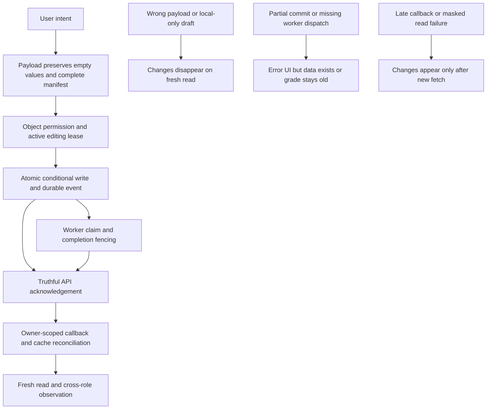

# System Data Synchronization Audit

**Ngày:** 2026-10-11 (Asia/Bangkok)  
**Workspace:** `E:\PWD301`  
**Snapshot HEAD:** `efd37187b1195c04dd1774ed34712102f61a2a76`  
**Chế độ:** READ → TRACE → VERIFY READ-ONLY → REPORT. Không sửa source/test/config/env/dependency; không migration, CRUD live, backup/restore hoặc commit.  
**Deliverable duy nhất:** `SYSTEM_DATA_SYNCHRONIZATION_AUDIT_2026-10-11.md`. Giữ nguyên audit ngày07/10 và mọi báo cáo cũ.

## 1. Executive Summary

Phát hiện **40 finding hiện tại: 2 P0, 29 P1, 9 P2, 0 P3**, thuộc **15 nhóm root cause**. Hai P0 là rủi ro sửa điểm khác course qua correction ID và rò nội dung notification qua browser cache rollback. P0 là mức ưu tiên khắc phục theo source/VM, **không phải xác nhận sự cố production đã xảy ra**.

Dữ liệu không đồng bộ có nhiều nguyên nhân độc lập: partial commits và publication diff nhiều request; payload làm mất ý định xóa hoặc metadata; callbacks không giữ identity; sequence/lease chỉ check trước unconditional update; jobs/outbox thiếu dispatch/commit. Không có bằng chứng SQL Server tự xóa mọi write đã commit khi F5.

Một số lỗi ngày 07/10 đã được sửa. DB cấu hình trong .env hiện khớp migration head và đủ 76 bảng nghiệp vụ. 177 frontend tests pass không chứng minh toàn hệ thống ổn định: phần lớn chạy trong Node với dependencies mô phỏng hoặc đối chiếu source.

Ưu tiên xử lý SYNC-061 và SYNC-078, sau đó autosave/lease/submit, caller-owned transactions và approval manifest. Chưa implement bất kỳ đề xuất nào.

## 2. Audit Scope

Scan cú pháp toàn bộ **96 Python source + 19 migration files**, **11 application JS files**. AST inventory liệt kê **256 mutation route decorators** trong **16 blueprints**, và **103 ApiClient method definitions có explicit POST/PUT/PATCH/DELETE**. Aliases, session/JWT mirrors, wrapper definitions không phải số business features độc lập; wrappers gián tiếp không nằm trong count103. Bảng section10 giữ từng decorator, không bỏ những route không có frontend.

Deep review tập trung high-risk data boundaries trong Admin/auth/operations/AI, Instructor/course/lesson/file/import, Student/attempt/progress/grading và worker. Inventory/pattern scan bao phủ toàn repository application; **không khẳng định đã manual-review mọi branch hoặc chứng minh toàn bộ 256 mutations hoạt động**.

Nguồn đã dùng: AGENTS.md người dùng cung cấp và repository; tasks/CURRENT.md TASK-090/TASK-089/TASK-088; README.md kiến trúc, roles, testing; tasks/templates/TASK_TEMPLATE.md; CODING_AGENT_START_HERE.md, business/01_BUSINESS_RULE_CATALOG.md, implementation/06_NON_NEGOTIABLE_INVARIANTS.md, algorithms/07_ATTEMPT_LEASE_ALGORITHM.md, business/15_AUDIT_AND_ADMIN_ACTIONS.md; canonical Database Architecture README, 16_CONCURRENCY_AND_TRANSACTIONS.md, identity/learning/question/attempt reference DDL; source/model/migrations/tests liên quan.

Evidence levels: **SOURCE** = trace current code; **VM** = actual JS functions trong memory với stubs, không browser/HTTP/DB writes; **AST PROBE** = actual source expression isolated; **LIVE SELECT** = DB metadata read-only. CONFIRMED SOURCE khác live workflow reproduced. Không chạy backend pytest/aggregate verifier vì fixtures có create/drop/delete DB; không import create_app vì startup có side effects. Không gọi GET tùy tiện: delivery GET có thể acquire/takeover lease, auth GET có thể thay session.

Skill adaptation: Superpowers systematic-debugging/verification/dispatching-parallel-agents; Task Observer ghi process/gaps trong chính report, không tạo observation file; Ponytail suite dùng minimal-risk review và không báo savings tưởng tượng; Full Output Enforcement kiểm đủ31 sections/57 historical IDs; OCR CLI preview trả “No files changed”, không có LLM review completed; áp dụng line-level rules bằng review trực tiếp và ba read-only agents. Graphify hiện có 3053 nodes/10275 edges, built 4b6c33f0 ngày05/10, **stale**; chỉ navigation hint, không rebuild tạo file. Impeccable áp dụng semantics/loading/error integrity, không claim visual/a11y browser audit.

RTK không có trong PATH ở phiên này; dùng công cụ native tương ứng. Không cài RTK/OCR/dependencies, không sửa skill library.

## 3. System Architecture Overview

Source thực tế là Flask/SQLAlchemy/SQL Server với browser-session+CSRF và REST JWT, cộng Vanilla JS hash SPA trong frontend/. App factory vẫn register frontend blueprint tại src/pwd301/__init__.py:823. README.md:32–33 mô tả cả headless API và Single-DOM SPA. Đây là **mâu thuẫn tài liệu so với tuyên bố “frontend đã removed” trong AGENTS**, không được tự ý xóa hay tái dựng UI để giải quyết trong audit.

Không tìm thấy React/Next/Vue, Redux/Zustand/TanStack Query/SWR/Apollo, IndexedDB hay service worker trong application scan liên quan. Các checklist riêng framework đó là NOT_APPLICABLE. Browser state gồm view closures, DOM inputs, ExamStore RAM/localStorage, router user/role và notification sessionStorage. Server DB là authority cho persisted domain; file bytes nằm storage adapter, DB giữ ownership/reference/security metadata.

Hai đường progress cùng tồn tại: generic lesson_progress và durable playback_sessions/lesson_media_progress/playback_receipts. Không gộp kết quả bảo vệ của một đường cho đường khác.

## 4. Current Data Flow

```text
User action -> view handler/DOM draft -> ApiClient JSON/FormData + CSRF/session
-> Flask role/object/lifecycle validation -> service/SQLAlchemy
-> database transaction/commit -> serializer/HTTP acknowledgement
-> view patch/refetch/notification cache -> render
-> F5/relogin hydrates server data and eligible browser drafts
```

| Hành động | Boundary trace | Failure/guard hiện tại |
|---|---|---|
| Instructor Save lesson | instructor.js:2840 -> ApiClient.updateLesson -> instructor route -> Lesson clone/update -> returned ID -> tree | ID fence có; late title/video callbacks còn SYNC-026; block representation SYNC-018 |
| Remove resource block | instructor.js:3034 -> detach API -> lesson_resources -> splice UI | catch detach lỗi vẫn splice, SYNC-017 |
| Publish exam | ExamStore -> settings handler -> create/update -> diff remove/edit/batch -> publish -> clearDraft | Batch atomic; composite diff/retry chưa atomic, SYNC-079 |
| Student answer clear | student.js:6820 -> saveAttemptAnswer -> save_attempt_answer -> choices rows | [] normalized None, SYNC-058 |
| Student submit | flush -> retry failed saves -> submit -> terminal commit -> objective grade second commit | partial terminal recovery gap SYNC-060 |
| Admin approve | review route -> approve_course_change_request -> original/draft/resources/deletion -> audit/decision | re-copy resource SYNC-014; deletion failure swallow xem thêm bên dưới |
| Regrade | assessment authorize -> payload correction -> job/items -> result/history | correction object authorization SYNC-061; dispatch SYNC-062 |
| Password reset | secure token -> consume commit -> credential/revoke commits -> notification flush -> success | SYNC-071/072/073 |
| Upload/import | upload+scan metadata -> background dispatch -> blob materialization -> import helper create/assign | SYNC-004/065/066/067 |
| Notification delete | recipient-scoped API -> local optimistic change -> failure rollback | backend scoped; rollback cross-owner SYNC-078 |

## 5. Critical Findings

Mỗi finding dưới đây có trigger, source anchors và proposed fix. Endpoint template trong finding là surface tiêu biểu; section10 là decorator inventory chính xác. `Data Loss Risk=YES` bao gồm mất ý định/draft/partial history, không khẳng định đã xóa dữ liệu production. Với lỗi concurrency, interleaving là phân tích source và cần SQL fault-injection.

### BUG-ID: SYNC-061 — Regrade correction của course khác qua assessment mình quản lý

- **Severity:** P0
- **Status:** CONFIRMED SOURCE; LIVE CRUD/F5/concurrency NOT_REPRODUCED.
- **Role:** Instructor/Student
- **Module:** question_corrections, regrade_jobs, assessment_results, grade histories
- **Feature:** Regrade correction của course khác qua assessment mình quản lý
- **Action:** POST /instructor/assessments/{id}/regrade; REST mirror
- **Symptom:** Chỉ authorize assessment A; payload correction_id được resolve bất kỳ. process_regrade_job không authorize course của correction. Instructor A biết UUID correction B có thể thay grades B.
- **Expected Behavior:** ACK phản ánh committed authoritative state và giữ đúng user/resource/intent; failure không công bố hành động hoàn tất.
- **Actual Behavior:** Chỉ authorize assessment A; payload correction_id được resolve bất kỳ. process_regrade_job không authorize course của correction. Instructor A biết UUID correction B có thể thay grades B.
- **Frontend File:** frontend/assets/js/views/instructor-exams.js:1
- **Frontend Function:** module/view declaration
- **API Endpoint:** POST /instructor/assessments/{id}/regrade; REST mirror
- **Backend File:** src/pwd301/services/assessment_service.py:2072; src/pwd301/services/assessment_service.py:2083; src/pwd301/services/regrade_worker.py:698
- **Backend Function:** trigger_assessment_regrade → process_regrade_job
- **Database Entity/Table:** question_corrections, regrade_jobs, assessment_results, grade histories
- **Technical Cause:** Chỉ authorize assessment A; payload correction_id được resolve bất kỳ. process_regrade_job không authorize course của correction. Instructor A biết UUID correction B có thể thay grades B.
- **Root Cause:** G09, định nghĩa ở section6.
- **Evidence:** current file/line ở trên; VM/AST probe chỉ được đánh dấu khi thực sự chạy. Source defect không bằng live incident.
- **Why F5 affects this issue:** Cross-role reload ở B thấy điểm bị thay bởi người ngoài course.
- **Data Loss Risk:** YES — mất ý định/state/history hoặc thay đổi sai scope có thể xảy ra.
- **Affected Features:** Instructor/Student → Regrade correction của course khác qua assessment mình quản lý.
- **Recommended Fix:** Kiểm correction question/course/assessment relationship và actor permission trước xử lý; enforce entry point chung.
- **Regression Risk:** cần test success/failure/retry + fresh DB read và object authorization; không làm yếu fail-closed, audit, snapshots hoặc lease khi sửa.

### BUG-ID: SYNC-078 — Notification rollback đến muộn ghi cache user A dưới user B

- **Severity:** P0
- **Status:** CONFIRMED VM + SOURCE; LIVE CRUD/F5/concurrency NOT_REPRODUCED.
- **Role:** All
- **Module:** notifications; sessionStorage cache
- **Feature:** Notification rollback đến muộn ghi cache user A dưới user B
- **Action:** DELETE notification; POST mark-all-read
- **Symptom:** GET notification đã fence identity, nhưng mutation rollback giữ snapshot A rồi gán vào this.notificationsCache hiện hành. Account/role switch trước rejection làm A items vào B; saveCachedNotifications dùng identity B. VM actual AppRouter tái hiện; không phải DB IDOR.
- **Expected Behavior:** ACK phản ánh committed authoritative state và giữ đúng user/resource/intent; failure không công bố hành động hoàn tất.
- **Actual Behavior:** GET notification đã fence identity, nhưng mutation rollback giữ snapshot A rồi gán vào this.notificationsCache hiện hành. Account/role switch trước rejection làm A items vào B; saveCachedNotifications dùng identity B. VM actual AppRouter tái hiện; không phải DB IDOR.
- **Frontend File:** frontend/assets/js/router.js:1652; frontend/assets/js/router.js:1670; frontend/assets/js/router.js:1797; frontend/assets/js/router.js:1816
- **Frontend Function:** handleDeleteNotification / handleMarkAllRead
- **API Endpoint:** DELETE notification; POST mark-all-read
- **Backend File:** src/pwd301/services/notification_service.py:319
- **Backend Function:** _visible_notification_query
- **Database Entity/Table:** notifications; sessionStorage cache
- **Technical Cause:** GET notification đã fence identity, nhưng mutation rollback giữ snapshot A rồi gán vào this.notificationsCache hiện hành. Account/role switch trước rejection làm A items vào B; saveCachedNotifications dùng identity B. VM actual AppRouter tái hiện; không phải DB IDOR.
- **Root Cause:** G06, định nghĩa ở section6.
- **Evidence:** current file/line ở trên; VM/AST probe chỉ được đánh dấu khi thực sự chạy. Source defect không bằng live incident.
- **Why F5 affects this issue:** B reload có thể hydrate cache A cho đến fetch authoritative; privacy leak ở browser cache.
- **Data Loss Risk:** YES — mất ý định/state/history hoặc thay đổi sai scope có thể xảy ra.
- **Affected Features:** All → Notification rollback đến muộn ghi cache user A dưới user B.
- **Recommended Fix:** Fence user/role/generation/cache object cho cả success/catch; không rollback vào owner mới, refetch đúng owner.
- **Regression Risk:** cần test success/failure/retry + fresh DB read và object authorization; không làm yếu fail-closed, audit, snapshots hoặc lease khi sửa.

### BUG-ID: SYNC-004 — Import và Quick Add vẫn commit từng phần

- **Severity:** P1
- **Status:** CONFIRMED SOURCE; LIVE CRUD/F5/concurrency NOT_REPRODUCED.
- **Role:** Instructor
- **Module:** questions, question_revisions, assessment_question_assignments, import_jobs
- **Feature:** Import và Quick Add vẫn commit từng phần
- **Action:** POST /api/imports/{id}/commit; POST /instructor/imports/{id}/commit; POST /instructor/assessments/{id}/questions/create
- **Symptom:** create_question và assign_question mặc định commit=True. Nếu câu sau hoặc assignment thất bại, câu trước đã durable dù toàn hành động báo lỗi; retry tạo câu dư. Batch đã sửa commit=False, không sửa được caller import/Quick Add.
- **Expected Behavior:** ACK phản ánh committed authoritative state và giữ đúng user/resource/intent; failure không công bố hành động hoàn tất.
- **Actual Behavior:** create_question và assign_question mặc định commit=True. Nếu câu sau hoặc assignment thất bại, câu trước đã durable dù toàn hành động báo lỗi; retry tạo câu dư. Batch đã sửa commit=False, không sửa được caller import/Quick Add.
- **Frontend File:** frontend/assets/js/views/instructor-exams.js:5222
- **Frontend Function:** pad
- **API Endpoint:** POST /api/imports/{id}/commit; POST /instructor/imports/{id}/commit; POST /instructor/assessments/{id}/questions/create
- **Backend File:** src/pwd301/services/import_service.py:1610; src/pwd301/blueprints/instructor/routes.py:3594; src/pwd301/services/question_bank_service.py:754; src/pwd301/services/assessment_service.py:1500
- **Backend Function:** commit_import_job → create_instructor_assessment_question_route → create_question → assign_question
- **Database Entity/Table:** questions, question_revisions, assessment_question_assignments, import_jobs
- **Technical Cause:** create_question và assign_question mặc định commit=True. Nếu câu sau hoặc assignment thất bại, câu trước đã durable dù toàn hành động báo lỗi; retry tạo câu dư. Batch đã sửa commit=False, không sửa được caller import/Quick Add.
- **Root Cause:** G02, định nghĩa ở section6.
- **Evidence:** current file/line ở trên; VM/AST probe chỉ được đánh dấu khi thực sự chạy. Source defect không bằng live incident.
- **Why F5 affects this issue:** F5 có thể thấy câu/assignment từ thao tác báo lỗi.
- **Data Loss Risk:** YES — mất ý định/state/history hoặc thay đổi sai scope có thể xảy ra.
- **Affected Features:** Instructor → Import và Quick Add vẫn commit từng phần.
- **Recommended Fix:** Truyền commit=False cho helper hiện có và một commit/rollback tại caller; serialize commit import job.
- **Regression Risk:** cần test success/failure/retry + fresh DB read và object authorization; không làm yếu fail-closed, audit, snapshots hoặc lease khi sửa.

### BUG-ID: SYNC-013 — Changeset hủy đề xuất cấu trúc không liên quan

- **Severity:** P1
- **Status:** CONFIRMED SOURCE; LIVE CRUD/F5/concurrency NOT_REPRODUCED.
- **Role:** Instructor/Admin
- **Module:** course_change_requests, learning_units
- **Feature:** Changeset hủy đề xuất cấu trúc không liên quan
- **Action:** POST /instructor/courses/{id}/changeset/submit
- **Symptom:** submit_course_changeset hủy mọi pending LESSON_STRUCTURE nhắm course; đề xuất REORDER_LEARNING_UNITS bị hủy dù changeset mới không mang order đó.
- **Expected Behavior:** ACK phản ánh committed authoritative state và giữ đúng user/resource/intent; failure không công bố hành động hoàn tất.
- **Actual Behavior:** submit_course_changeset hủy mọi pending LESSON_STRUCTURE nhắm course; đề xuất REORDER_LEARNING_UNITS bị hủy dù changeset mới không mang order đó.
- **Frontend File:** frontend/assets/js/views/instructor.js:2841
- **Frontend Function:** handleSave
- **API Endpoint:** POST /instructor/courses/{id}/changeset/submit
- **Backend File:** src/pwd301/services/lesson_service.py:3300; src/pwd301/blueprints/instructor/routes.py:1046
- **Backend Function:** submit_course_changeset → reorder_learning_units_route
- **Database Entity/Table:** course_change_requests, learning_units
- **Technical Cause:** submit_course_changeset hủy mọi pending LESSON_STRUCTURE nhắm course; đề xuất REORDER_LEARNING_UNITS bị hủy dù changeset mới không mang order đó.
- **Root Cause:** G03, định nghĩa ở section6.
- **Evidence:** current file/line ở trên; VM/AST probe chỉ được đánh dấu khi thực sự chạy. Source defect không bằng live incident.
- **Why F5 affects this issue:** Reload hiện thứ tự cũ; intent nằm trong JSON bị cancelled.
- **Data Loss Risk:** YES — mất ý định/state/history hoặc thay đổi sai scope có thể xảy ra.
- **Affected Features:** Instructor/Admin → Changeset hủy đề xuất cấu trúc không liên quan.
- **Recommended Fix:** Chỉ supersede cùng loại changeset hoặc merge intent được hỗ trợ trước khi hủy.
- **Regression Risk:** cần test success/failure/retry + fresh DB read và object authorization; không làm yếu fail-closed, audit, snapshots hoặc lease khi sửa.

### BUG-ID: SYNC-014 — Duyệt bản nháp làm sống lại tệp đã gỡ

- **Severity:** P1
- **Status:** CONFIRMED SOURCE; LIVE CRUD/F5/concurrency NOT_REPRODUCED.
- **Role:** Instructor/Admin/Student
- **Module:** lessons, lesson_resources
- **Feature:** Duyệt bản nháp làm sống lại tệp đã gỡ
- **Action:** POST /admin/change-requests/{id}/review
- **Symptom:** Admin route thực tế dùng approve_course_change_request, vẫn _copy_lesson_resources từ original sang draft khi approve. Resource đã gỡ trong draft bị copy lại; sửa ở apply_course_version_changeset không bao phủ route này.
- **Expected Behavior:** ACK phản ánh committed authoritative state và giữ đúng user/resource/intent; failure không công bố hành động hoàn tất.
- **Actual Behavior:** Admin route thực tế dùng approve_course_change_request, vẫn _copy_lesson_resources từ original sang draft khi approve. Resource đã gỡ trong draft bị copy lại; sửa ở apply_course_version_changeset không bao phủ route này.
- **Frontend File:** frontend/assets/js/views/instructor.js:3118
- **Frontend Function:** handleSave
- **API Endpoint:** POST /admin/change-requests/{id}/review
- **Backend File:** src/pwd301/blueprints/admin/routes.py:2412; src/pwd301/services/lesson_service.py:2481; src/pwd301/services/lesson_service.py:2730; src/pwd301/services/lesson_service.py:2242
- **Backend Function:** admin_review_change_request → approve_course_change_request → _copy_lesson_resources
- **Database Entity/Table:** lessons, lesson_resources
- **Technical Cause:** Admin route thực tế dùng approve_course_change_request, vẫn _copy_lesson_resources từ original sang draft khi approve. Resource đã gỡ trong draft bị copy lại; sửa ở apply_course_version_changeset không bao phủ route này.
- **Root Cause:** G03, định nghĩa ở section6.
- **Evidence:** current file/line ở trên; VM/AST probe chỉ được đánh dấu khi thực sự chạy. Source defect không bằng live incident.
- **Why F5 affects this issue:** Refetch sau approve hiện lại tệp người soạn đã gỡ.
- **Data Loss Risk:** YES — mất ý định/state/history hoặc thay đổi sai scope có thể xảy ra.
- **Affected Features:** Instructor/Admin/Student → Duyệt bản nháp làm sống lại tệp đã gỡ.
- **Recommended Fix:** Chỉ copy lúc clone; approve giữ manifest tài nguyên của draft.
- **Regression Risk:** cần test success/failure/retry + fresh DB read và object authorization; không làm yếu fail-closed, audit, snapshots hoặc lease khi sửa.

### BUG-ID: SYNC-017 — Xóa khối tài liệu vẫn xóa UI khi detach thất bại

- **Severity:** P1
- **Status:** CONFIRMED SOURCE; LIVE CRUD/F5/concurrency NOT_REPRODUCED.
- **Role:** Instructor
- **Module:** lesson_resources
- **Feature:** Xóa khối tài liệu vẫn xóa UI khi detach thất bại
- **Action:** DELETE /instructor/courses/{course}/lessons/{lesson}/resources/{resource}
- **Symptom:** Block delete gọi detach từng tệp nhưng catch chỉ console.warn; sau lỗi vẫn splice toàn khối. Save lesson không reconcile đầy đủ manifest resource để bù cho detach thất bại.
- **Expected Behavior:** ACK phản ánh committed authoritative state và giữ đúng user/resource/intent; failure không công bố hành động hoàn tất.
- **Actual Behavior:** Block delete gọi detach từng tệp nhưng catch chỉ console.warn; sau lỗi vẫn splice toàn khối. Save lesson không reconcile đầy đủ manifest resource để bù cho detach thất bại.
- **Frontend File:** frontend/assets/js/views/instructor.js:3034; frontend/assets/js/views/instructor.js:3051; frontend/assets/js/views/instructor.js:3058
- **Frontend Function:** handleSave
- **API Endpoint:** DELETE /instructor/courses/{course}/lessons/{lesson}/resources/{resource}
- **Backend File:** src/pwd301/services/lesson_service.py:2242
- **Backend Function:** _copy_lesson_resources
- **Database Entity/Table:** lesson_resources
- **Technical Cause:** Block delete gọi detach từng tệp nhưng catch chỉ console.warn; sau lỗi vẫn splice toàn khối. Save lesson không reconcile đầy đủ manifest resource để bù cho detach thất bại.
- **Root Cause:** G04, định nghĩa ở section6.
- **Evidence:** current file/line ở trên; VM/AST probe chỉ được đánh dấu khi thực sự chạy. Source defect không bằng live incident.
- **Why F5 affects this issue:** F5 đọc các liên kết còn trong DB và khối sống lại.
- **Data Loss Risk:** YES — mất ý định/state/history hoặc thay đổi sai scope có thể xảy ra.
- **Affected Features:** Instructor → Xóa khối tài liệu vẫn xóa UI khi detach thất bại.
- **Recommended Fix:** Giữ các tài nguyên chưa detach, báo lỗi inline; rollback/refetch block, không công bố xóa hoàn tất.
- **Regression Risk:** cần test success/failure/retry + fresh DB read và object authorization; không làm yếu fail-closed, audit, snapshots hoặc lease khi sửa.

### BUG-ID: SYNC-026 — Callback lưu/xóa video còn dùng state lesson thay đổi sau await

- **Severity:** P1
- **Status:** CONFIRMED SOURCE; LIVE CRUD/F5/concurrency NOT_REPRODUCED.
- **Role:** Instructor
- **Module:** lessons, lesson_resources
- **Feature:** Callback lưu/xóa video còn dùng state lesson thay đổi sau await
- **Action:** PATCH /instructor/lessons/{id}; DELETE lesson resource
- **Symptom:** Save đã chụp targetLessonId nhưng sau await ghi activeLessonMeta.title của lesson mới vào tree lesson cũ. Delete-video dùng activeLessonId và activeBlocks[bIdx] qua confirm/detach await không có fence; đổi lesson có thể splice khối lesson mới.
- **Expected Behavior:** ACK phản ánh committed authoritative state và giữ đúng user/resource/intent; failure không công bố hành động hoàn tất.
- **Actual Behavior:** Save đã chụp targetLessonId nhưng sau await ghi activeLessonMeta.title của lesson mới vào tree lesson cũ. Delete-video dùng activeLessonId và activeBlocks[bIdx] qua confirm/detach await không có fence; đổi lesson có thể splice khối lesson mới.
- **Frontend File:** frontend/assets/js/views/instructor.js:2869; frontend/assets/js/views/instructor.js:2879; frontend/assets/js/views/instructor.js:3269; frontend/assets/js/views/instructor.js:3271
- **Frontend Function:** handleSave / handleUploadVideoFiles
- **API Endpoint:** PATCH /instructor/lessons/{id}; DELETE lesson resource
- **Backend File:** src/pwd301/services/lesson_service.py:2242
- **Backend Function:** _copy_lesson_resources
- **Database Entity/Table:** lessons, lesson_resources
- **Technical Cause:** Save đã chụp targetLessonId nhưng sau await ghi activeLessonMeta.title của lesson mới vào tree lesson cũ. Delete-video dùng activeLessonId và activeBlocks[bIdx] qua confirm/detach await không có fence; đổi lesson có thể splice khối lesson mới.
- **Root Cause:** G06, định nghĩa ở section6.
- **Evidence:** current file/line ở trên; VM/AST probe chỉ được đánh dấu khi thực sự chạy. Source defect không bằng live incident.
- **Why F5 affects this issue:** F5 có thể sửa tree title sai hoặc phục hồi video bị xóa local nhầm.
- **Data Loss Risk:** YES — mất ý định/state/history hoặc thay đổi sai scope có thể xảy ra.
- **Affected Features:** Instructor → Callback lưu/xóa video còn dùng state lesson thay đổi sau await.
- **Recommended Fix:** Chụp ID lesson/block, metadata và generation trước await; chỉ apply callback vào đúng entity/generation, reconcile response.
- **Regression Risk:** cần test success/failure/retry + fresh DB read và object authorization; không làm yếu fail-closed, audit, snapshots hoặc lease khi sửa.

### BUG-ID: SYNC-028 — Lease còn bị takeover khi hợp lệ; submit không bắt buộc lease

- **Severity:** P1
- **Status:** CONFIRMED SOURCE; LIVE CRUD/F5/concurrency NOT_REPRODUCED.
- **Role:** Student
- **Module:** assessment_attempts
- **Feature:** Lease còn bị takeover khi hợp lệ; submit không bắt buộc lease
- **Action:** GET /student/attempts/{id}; POST attempt takeover; POST attempt submit
- **Symptom:** Takeover đổi token/epoch mà không yêu cầu expiry; GET delivery tự takeover nếu session thiếu token. Submit chỉ kiểm token khi được cung cấp và không check expiry. Ownership đã cải thiện nhưng không bảo đảm single active editing lease.
- **Expected Behavior:** ACK phản ánh committed authoritative state và giữ đúng user/resource/intent; failure không công bố hành động hoàn tất.
- **Actual Behavior:** Takeover đổi token/epoch mà không yêu cầu expiry; GET delivery tự takeover nếu session thiếu token. Submit chỉ kiểm token khi được cung cấp và không check expiry. Ownership đã cải thiện nhưng không bảo đảm single active editing lease.
- **Frontend File:** frontend/assets/js/views/student.js:6046; frontend/assets/js/api.js:507
- **Frontend Function:** renderAttemptConsole / submitAttempt
- **API Endpoint:** GET /student/attempts/{id}; POST attempt takeover; POST attempt submit
- **Backend File:** src/pwd301/services/attempt_service.py:1184; src/pwd301/services/attempt_service.py:2015; src/pwd301/blueprints/student/routes.py:144
- **Backend Function:** takeover_attempt_lease → submit_assessment_attempt → attempt_view
- **Database Entity/Table:** assessment_attempts
- **Technical Cause:** Takeover đổi token/epoch mà không yêu cầu expiry; GET delivery tự takeover nếu session thiếu token. Submit chỉ kiểm token khi được cung cấp và không check expiry. Ownership đã cải thiện nhưng không bảo đảm single active editing lease.
- **Root Cause:** G07, định nghĩa ở section6.
- **Evidence:** current file/line ở trên; VM/AST probe chỉ được đánh dấu khi thực sự chạy. Source defect không bằng live incident.
- **Why F5 affects this issue:** Mở lại ở session khác có thể tước quyền editor đang làm; F5 không chữa điều kiện admission.
- **Data Loss Risk:** YES — mất ý định/state/history hoặc thay đổi sai scope có thể xảy ra.
- **Affected Features:** Student → Lease còn bị takeover khi hợp lệ; submit không bắt buộc lease.
- **Recommended Fix:** Acquisition conditional theo expiry; require active token/epoch cho submit thông thường, tách trusted expiry finalize.
- **Regression Risk:** cần test success/failure/retry + fresh DB read và object authorization; không làm yếu fail-closed, audit, snapshots hoặc lease khi sửa.

### BUG-ID: SYNC-043 — ExamStore nhận lỗi quota nhưng UI vẫn ghi Tự động lưu

- **Severity:** P1
- **Status:** CONFIRMED VM + SOURCE; LIVE CRUD/F5/concurrency NOT_REPRODUCED.
- **Role:** Instructor
- **Module:** N/A — localStorage draft
- **Feature:** ExamStore nhận lỗi quota nhưng UI vẫn ghi Tự động lưu
- **Action:** N/A — local draft chưa POST
- **Symptom:** Store hiện trả storageFailed=true,lastSaved=null khi quota lỗi; caller authoring không đọc flag và badge vẫn Tự động lưu. Probe quota trên actual ExamStore xác nhận return flag; không tái hiện browser.
- **Expected Behavior:** ACK phản ánh committed authoritative state và giữ đúng user/resource/intent; failure không công bố hành động hoàn tất.
- **Actual Behavior:** Store hiện trả storageFailed=true,lastSaved=null khi quota lỗi; caller authoring không đọc flag và badge vẫn Tự động lưu. Probe quota trên actual ExamStore xác nhận return flag; không tái hiện browser.
- **Frontend File:** frontend/assets/js/exam-store.js:154; frontend/assets/js/exam-store.js:160; frontend/assets/js/views/instructor-exams.js:144; frontend/assets/js/views/instructor-exams.js:169
- **Frontend Function:** saveDraft / canVisit / bindExamWorkflowHeaderEvents
- **API Endpoint:** N/A — local draft chưa POST
- **Backend File:** N/A — bản nháp trước publish còn browser-local
- **Backend Function:** N/A — no backend mutation for prepublish local draft.
- **Database Entity/Table:** N/A — localStorage draft
- **Technical Cause:** Store hiện trả storageFailed=true,lastSaved=null khi quota lỗi; caller authoring không đọc flag và badge vẫn Tự động lưu. Probe quota trên actual ExamStore xác nhận return flag; không tái hiện browser.
- **Root Cause:** G04, định nghĩa ở section6.
- **Evidence:** current file/line ở trên; VM/AST probe chỉ được đánh dấu khi thực sự chạy. Source defect không bằng live incident.
- **Why F5 affects this issue:** F5 loại memory-only changes khi browser persistence thất bại.
- **Data Loss Risk:** YES — mất ý định/state/history hoặc thay đổi sai scope có thể xảy ra.
- **Affected Features:** Instructor → ExamStore nhận lỗi quota nhưng UI vẫn ghi Tự động lưu.
- **Recommended Fix:** Hiển thị unsaved/storage failure từ return, giữ memory và đường export/retry; không báo durable khi setItem lỗi.
- **Regression Risk:** cần test success/failure/retry + fresh DB read và object authorization; không làm yếu fail-closed, audit, snapshots hoặc lease khi sửa.

### BUG-ID: SYNC-047 — Suspend đã reauth nhưng chưa enforce confirmation phrase

- **Severity:** P1
- **Status:** CONFIRMED SOURCE; LIVE CRUD/F5/concurrency NOT_REPRODUCED.
- **Role:** Admin
- **Module:** users, auth_sessions, jwt_token_grants, audit_events
- **Feature:** Suspend đã reauth nhưng chưa enforce confirmation phrase
- **Action:** POST /admin/users/{id}/suspend; JWT suspend mirror
- **Symptom:** Canonical USER_SUSPEND yêu cầu phrase. Cả hai routes gọi verify_sensitive_action_reauth không expected_phrase; helper chỉ check khi parameter có giá trị. Mật khẩu+lý do đúng vẫn nhận thiếu/sai phrase.
- **Expected Behavior:** ACK phản ánh committed authoritative state và giữ đúng user/resource/intent; failure không công bố hành động hoàn tất.
- **Actual Behavior:** Canonical USER_SUSPEND yêu cầu phrase. Cả hai routes gọi verify_sensitive_action_reauth không expected_phrase; helper chỉ check khi parameter có giá trị. Mật khẩu+lý do đúng vẫn nhận thiếu/sai phrase.
- **Frontend File:** frontend/assets/js/views/admin.js:1267; frontend/assets/js/views/admin.js:1311
- **Frontend Function:** openSuspendModal
- **API Endpoint:** POST /admin/users/{id}/suspend; JWT suspend mirror
- **Backend File:** src/pwd301/blueprints/admin/routes.py:837; src/pwd301/blueprints/api_admin/routes.py:738; src/pwd301/services/authorization_service.py:1258
- **Backend Function:** admin_suspend_user → api_admin_suspend_user → verify_sensitive_action_reauth
- **Database Entity/Table:** users, auth_sessions, jwt_token_grants, audit_events
- **Technical Cause:** Canonical USER_SUSPEND yêu cầu phrase. Cả hai routes gọi verify_sensitive_action_reauth không expected_phrase; helper chỉ check khi parameter có giá trị. Mật khẩu+lý do đúng vẫn nhận thiếu/sai phrase.
- **Root Cause:** G09, định nghĩa ở section6.
- **Evidence:** current file/line ở trên; VM/AST probe chỉ được đánh dấu khi thực sự chạy. Source defect không bằng live incident.
- **Why F5 affects this issue:** F5 không tác động; đây là guard cho sensitive mutation.
- **Data Loss Risk:** NO — chưa chứng minh mất domain records; có rủi ro availability/contract/retention như mô tả.
- **Affected Features:** Admin → Suspend đã reauth nhưng chưa enforce confirmation phrase.
- **Recommended Fix:** Truyền phrase canonical và expose field UI tương ứng; giữ atomic audit/revocation.
- **Regression Risk:** cần test success/failure/retry + fresh DB read và object authorization; không làm yếu fail-closed, audit, snapshots hoặc lease khi sửa.

### BUG-ID: SYNC-056 — Retry job có guard nhưng vẫn race với claim

- **Severity:** P1
- **Status:** CONFIRMED SOURCE; LIVE CRUD/F5/concurrency NOT_REPRODUCED.
- **Role:** Admin
- **Module:** background_jobs
- **Feature:** Retry job có guard nhưng vẫn race với claim
- **Action:** POST /admin/operations/jobs/{id}/retry
- **Symptom:** Service đọc rồi check RUNNING lease nhưng sau đó requeue unconditional. Worker có thể claim giữa check và write; retry ghi đè active owner/state.
- **Expected Behavior:** ACK phản ánh committed authoritative state và giữ đúng user/resource/intent; failure không công bố hành động hoàn tất.
- **Actual Behavior:** Service đọc rồi check RUNNING lease nhưng sau đó requeue unconditional. Worker có thể claim giữa check và write; retry ghi đè active owner/state.
- **Frontend File:** frontend/assets/js/api.js:1283
- **Frontend Function:** retryAdminBackgroundJob
- **API Endpoint:** POST /admin/operations/jobs/{id}/retry
- **Backend File:** src/pwd301/services/operations_service.py:2228; src/pwd301/services/operations_service.py:2240; src/pwd301/services/operations_service.py:2245
- **Backend Function:** retry_background_job
- **Database Entity/Table:** background_jobs
- **Technical Cause:** Service đọc rồi check RUNNING lease nhưng sau đó requeue unconditional. Worker có thể claim giữa check và write; retry ghi đè active owner/state.
- **Root Cause:** G10, định nghĩa ở section6.
- **Evidence:** current file/line ở trên; VM/AST probe chỉ được đánh dấu khi thực sự chạy. Source defect không bằng live incident.
- **Why F5 affects this issue:** F5 có thể hiện job lùi về QUEUED khi tác vụ đang chạy.
- **Data Loss Risk:** NO — chưa chứng minh mất domain records; có rủi ro availability/contract/retention như mô tả.
- **Affected Features:** Admin → Retry job có guard nhưng vẫn race với claim.
- **Recommended Fix:** Requeue conditional theo status/lease snapshot và kiểm rowcount, không phá claim đang hoạt động.
- **Regression Risk:** cần test success/failure/retry + fresh DB read và object authorization; không làm yếu fail-closed, audit, snapshots hoặc lease khi sửa.

### BUG-ID: SYNC-057 — Maintenance cache khác worker; DB lỗi thành inactive

- **Severity:** P1
- **Status:** CONFIRMED SOURCE; LIVE CRUD/F5/concurrency NOT_REPRODUCED.
- **Role:** All
- **Module:** maintenance_windows
- **Feature:** Maintenance cache khác worker; DB lỗi thành inactive
- **Action:** All requests under maintenance
- **Symptom:** Cache và invalidation process-local TTL15s. Process khác chưa biết maintenance mới; DB exception được coi inactive. Khoảng stale có giới hạn, không phải trạng thái realtime tuyệt đối.
- **Expected Behavior:** ACK phản ánh committed authoritative state và giữ đúng user/resource/intent; failure không công bố hành động hoàn tất.
- **Actual Behavior:** Cache và invalidation process-local TTL15s. Process khác chưa biết maintenance mới; DB exception được coi inactive. Khoảng stale có giới hạn, không phải trạng thái realtime tuyệt đối.
- **Frontend File:** N/A — middleware trước route
- **Frontend Function:** N/A — backend/worker/API-only path.
- **API Endpoint:** All requests under maintenance
- **Backend File:** src/pwd301/services/operations_service.py:2060; src/pwd301/services/operations_service.py:2094; src/pwd301/services/operations_service.py:2099; src/pwd301/__init__.py:708
- **Backend Function:** module configuration/model declaration → is_maintenance_active → is_maintenance_active_cached → before_request
- **Database Entity/Table:** maintenance_windows
- **Technical Cause:** Cache và invalidation process-local TTL15s. Process khác chưa biết maintenance mới; DB exception được coi inactive. Khoảng stale có giới hạn, không phải trạng thái realtime tuyệt đối.
- **Root Cause:** G11, định nghĩa ở section6.
- **Evidence:** current file/line ở trên; VM/AST probe chỉ được đánh dấu khi thực sự chạy. Source defect không bằng live incident.
- **Why F5 affects this issue:** F5 có thể đổi worker và nhìn trạng thái khác trong TTL.
- **Data Loss Risk:** NO — chưa chứng minh mất domain records; có rủi ro availability/contract/retention như mô tả.
- **Affected Features:** All → Maintenance cache khác worker; DB lỗi thành inactive.
- **Recommended Fix:** Fail closed theo policy maintenance; đọc authoritative state trước sensitive mutations hoặc dùng cơ chế version nhỏ hiện có.
- **Regression Risk:** cần test success/failure/retry + fresh DB read và object authorization; không làm yếu fail-closed, audit, snapshots hoặc lease khi sửa.

### BUG-ID: SYNC-058 — Bỏ chọn toàn bộ đáp án nhận save nhưng giữ lựa chọn cũ

- **Severity:** P1
- **Status:** CONFIRMED AST PROBE + SOURCE; LIVE CRUD/F5/concurrency NOT_REPRODUCED.
- **Role:** Student
- **Module:** attempt_answers, attempt_answer_choices, attempt_answer_events
- **Feature:** Bỏ chọn toàn bộ đáp án nhận save nhưng giữ lựa chọn cũ
- **Action:** POST attempt answers; offline sync
- **Symptom:** or giữa alias biến selected_choice_keys=[] thành None. Sequence/event có thể advance nhưng delete choices bị bỏ qua. Actual AST expression online/offline đều trả None.
- **Expected Behavior:** ACK phản ánh committed authoritative state và giữ đúng user/resource/intent; failure không công bố hành động hoàn tất.
- **Actual Behavior:** or giữa alias biến selected_choice_keys=[] thành None. Sequence/event có thể advance nhưng delete choices bị bỏ qua. Actual AST expression online/offline đều trả None.
- **Frontend File:** frontend/assets/js/views/student.js:6820
- **Frontend Function:** requestFullscreenSafe
- **API Endpoint:** POST attempt answers; offline sync
- **Backend File:** src/pwd301/services/attempt_service.py:1589; src/pwd301/services/attempt_service.py:1614; src/pwd301/services/attempt_service.py:1857
- **Backend Function:** save_attempt_answer → sync_offline_answers
- **Database Entity/Table:** attempt_answers, attempt_answer_choices, attempt_answer_events
- **Technical Cause:** or giữa alias biến selected_choice_keys=[] thành None. Sequence/event có thể advance nhưng delete choices bị bỏ qua. Actual AST expression online/offline đều trả None.
- **Root Cause:** G05, định nghĩa ở section6.
- **Evidence:** current file/line ở trên; VM/AST probe chỉ được đánh dấu khi thực sự chạy. Source defect không bằng live incident.
- **Why F5 affects this issue:** F5 hiển thị lại lựa chọn cũ; grader dùng lựa chọn còn persist.
- **Data Loss Risk:** YES — mất ý định/state/history hoặc thay đổi sai scope có thể xảy ra.
- **Affected Features:** Student → Bỏ chọn toàn bộ đáp án nhận save nhưng giữ lựa chọn cũ.
- **Recommended Fix:** Chọn field hiện diện, không theo truthiness; tái sử dụng normalize cho hai đường.
- **Regression Risk:** cần test success/failure/retry + fresh DB read và object authorization; không làm yếu fail-closed, audit, snapshots hoặc lease khi sửa.

### BUG-ID: SYNC-059 — Autosave check sequence/lease rồi ORM update không CAS

- **Severity:** P1
- **Status:** CONFIRMED SOURCE; LIVE CRUD/F5/concurrency NOT_REPRODUCED.
- **Role:** Student
- **Module:** assessment_attempts, attempt_answers
- **Feature:** Autosave check sequence/lease rồi ORM update không CAS
- **Action:** POST attempt answers; offline sync
- **Symptom:** Adverse interleaving: hai saves validate cùng sequence cũ; newer commit trước, older commit sau overwrite. Save validate trước submit/takeover có thể ghi sau. ROWVERSION chỉ column; không version_id_col/mapper guard tìm thấy.
- **Expected Behavior:** ACK phản ánh committed authoritative state và giữ đúng user/resource/intent; failure không công bố hành động hoàn tất.
- **Actual Behavior:** Adverse interleaving: hai saves validate cùng sequence cũ; newer commit trước, older commit sau overwrite. Save validate trước submit/takeover có thể ghi sau. ROWVERSION chỉ column; không version_id_col/mapper guard tìm thấy.
- **Frontend File:** frontend/assets/js/views/student.js:6066
- **Frontend Function:** saveAnswerInOrder
- **API Endpoint:** POST attempt answers; offline sync
- **Backend File:** src/pwd301/services/attempt_service.py:1415; src/pwd301/services/attempt_service.py:1535; src/pwd301/services/attempt_service.py:1573; src/pwd301/models/attempt_regrade.py:458
- **Backend Function:** save_attempt_answer → AttemptAnswer
- **Database Entity/Table:** assessment_attempts, attempt_answers
- **Technical Cause:** Adverse interleaving: hai saves validate cùng sequence cũ; newer commit trước, older commit sau overwrite. Save validate trước submit/takeover có thể ghi sau. ROWVERSION chỉ column; không version_id_col/mapper guard tìm thấy.
- **Root Cause:** G08, định nghĩa ở section6.
- **Evidence:** current file/line ở trên; VM/AST probe chỉ được đánh dấu khi thực sự chạy. Source defect không bằng live incident.
- **Why F5 affects this issue:** Reload authoritative answer có thể cũ hơn edit mới; rủi ro sau submit chưa tái hiện SQL concurrency.
- **Data Loss Risk:** YES — mất ý định/state/history hoặc thay đổi sai scope có thể xảy ra.
- **Affected Features:** Student → Autosave check sequence/lease rồi ORM update không CAS.
- **Recommended Fix:** Serialize/CAS transaction tại write boundary theo sequence, current lease/epoch,status,deadline.
- **Regression Risk:** cần test success/failure/retry + fresh DB read và object authorization; không làm yếu fail-closed, audit, snapshots hoặc lease khi sửa.

### BUG-ID: SYNC-060 — Submit commit trước grading; replay không repair

- **Severity:** P1
- **Status:** CONFIRMED SOURCE; LIVE CRUD/F5/concurrency NOT_REPRODUCED.
- **Role:** Student/Instructor
- **Module:** assessment_attempts, attempt_question_grades, assessment_results
- **Feature:** Submit commit trước grading; replay không repair
- **Action:** POST attempt submit
- **Symptom:** Crash/error sau commit SUBMITTED trước grading/commit thứ hai làm attempt terminal thiếu result. Same-key replay return thành công trước grading, không tự bù công việc.
- **Expected Behavior:** ACK phản ánh committed authoritative state và giữ đúng user/resource/intent; failure không công bố hành động hoàn tất.
- **Actual Behavior:** Crash/error sau commit SUBMITTED trước grading/commit thứ hai làm attempt terminal thiếu result. Same-key replay return thành công trước grading, không tự bù công việc.
- **Frontend File:** frontend/assets/js/views/student.js:7194
- **Frontend Function:** handleSubmit
- **API Endpoint:** POST attempt submit
- **Backend File:** src/pwd301/services/attempt_service.py:2113; src/pwd301/services/attempt_service.py:2120; src/pwd301/services/attempt_service.py:1973
- **Backend Function:** submit_assessment_attempt
- **Database Entity/Table:** assessment_attempts, attempt_question_grades, assessment_results
- **Technical Cause:** Crash/error sau commit SUBMITTED trước grading/commit thứ hai làm attempt terminal thiếu result. Same-key replay return thành công trước grading, không tự bù công việc.
- **Root Cause:** G02, định nghĩa ở section6.
- **Evidence:** current file/line ở trên; VM/AST probe chỉ được đánh dấu khi thực sự chạy. Source defect không bằng live incident.
- **Why F5 affects this issue:** F5 chuyển sang results nhưng result có thể chưa tồn tại; retry submit trả replay.
- **Data Loss Risk:** YES — mất ý định/state/history hoặc thay đổi sai scope có thể xảy ra.
- **Affected Features:** Student/Instructor → Submit commit trước grading; replay không repair.
- **Recommended Fix:** Một transaction terminal+grade hoặc durable grading job atomically; replay kiểm trạng thái incomplete.
- **Regression Risk:** cần test success/failure/retry + fresh DB read và object authorization; không làm yếu fail-closed, audit, snapshots hoặc lease khi sửa.

### BUG-ID: SYNC-062 — Correction tạo regrade job nhưng không enqueue background dispatcher

- **Severity:** P1
- **Status:** CONFIRMED SOURCE; LIVE CRUD/F5/concurrency NOT_REPRODUCED.
- **Role:** Instructor/Student
- **Module:** question_corrections, regrade_jobs, regrade_items, background_jobs
- **Feature:** Correction tạo regrade job nhưng không enqueue background dispatcher
- **Action:** POST question revisions/corrections
- **Symptom:** Correction tạo RegradeJob/items nhưng không BackgroundJob REGRADE; worker chỉ nhận dispatcher jobs. Không tìm thấy producer REGRADE trong source đã scan. External scheduler chưa xác minh.
- **Expected Behavior:** ACK phản ánh committed authoritative state và giữ đúng user/resource/intent; failure không công bố hành động hoàn tất.
- **Actual Behavior:** Correction tạo RegradeJob/items nhưng không BackgroundJob REGRADE; worker chỉ nhận dispatcher jobs. Không tìm thấy producer REGRADE trong source đã scan. External scheduler chưa xác minh.
- **Frontend File:** N/A — question revision action
- **Frontend Function:** N/A — backend/worker/API-only path.
- **API Endpoint:** POST question revisions/corrections
- **Backend File:** src/pwd301/services/question_bank_service.py:1579; src/pwd301/services/regrade_worker.py:220; src/pwd301/services/background_job_service.py:274
- **Backend Function:** create_question_revision → create_or_get_regrade_job → execute_background_job
- **Database Entity/Table:** question_corrections, regrade_jobs, regrade_items, background_jobs
- **Technical Cause:** Correction tạo RegradeJob/items nhưng không BackgroundJob REGRADE; worker chỉ nhận dispatcher jobs. Không tìm thấy producer REGRADE trong source đã scan. External scheduler chưa xác minh.
- **Root Cause:** G12, định nghĩa ở section6.
- **Evidence:** current file/line ở trên; VM/AST probe chỉ được đánh dấu khi thực sự chạy. Source defect không bằng live incident.
- **Why F5 affects this issue:** F5 không thay điểm cho đến khi manual regrade chạy.
- **Data Loss Risk:** NO — chưa chứng minh mất domain records; có rủi ro availability/contract/retention như mô tả.
- **Affected Features:** Instructor/Student → Correction tạo regrade job nhưng không enqueue background dispatcher.
- **Recommended Fix:** Enqueue dispatcher hiện có cùng transaction correction/job, key idempotent.
- **Regression Risk:** cần test success/failure/retry + fresh DB read và object authorization; không làm yếu fail-closed, audit, snapshots hoặc lease khi sửa.

### BUG-ID: SYNC-063 — Correction lúc đang thi bị bỏ qua khi nộp sau

- **Severity:** P1
- **Status:** CONFIRMED SOURCE; LIVE CRUD/F5/concurrency NOT_REPRODUCED.
- **Role:** Student/Instructor
- **Module:** attempt_questions, question_corrections, attempt_question_grades
- **Feature:** Correction lúc đang thi bị bỏ qua khi nộp sau
- **Action:** POST correction; POST attempt submit
- **Symptom:** Regrade job exclude IN_PROGRESS; initial grader sau submit dùng frozen original revision, không reconcile correction effective. Job đã completed không xử lý item bổ sung.
- **Expected Behavior:** ACK phản ánh committed authoritative state và giữ đúng user/resource/intent; failure không công bố hành động hoàn tất.
- **Actual Behavior:** Regrade job exclude IN_PROGRESS; initial grader sau submit dùng frozen original revision, không reconcile correction effective. Job đã completed không xử lý item bổ sung.
- **Frontend File:** N/A — instructor correction + student submit
- **Frontend Function:** N/A — backend/worker/API-only path.
- **API Endpoint:** POST correction; POST attempt submit
- **Backend File:** src/pwd301/services/regrade_worker.py:272; src/pwd301/services/regrade_worker.py:351; src/pwd301/services/attempt_service.py:2435
- **Backend Function:** create_or_get_regrade_job → _evaluate_attempt_item_regrade → grade_attempt_objective_questions
- **Database Entity/Table:** attempt_questions, question_corrections, attempt_question_grades
- **Technical Cause:** Regrade job exclude IN_PROGRESS; initial grader sau submit dùng frozen original revision, không reconcile correction effective. Job đã completed không xử lý item bổ sung.
- **Root Cause:** G12, định nghĩa ở section6.
- **Evidence:** current file/line ở trên; VM/AST probe chỉ được đánh dấu khi thực sự chạy. Source defect không bằng live incident.
- **Why F5 affects this issue:** F5 vẫn thấy điểm theo key cũ; không phải lỗi client cache.
- **Data Loss Risk:** YES — mất ý định/state/history hoặc thay đổi sai scope có thể xảy ra.
- **Affected Features:** Student/Instructor → Correction lúc đang thi bị bỏ qua khi nộp sau.
- **Recommended Fix:** Reconcile eligible corrections khi grade terminal hoặc enroll durable regrade sau submit.
- **Regression Risk:** cần test success/failure/retry + fresh DB read và object authorization; không làm yếu fail-closed, audit, snapshots hoặc lease khi sửa.

### BUG-ID: SYNC-064 — Regrade item catch không rollback/savepoint riêng

- **Severity:** P1
- **Status:** CONFIRMED SOURCE; LIVE CRUD/F5/concurrency NOT_REPRODUCED.
- **Role:** Instructor
- **Module:** regrade_items, grade histories, assessment_results
- **Feature:** Regrade item catch không rollback/savepoint riêng
- **Action:** POST regrade; worker REGRADE
- **Symptom:** Evaluate item chung transaction; exception thông thường sau sửa grade có thể giữ partial mutations cùng FAILED item. DB flush failure làm session poisoned, catch flush lại có thể abort batch.
- **Expected Behavior:** ACK phản ánh committed authoritative state và giữ đúng user/resource/intent; failure không công bố hành động hoàn tất.
- **Actual Behavior:** Evaluate item chung transaction; exception thông thường sau sửa grade có thể giữ partial mutations cùng FAILED item. DB flush failure làm session poisoned, catch flush lại có thể abort batch.
- **Frontend File:** N/A — regrade route
- **Frontend Function:** N/A — backend/worker/API-only path.
- **API Endpoint:** POST regrade; worker REGRADE
- **Backend File:** src/pwd301/services/regrade_worker.py:741; src/pwd301/services/regrade_worker.py:792
- **Backend Function:** process_regrade_job
- **Database Entity/Table:** regrade_items, grade histories, assessment_results
- **Technical Cause:** Evaluate item chung transaction; exception thông thường sau sửa grade có thể giữ partial mutations cùng FAILED item. DB flush failure làm session poisoned, catch flush lại có thể abort batch.
- **Root Cause:** G02, định nghĩa ở section6.
- **Evidence:** current file/line ở trên; VM/AST probe chỉ được đánh dấu khi thực sự chạy. Source defect không bằng live incident.
- **Why F5 affects this issue:** Reload có thể thấy điểm đổi dù item báo failed; chưa fault-inject.
- **Data Loss Risk:** YES — mất ý định/state/history hoặc thay đổi sai scope có thể xảy ra.
- **Affected Features:** Instructor → Regrade item catch không rollback/savepoint riêng.
- **Recommended Fix:** Savepoint mỗi item, rollback item hỏng rồi persist error ngoài savepoint; giữ history/idempotency.
- **Regression Risk:** cần test success/failure/retry + fresh DB read và object authorization; không làm yếu fail-closed, audit, snapshots hoặc lease khi sửa.

### BUG-ID: SYNC-065 — Import không đọc được document B2 đã prune local

- **Severity:** P1
- **Status:** CONFIRMED SOURCE; LIVE CRUD/F5/concurrency NOT_REPRODUCED.
- **Role:** Instructor
- **Module:** file_assets, file_blobs, import_jobs
- **Feature:** Import không đọc được document B2 đã prune local
- **Action:** POST /api/imports/{id}/process
- **Symptom:** Import resolve storage_root/blob.storage_key trực tiếp. Blob cloud verified/pruned không còn file đó; download materialize ở cache, không đường import đang đọc. Job FAILED dù asset hợp lệ.
- **Expected Behavior:** ACK phản ánh committed authoritative state và giữ đúng user/resource/intent; failure không công bố hành động hoàn tất.
- **Actual Behavior:** Import resolve storage_root/blob.storage_key trực tiếp. Blob cloud verified/pruned không còn file đó; download materialize ở cache, không đường import đang đọc. Job FAILED dù asset hợp lệ.
- **Frontend File:** N/A — file import
- **Frontend Function:** N/A — backend/worker/API-only path.
- **API Endpoint:** POST /api/imports/{id}/process
- **Backend File:** src/pwd301/services/import_service.py:1257; src/pwd301/services/storage_maintenance_service.py:97; src/pwd301/services/file_service.py:1262
- **Backend Function:** process_import_job → maintain_storage → materialize_authorized_blob
- **Database Entity/Table:** file_assets, file_blobs, import_jobs
- **Technical Cause:** Import resolve storage_root/blob.storage_key trực tiếp. Blob cloud verified/pruned không còn file đó; download materialize ở cache, không đường import đang đọc. Job FAILED dù asset hợp lệ.
- **Root Cause:** G13, định nghĩa ở section6.
- **Evidence:** current file/line ở trên; VM/AST probe chỉ được đánh dấu khi thực sự chạy. Source defect không bằng live incident.
- **Why F5 affects this issue:** F5 không sửa import FAILED; file vẫn tải được qua adapter khác.
- **Data Loss Risk:** NO — chưa chứng minh mất domain records; có rủi ro availability/contract/retention như mô tả.
- **Affected Features:** Instructor → Import không đọc được document B2 đã prune local.
- **Recommended Fix:** Reauthorize revision và reuse materialize_authorized_blob; không restore local source vĩnh viễn.
- **Regression Risk:** cần test success/failure/retry + fresh DB read và object authorization; không làm yếu fail-closed, audit, snapshots hoặc lease khi sửa.

### BUG-ID: SYNC-066 — Async scan dispatch trước commit và bỏ qua claim

- **Severity:** P1
- **Status:** CONFIRMED SOURCE; LIVE CRUD/F5/concurrency NOT_REPRODUCED.
- **Role:** Instructor/Admin
- **Module:** background_jobs, file_scan_results, file_assets
- **Feature:** Async scan dispatch trước commit và bỏ qua claim
- **Action:** POST course/file upload; scan retry
- **Symptom:** enqueue run_async=True flush rồi submit thread trước caller commit; _run_job_safely execute trực tiếp không claim. Thread có thể không thấy row hoặc chạy song song worker ngoài. TESTING disable nên unit path không phản ánh production.
- **Expected Behavior:** ACK phản ánh committed authoritative state và giữ đúng user/resource/intent; failure không công bố hành động hoàn tất.
- **Actual Behavior:** enqueue run_async=True flush rồi submit thread trước caller commit; _run_job_safely execute trực tiếp không claim. Thread có thể không thấy row hoặc chạy song song worker ngoài. TESTING disable nên unit path không phản ánh production.
- **Frontend File:** N/A — upload retry scan
- **Frontend Function:** N/A — backend/worker/API-only path.
- **API Endpoint:** POST course/file upload; scan retry
- **Backend File:** src/pwd301/services/file_service.py:715; src/pwd301/services/background_job_service.py:133; src/pwd301/services/background_job_service.py:381
- **Backend Function:** store_file_stream → enqueue_background_job → _run_job_safely
- **Database Entity/Table:** background_jobs, file_scan_results, file_assets
- **Technical Cause:** enqueue run_async=True flush rồi submit thread trước caller commit; _run_job_safely execute trực tiếp không claim. Thread có thể không thấy row hoặc chạy song song worker ngoài. TESTING disable nên unit path không phản ánh production.
- **Root Cause:** G10, định nghĩa ở section6.
- **Evidence:** current file/line ở trên; VM/AST probe chỉ được đánh dấu khi thực sự chạy. Source defect không bằng live incident.
- **Why F5 affects this issue:** Refetch job có thể queued/failed dù thread đã chạy; upload fail-closed vẫn cần giữ.
- **Data Loss Risk:** YES — mất ý định/state/history hoặc thay đổi sai scope có thể xảy ra.
- **Affected Features:** Instructor/Admin → Async scan dispatch trước commit và bỏ qua claim.
- **Recommended Fix:** Dùng durable queue và external worker đã có, hoặc after-commit dispatch qua cùng claim.
- **Regression Risk:** cần test success/failure/retry + fresh DB read và object authorization; không làm yếu fail-closed, audit, snapshots hoặc lease khi sửa.

### BUG-ID: SYNC-067 — Executor hết lease vẫn overwrite trạng thái job

- **Severity:** P1
- **Status:** CONFIRMED SOURCE; LIVE CRUD/F5/concurrency NOT_REPRODUCED.
- **Role:** Admin/Instructor
- **Module:** background_jobs
- **Feature:** Executor hết lease vẫn overwrite trạng thái job
- **Action:** worker execution; Admin job views
- **Symptom:** Claim cho phép reclaim expired RUNNING. Execute không mang owner/generation, terminal status update unconditional. Worker A >lease, B reclaim, A finish overwrite B.
- **Expected Behavior:** ACK phản ánh committed authoritative state và giữ đúng user/resource/intent; failure không công bố hành động hoàn tất.
- **Actual Behavior:** Claim cho phép reclaim expired RUNNING. Execute không mang owner/generation, terminal status update unconditional. Worker A >lease, B reclaim, A finish overwrite B.
- **Frontend File:** N/A — worker
- **Frontend Function:** N/A — backend/worker/API-only path.
- **API Endpoint:** worker execution; Admin job views
- **Backend File:** src/pwd301/services/background_job_service.py:190; src/pwd301/services/background_job_service.py:254; src/pwd301/services/background_job_service.py:341
- **Backend Function:** claim_next_background_job → execute_background_job
- **Database Entity/Table:** background_jobs
- **Technical Cause:** Claim cho phép reclaim expired RUNNING. Execute không mang owner/generation, terminal status update unconditional. Worker A >lease, B reclaim, A finish overwrite B.
- **Root Cause:** G10, định nghĩa ở section6.
- **Evidence:** current file/line ở trên; VM/AST probe chỉ được đánh dấu khi thực sự chạy. Source defect không bằng live incident.
- **Why F5 affects this issue:** F5 hiển thị success/failure của executor cũ, không chứng minh tác vụ hiện tại hoàn tất.
- **Data Loss Risk:** YES — mất ý định/state/history hoặc thay đổi sai scope có thể xảy ra.
- **Affected Features:** Admin/Instructor → Executor hết lease vẫn overwrite trạng thái job.
- **Recommended Fix:** Carry lease generation, conditional finish/requeue và renewal cho tác vụ dài.
- **Regression Risk:** cần test success/failure/retry + fresh DB read và object authorization; không làm yếu fail-closed, audit, snapshots hoặc lease khi sửa.

### BUG-ID: SYNC-068 — Hai lesson additions payload-only trùng temporary position

- **Severity:** P1
- **Status:** CONFIRMED SOURCE; LIVE CRUD/F5/concurrency NOT_REPRODUCED.
- **Role:** Instructor/Admin
- **Module:** lessons, course_change_requests
- **Feature:** Hai lesson additions payload-only trùng temporary position
- **Action:** POST changeset submit; POST Admin approve
- **Symptom:** Approval nhận hai added_lessons chưa có persisted temp_id, cho cùng TEMP_POSITION_OFFSET+9999 rồi flush trước renumber. Unique active course position index từ chối.
- **Expected Behavior:** ACK phản ánh committed authoritative state và giữ đúng user/resource/intent; failure không công bố hành động hoàn tất.
- **Actual Behavior:** Approval nhận hai added_lessons chưa có persisted temp_id, cho cùng TEMP_POSITION_OFFSET+9999 rồi flush trước renumber. Unique active course position index từ chối.
- **Frontend File:** N/A — submit changeset
- **Frontend Function:** N/A — backend/worker/API-only path.
- **API Endpoint:** POST changeset submit; POST Admin approve
- **Backend File:** src/pwd301/services/lesson_service.py:2535; src/pwd301/services/lesson_service.py:2585; src/pwd301/services/lesson_service.py:2592; src/pwd301/models/course.py:616
- **Backend Function:** approve_course_change_request → Lesson
- **Database Entity/Table:** lessons, course_change_requests
- **Technical Cause:** Approval nhận hai added_lessons chưa có persisted temp_id, cho cùng TEMP_POSITION_OFFSET+9999 rồi flush trước renumber. Unique active course position index từ chối.
- **Root Cause:** G14, định nghĩa ở section6.
- **Evidence:** current file/line ở trên; VM/AST probe chỉ được đánh dấu khi thực sự chạy. Source defect không bằng live incident.
- **Why F5 affects this issue:** Reload vẫn pending/không thấy hai lesson; SQL constraint interleaving chưa chạy.
- **Data Loss Risk:** YES — mất ý định/state/history hoặc thay đổi sai scope có thể xảy ra.
- **Affected Features:** Instructor/Admin → Hai lesson additions payload-only trùng temporary position.
- **Recommended Fix:** Cấp distinct temporary positions và validate toàn additions trước flush.
- **Regression Risk:** cần test success/failure/retry + fresh DB read và object authorization; không làm yếu fail-closed, audit, snapshots hoặc lease khi sửa.

### BUG-ID: SYNC-070 — Refresh JWT có thể consume cùng grant hai lần

- **Severity:** P1
- **Status:** CONFIRMED SOURCE; LIVE CRUD/F5/concurrency NOT_REPRODUCED.
- **Role:** All
- **Module:** jwt_token_grants
- **Feature:** Refresh JWT có thể consume cùng grant hai lần
- **Action:** POST /api/v1/auth/refresh; /api/auth/refresh alias
- **Symptom:** Ordinary SELECT grant rồi revoke/insert descendants không lock/CAS. Hai refresh cùng đọc unrevoked grant có thể tạo hai token families; không uniqueness/version guard phù hợp.
- **Expected Behavior:** ACK phản ánh committed authoritative state và giữ đúng user/resource/intent; failure không công bố hành động hoàn tất.
- **Actual Behavior:** Ordinary SELECT grant rồi revoke/insert descendants không lock/CAS. Hai refresh cùng đọc unrevoked grant có thể tạo hai token families; không uniqueness/version guard phù hợp.
- **Frontend File:** N/A — REST clients
- **Frontend Function:** N/A — backend/worker/API-only path.
- **API Endpoint:** POST /api/v1/auth/refresh; /api/auth/refresh alias
- **Backend File:** src/pwd301/services/jwt_auth_service.py:216; src/pwd301/services/jwt_auth_service.py:260; src/pwd301/models/identity.py:474
- **Backend Function:** refresh_tokens → JwtTokenGrant
- **Database Entity/Table:** jwt_token_grants
- **Technical Cause:** Ordinary SELECT grant rồi revoke/insert descendants không lock/CAS. Hai refresh cùng đọc unrevoked grant có thể tạo hai token families; không uniqueness/version guard phù hợp.
- **Root Cause:** G15, định nghĩa ở section6.
- **Evidence:** current file/line ở trên; VM/AST probe chỉ được đánh dấu khi thực sự chạy. Source defect không bằng live incident.
- **Why F5 affects this issue:** Reload client không thu hồi descendants đã cấp; runtime race chưa chạy.
- **Data Loss Risk:** YES — mất ý định/state/history hoặc thay đổi sai scope có thể xảy ra.
- **Affected Features:** All → Refresh JWT có thể consume cùng grant hai lần.
- **Recommended Fix:** Conditional consume revoked_at IS NULL và check rowcount trong transaction.
- **Regression Risk:** cần test success/failure/retry + fresh DB read và object authorization; không làm yếu fail-closed, audit, snapshots hoặc lease khi sửa.

### BUG-ID: SYNC-071 — Security token consume commit trước mutation; thiếu CAS

- **Severity:** P1
- **Status:** CONFIRMED SOURCE; LIVE CRUD/F5/concurrency NOT_REPRODUCED.
- **Role:** All
- **Module:** user_security_tokens, users, auth_sessions, jwt_token_grants
- **Feature:** Security token consume commit trước mutation; thiếu CAS
- **Action:** POST reset-password; email verification/change
- **Symptom:** Token ordinary SELECT rồi consumed_at commit. Later mutation failure làm token unusable; concurrent consumes đều có thể pass. Password revocation helper còn tự commit riêng.
- **Expected Behavior:** ACK phản ánh committed authoritative state và giữ đúng user/resource/intent; failure không công bố hành động hoàn tất.
- **Actual Behavior:** Token ordinary SELECT rồi consumed_at commit. Later mutation failure làm token unusable; concurrent consumes đều có thể pass. Password revocation helper còn tự commit riêng.
- **Frontend File:** N/A — email/reset form
- **Frontend Function:** N/A — backend/worker/API-only path.
- **API Endpoint:** POST reset-password; email verification/change
- **Backend File:** src/pwd301/services/auth_token_service.py:197; src/pwd301/services/auth_token_service.py:235; src/pwd301/services/auth_token_service.py:316
- **Backend Function:** verify_security_token → consume_security_token → reset_password_with_token
- **Database Entity/Table:** user_security_tokens, users, auth_sessions, jwt_token_grants
- **Technical Cause:** Token ordinary SELECT rồi consumed_at commit. Later mutation failure làm token unusable; concurrent consumes đều có thể pass. Password revocation helper còn tự commit riêng.
- **Root Cause:** G02, định nghĩa ở section6.
- **Evidence:** current file/line ở trên; VM/AST probe chỉ được đánh dấu khi thực sự chạy. Source defect không bằng live incident.
- **Why F5 affects this issue:** Reload/retry thấy token consumed dù toàn thao tác trước báo lỗi.
- **Data Loss Risk:** YES — mất ý định/state/history hoặc thay đổi sai scope có thể xảy ra.
- **Affected Features:** All → Security token consume commit trước mutation; thiếu CAS.
- **Recommended Fix:** Caller-owned transaction cùng conditional consumption/account/audit/outbox mutation.
- **Regression Risk:** cần test success/failure/retry + fresh DB read và object authorization; không làm yếu fail-closed, audit, snapshots hoặc lease khi sửa.

### BUG-ID: SYNC-072 — Reset-password catch mọi lỗi rồi set_password trực tiếp

- **Severity:** P1
- **Status:** CONFIRMED SOURCE; LIVE CRUD/F5/concurrency NOT_REPRODUCED.
- **Role:** All
- **Module:** users, user_security_tokens
- **Feature:** Reset-password catch mọi lỗi rồi set_password trực tiếp
- **Action:** POST /auth/reset-password
- **Symptom:** Exception secure reset/consume/update bất kỳ bị fallback set_password theo user_id đã resolve; có thể che token conflict và DB/business failure. Không chứng minh arbitrary-user reset khi không có token hợp lệ.
- **Expected Behavior:** ACK phản ánh committed authoritative state và giữ đúng user/resource/intent; failure không công bố hành động hoàn tất.
- **Actual Behavior:** Exception secure reset/consume/update bất kỳ bị fallback set_password theo user_id đã resolve; có thể che token conflict và DB/business failure. Không chứng minh arbitrary-user reset khi không có token hợp lệ.
- **Frontend File:** frontend/assets/js/views/auth.js:1
- **Frontend Function:** module/view declaration
- **API Endpoint:** POST /auth/reset-password
- **Backend File:** src/pwd301/blueprints/auth/routes.py:644; src/pwd301/blueprints/auth/routes.py:648
- **Backend Function:** reset_password
- **Database Entity/Table:** users, user_security_tokens
- **Technical Cause:** Exception secure reset/consume/update bất kỳ bị fallback set_password theo user_id đã resolve; có thể che token conflict và DB/business failure. Không chứng minh arbitrary-user reset khi không có token hợp lệ.
- **Root Cause:** G09, định nghĩa ở section6.
- **Evidence:** current file/line ở trên; VM/AST probe chỉ được đánh dấu khi thực sự chạy. Source defect không bằng live incident.
- **Why F5 affects this issue:** F5 có thể thấy password đã đổi dù secure operation thất bại.
- **Data Loss Risk:** YES — mất ý định/state/history hoặc thay đổi sai scope có thể xảy ra.
- **Affected Features:** All → Reset-password catch mọi lỗi rồi set_password trực tiếp.
- **Recommended Fix:** Chỉ cho legacy format được nhận diện explicit; propagate lỗi secure path và rollback.
- **Regression Risk:** cần test success/failure/retry + fresh DB read và object authorization; không làm yếu fail-closed, audit, snapshots hoặc lease khi sửa.

### BUG-ID: SYNC-073 — Password reset success nhưng notification/outbox chưa commit

- **Severity:** P1
- **Status:** CONFIRMED SOURCE; LIVE CRUD/F5/concurrency NOT_REPRODUCED.
- **Role:** All
- **Module:** users, notification_events, notifications, email_deliveries
- **Feature:** Password reset success nhưng notification/outbox chưa commit
- **Action:** POST /auth/reset-password
- **Symptom:** Credential commit trước notification dispatch chỉ flush; route return không commit tiếp. Teardown rollback outbox. Change-password bình thường có create_auth_session commit sau nên không gán cùng defect cho route đó.
- **Expected Behavior:** ACK phản ánh committed authoritative state và giữ đúng user/resource/intent; failure không công bố hành động hoàn tất.
- **Actual Behavior:** Credential commit trước notification dispatch chỉ flush; route return không commit tiếp. Teardown rollback outbox. Change-password bình thường có create_auth_session commit sau nên không gán cùng defect cho route đó.
- **Frontend File:** N/A — reset flow
- **Frontend Function:** N/A — backend/worker/API-only path.
- **API Endpoint:** POST /auth/reset-password
- **Backend File:** src/pwd301/services/auth_token_service.py:337; src/pwd301/services/auth_token_service.py:345; src/pwd301/blueprints/auth/routes.py:652; src/pwd301/services/user_service.py:401
- **Backend Function:** reset_password_with_token → reset_password → set_password
- **Database Entity/Table:** users, notification_events, notifications, email_deliveries
- **Technical Cause:** Credential commit trước notification dispatch chỉ flush; route return không commit tiếp. Teardown rollback outbox. Change-password bình thường có create_auth_session commit sau nên không gán cùng defect cho route đó.
- **Root Cause:** G02, định nghĩa ở section6.
- **Evidence:** current file/line ở trên; VM/AST probe chỉ được đánh dấu khi thực sự chạy. Source defect không bằng live incident.
- **Why F5 affects this issue:** F5 notification không xuất hiện dù password đã đổi.
- **Data Loss Risk:** YES — mất ý định/state/history hoặc thay đổi sai scope có thể xảy ra.
- **Affected Features:** All → Password reset success nhưng notification/outbox chưa commit.
- **Recommended Fix:** Persist mandatory event/outbox trong credential transaction; SMTP ngoài transaction.
- **Regression Risk:** cần test success/failure/retry + fresh DB read và object authorization; không làm yếu fail-closed, audit, snapshots hoặc lease khi sửa.

### BUG-ID: SYNC-075 — AI raw chat cleanup chưa được nối scheduler trong repo

- **Severity:** P1
- **Status:** HIGHLY LIKELY SOURCE; external scheduler UNVERIFIED; LIVE CRUD/F5/concurrency NOT_REPRODUCED.
- **Role:** Student/All
- **Module:** ai_conversations, ai_messages
- **Feature:** AI raw chat cleanup chưa được nối scheduler trong repo
- **Action:** POST Admin AI cleanup; normal chat
- **Symptom:** Source execution references chỉ Admin cleanup; run_full_retention_cycle không production caller trong repo scan. EXPIRED serialization ẩn messages nhưng không xóa bytes; external schedule chưa xác minh.
- **Expected Behavior:** ACK phản ánh committed authoritative state và giữ đúng user/resource/intent; failure không công bố hành động hoàn tất.
- **Actual Behavior:** Source execution references chỉ Admin cleanup; run_full_retention_cycle không production caller trong repo scan. EXPIRED serialization ẩn messages nhưng không xóa bytes; external schedule chưa xác minh.
- **Frontend File:** frontend/assets/js/views/student.js:8686
- **Frontend Function:** renderAIAssistant
- **API Endpoint:** POST Admin AI cleanup; normal chat
- **Backend File:** src/pwd301/blueprints/api_ai/routes.py:294; src/pwd301/services/ai_service.py:635; src/pwd301/models/ai_rag.py:155
- **Backend Function:** module configuration/model declaration → get_conversation → to_dict
- **Database Entity/Table:** ai_conversations, ai_messages
- **Technical Cause:** Source execution references chỉ Admin cleanup; run_full_retention_cycle không production caller trong repo scan. EXPIRED serialization ẩn messages nhưng không xóa bytes; external schedule chưa xác minh.
- **Root Cause:** G16, định nghĩa ở section6.
- **Evidence:** current file/line ở trên; VM/AST probe chỉ được đánh dấu khi thực sự chạy. Source defect không bằng live incident.
- **Why F5 affects this issue:** F5 có thể không thấy chat nhưng raw content chưa xóa; không suy ra DB purge từ UI.
- **Data Loss Risk:** NO — chưa chứng minh mất domain records; có rủi ro availability/contract/retention như mô tả.
- **Affected Features:** Student/All → AI raw chat cleanup chưa được nối scheduler trong repo.
- **Recommended Fix:** Wire existing purge vào existing worker cadence <= retention rule và monitor backlog.
- **Regression Risk:** cần test success/failure/retry + fresh DB read và object authorization; không làm yếu fail-closed, audit, snapshots hoặc lease khi sửa.

### BUG-ID: SYNC-076 — Retention batch có thể lặp mãi 100 conversation đã rỗng

- **Severity:** P1
- **Status:** CONFIRMED SOURCE; LIVE CRUD/F5/concurrency NOT_REPRODUCED.
- **Role:** Student/All
- **Module:** ai_conversations, ai_messages
- **Feature:** Retention batch có thể lặp mãi 100 conversation đã rỗng
- **Action:** AI cleanup job/endpoint
- **Symptom:** Query limit100 bao gồm already EXPIRED; xóa messages nhưng parent vẫn eligible. Với >100 parent cũ còn đó, các batch sau có thể chọn lại empty parents, để raw content conversation sau mãi tồn tại.
- **Expected Behavior:** ACK phản ánh committed authoritative state và giữ đúng user/resource/intent; failure không công bố hành động hoàn tất.
- **Actual Behavior:** Query limit100 bao gồm already EXPIRED; xóa messages nhưng parent vẫn eligible. Với >100 parent cũ còn đó, các batch sau có thể chọn lại empty parents, để raw content conversation sau mãi tồn tại.
- **Frontend File:** N/A — retention
- **Frontend Function:** N/A — backend/worker/API-only path.
- **API Endpoint:** AI cleanup job/endpoint
- **Backend File:** src/pwd301/services/retention_service.py:614; src/pwd301/services/retention_service.py:628
- **Backend Function:** purge_expired_ai_messages
- **Database Entity/Table:** ai_conversations, ai_messages
- **Technical Cause:** Query limit100 bao gồm already EXPIRED; xóa messages nhưng parent vẫn eligible. Với >100 parent cũ còn đó, các batch sau có thể chọn lại empty parents, để raw content conversation sau mãi tồn tại.
- **Root Cause:** G16, định nghĩa ở section6.
- **Evidence:** current file/line ở trên; VM/AST probe chỉ được đánh dấu khi thực sự chạy. Source defect không bằng live incident.
- **Why F5 affects this issue:** F5 ẩn expired content không chứng minh retention toàn DB.
- **Data Loss Risk:** NO — chưa chứng minh mất domain records; có rủi ro availability/contract/retention như mô tả.
- **Affected Features:** Student/All → Retention batch có thể lặp mãi 100 conversation đã rỗng.
- **Recommended Fix:** Batch stable chỉ conversations có messages cần purge, có progress cursor.
- **Regression Risk:** cần test success/failure/retry + fresh DB read và object authorization; không làm yếu fail-closed, audit, snapshots hoặc lease khi sửa.

### BUG-ID: SYNC-079 — Publish retry/diff có nhiều HTTP mutations không atomic/checkpoint question IDs

- **Severity:** P1
- **Status:** CONFIRMED SOURCE; LIVE CRUD/F5/concurrency NOT_REPRODUCED.
- **Role:** Instructor
- **Module:** assessments, questions, assessment_question_assignments
- **Feature:** Publish retry/diff có nhiều HTTP mutations không atomic/checkpoint question IDs
- **Action:** POST/PATCH assessment; DELETE/edit/batch questions; POST publish
- **Symptom:** Checkpoint mới lưu assessmentId nhưng không reconcile created question IDs vào draft. Batch success + publish fail; retry draft questions chưa ID so diff remove assignments rồi recreate. Một later edit/create failure giữ earlier removals/edits; batch atomic không phủ cả diff.
- **Expected Behavior:** ACK phản ánh committed authoritative state và giữ đúng user/resource/intent; failure không công bố hành động hoàn tất.
- **Actual Behavior:** Checkpoint mới lưu assessmentId nhưng không reconcile created question IDs vào draft. Batch success + publish fail; retry draft questions chưa ID so diff remove assignments rồi recreate. Một later edit/create failure giữ earlier removals/edits; batch atomic không phủ cả diff.
- **Frontend File:** frontend/assets/js/views/instructor-exams.js:4212; frontend/assets/js/views/instructor-exams.js:4289; frontend/assets/js/views/instructor-exams.js:4297; frontend/assets/js/views/instructor-exams.js:4305; frontend/assets/js/views/instructor-exams.js:4331
- **Frontend Function:** updatePublishButtonState / choices
- **API Endpoint:** POST/PATCH assessment; DELETE/edit/batch questions; POST publish
- **Backend File:** src/pwd301/blueprints/instructor/routes.py:3811
- **Backend Function:** batch_create_instructor_assessment_questions_route
- **Database Entity/Table:** assessments, questions, assessment_question_assignments
- **Technical Cause:** Checkpoint mới lưu assessmentId nhưng không reconcile created question IDs vào draft. Batch success + publish fail; retry draft questions chưa ID so diff remove assignments rồi recreate. Một later edit/create failure giữ earlier removals/edits; batch atomic không phủ cả diff.
- **Root Cause:** G02, định nghĩa ở section6.
- **Evidence:** current file/line ở trên; VM/AST probe chỉ được đánh dấu khi thực sự chạy. Source defect không bằng live incident.
- **Why F5 affects this issue:** F5 cho thấy partial edit hoặc mất assignments khi thao tác tổng báo lỗi.
- **Data Loss Risk:** YES — mất ý định/state/history hoặc thay đổi sai scope có thể xảy ra.
- **Affected Features:** Instructor → Publish retry/diff có nhiều HTTP mutations không atomic/checkpoint question IDs.
- **Recommended Fix:** Checkpoint authoritative questions/IDs và diff idempotent; smallest server changeset transaction nếu cần atomic whole-save.
- **Regression Risk:** cần test success/failure/retry + fresh DB read và object authorization; không làm yếu fail-closed, audit, snapshots hoặc lease khi sửa.

### BUG-ID: SYNC-080 — Chapter-linked exam không gửi learning_unit_id khi publish

- **Severity:** P1
- **Status:** CONFIRMED SOURCE; LIVE CRUD/F5/concurrency NOT_REPRODUCED.
- **Role:** Instructor
- **Module:** assessments.description marker, learning_units
- **Feature:** Chapter-linked exam không gửi learning_unit_id khi publish
- **Action:** POST /instructor/courses/{course}/assessments
- **Symptom:** Draft academicMode=chapter_linked giữ learningUnitId nhưng asmPayload.learning_unit_id chỉ gán trong condition lesson_linked && lessonId. Chapter-linked publish bỏ unit ID; backend marker không tự suy ra chapter. Marker cũng chưa typed FK/same-course check.
- **Expected Behavior:** ACK phản ánh committed authoritative state và giữ đúng user/resource/intent; failure không công bố hành động hoàn tất.
- **Actual Behavior:** Draft academicMode=chapter_linked giữ learningUnitId nhưng asmPayload.learning_unit_id chỉ gán trong condition lesson_linked && lessonId. Chapter-linked publish bỏ unit ID; backend marker không tự suy ra chapter. Marker cũng chưa typed FK/same-course check.
- **Frontend File:** frontend/assets/js/views/instructor-exams.js:211; frontend/assets/js/views/instructor-exams.js:3678; frontend/assets/js/views/instructor-exams.js:4201
- **Frontend Function:** renderExamsHub / onProceedToSettings / updatePublishButtonState
- **API Endpoint:** POST /instructor/courses/{course}/assessments
- **Backend File:** src/pwd301/services/assessment_service.py:625; src/pwd301/services/assessment_service.py:348
- **Backend Function:** create_assessment → _serialize_assessment
- **Database Entity/Table:** assessments.description marker, learning_units
- **Technical Cause:** Draft academicMode=chapter_linked giữ learningUnitId nhưng asmPayload.learning_unit_id chỉ gán trong condition lesson_linked && lessonId. Chapter-linked publish bỏ unit ID; backend marker không tự suy ra chapter. Marker cũng chưa typed FK/same-course check.
- **Root Cause:** G05, định nghĩa ở section6.
- **Evidence:** current file/line ở trên; VM/AST probe chỉ được đánh dấu khi thực sự chạy. Source defect không bằng live incident.
- **Why F5 affects this issue:** F5/cross-role cây course có thể mất gắn chapter và dùng title heuristic.
- **Data Loss Risk:** YES — mất ý định/state/history hoặc thay đổi sai scope có thể xảy ra.
- **Affected Features:** Instructor → Chapter-linked exam không gửi learning_unit_id khi publish.
- **Recommended Fix:** Gửi unit ID cho chapter_linked, validate cùng course; giữ canonical relation contract.
- **Regression Risk:** cần test success/failure/retry + fresh DB read và object authorization; không làm yếu fail-closed, audit, snapshots hoặc lease khi sửa.

### BUG-ID: SYNC-018 — Thứ tự video/text và ranh giới khối text không roundtrip

- **Severity:** P2
- **Status:** CONFIRMED VM + SOURCE; LIVE CRUD/F5/concurrency NOT_REPRODUCED.
- **Role:** Instructor
- **Module:** lessons.markdown_content, lesson_resources
- **Feature:** Thứ tự video/text và ranh giới khối text không roundtrip
- **Action:** PATCH /instructor/lessons/{id}
- **Symptom:** Serializer chia nội dung thành textChunks/videoUrls/quizzes/resources; parser dựng text rồi video rồi document rồi quiz. Probe dùng block hợp lệ video,text,text cho kết quả text,video; hai text gộp thành một. content_blocks backend chỉ dùng diff, không phải manifest persist.
- **Expected Behavior:** ACK phản ánh committed authoritative state và giữ đúng user/resource/intent; failure không công bố hành động hoàn tất.
- **Actual Behavior:** Serializer chia nội dung thành textChunks/videoUrls/quizzes/resources; parser dựng text rồi video rồi document rồi quiz. Probe dùng block hợp lệ video,text,text cho kết quả text,video; hai text gộp thành một. content_blocks backend chỉ dùng diff, không phải manifest persist.
- **Frontend File:** frontend/assets/js/views/instructor.js:614; frontend/assets/js/views/instructor.js:762; frontend/assets/js/views/instructor.js:807
- **Frontend Function:** parseLessonToBlocks / serializeBlocksToPayload
- **API Endpoint:** PATCH /instructor/lessons/{id}
- **Backend File:** src/pwd301/services/lesson_service.py:4044
- **Backend Function:** get_course_changeset_diff
- **Database Entity/Table:** lessons.markdown_content, lesson_resources
- **Technical Cause:** Serializer chia nội dung thành textChunks/videoUrls/quizzes/resources; parser dựng text rồi video rồi document rồi quiz. Probe dùng block hợp lệ video,text,text cho kết quả text,video; hai text gộp thành một. content_blocks backend chỉ dùng diff, không phải manifest persist.
- **Root Cause:** G05, định nghĩa ở section6.
- **Evidence:** current file/line ở trên; VM/AST probe chỉ được đánh dấu khi thực sự chạy. Source defect không bằng live incident.
- **Why F5 affects this issue:** Save thành công nhưng mở lại/reload đổi bố cục.
- **Data Loss Risk:** YES — mất ý định/state/history hoặc thay đổi sai scope có thể xảy ra.
- **Affected Features:** Instructor → Thứ tự video/text và ranh giới khối text không roundtrip.
- **Recommended Fix:** Persist thứ tự/ràng buộc khối bằng representation nhỏ được cả serializer/parser hỗ trợ; giữ backward compatibility.
- **Regression Risk:** cần test success/failure/retry + fresh DB read và object authorization; không làm yếu fail-closed, audit, snapshots hoặc lease khi sửa.

### BUG-ID: SYNC-024 — Publish Studio vẫn ép Bloom cao về UNDERSTAND

- **Severity:** P2
- **Status:** CONFIRMED SOURCE; LIVE CRUD/F5/concurrency NOT_REPRODUCED.
- **Role:** Instructor
- **Module:** questions.difficulty
- **Feature:** Publish Studio vẫn ép Bloom cao về UNDERSTAND
- **Action:** POST /instructor/assessments/{id}/questions/batch
- **Symptom:** Backend đã reject Bloom unsupported, nhưng frontend settings publish map chỉ REMEMBER/APPLY; ANALYZE/EVALUATE/CREATE bị gửi thành UNDERSTAND, nên validator không thấy giá trị gốc.
- **Expected Behavior:** ACK phản ánh committed authoritative state và giữ đúng user/resource/intent; failure không công bố hành động hoàn tất.
- **Actual Behavior:** Backend đã reject Bloom unsupported, nhưng frontend settings publish map chỉ REMEMBER/APPLY; ANALYZE/EVALUATE/CREATE bị gửi thành UNDERSTAND, nên validator không thấy giá trị gốc.
- **Frontend File:** frontend/assets/js/views/instructor-exams.js:4230
- **Frontend Function:** updatePublishButtonState
- **API Endpoint:** POST /instructor/assessments/{id}/questions/batch
- **Backend File:** src/pwd301/blueprints/instructor/routes.py:3465
- **Backend Function:** create_instructor_assessment_question_route
- **Database Entity/Table:** questions.difficulty
- **Technical Cause:** Backend đã reject Bloom unsupported, nhưng frontend settings publish map chỉ REMEMBER/APPLY; ANALYZE/EVALUATE/CREATE bị gửi thành UNDERSTAND, nên validator không thấy giá trị gốc.
- **Root Cause:** G05, định nghĩa ở section6.
- **Evidence:** current file/line ở trên; VM/AST probe chỉ được đánh dấu khi thực sự chạy. Source defect không bằng live incident.
- **Why F5 affects this issue:** Sau reload metadata câu hỏi thấp hơn lựa chọn.
- **Data Loss Risk:** YES — mất ý định/state/history hoặc thay đổi sai scope có thể xảy ra.
- **Affected Features:** Instructor → Publish Studio vẫn ép Bloom cao về UNDERSTAND.
- **Recommended Fix:** Chặn giá trị ngoài domain hoặc mapping được spec phê chuẩn; không silently coerce.
- **Regression Risk:** cần test success/failure/retry + fresh DB read và object authorization; không làm yếu fail-closed, audit, snapshots hoặc lease khi sửa.

### BUG-ID: SYNC-033 — Generic progress read-modify-write có thể mất cập nhật

- **Severity:** P2
- **Status:** CONFIRMED SOURCE; LIVE CRUD/F5/concurrency NOT_REPRODUCED.
- **Role:** Student
- **Module:** lesson_progress
- **Feature:** Generic progress read-modify-write có thể mất cập nhật
- **Action:** POST /student/lessons/{id}/progress
- **Symptom:** Hai request đọc cùng prior progress và ORM ghi tổng riêng có thể overwrite credited seconds/fraction. Có server wall-clock cap; playback mới có locking/receipts riêng, không suy rộng lỗi sang đường đó.
- **Expected Behavior:** ACK phản ánh committed authoritative state và giữ đúng user/resource/intent; failure không công bố hành động hoàn tất.
- **Actual Behavior:** Hai request đọc cùng prior progress và ORM ghi tổng riêng có thể overwrite credited seconds/fraction. Có server wall-clock cap; playback mới có locking/receipts riêng, không suy rộng lỗi sang đường đó.
- **Frontend File:** frontend/assets/js/api.js:427
- **Frontend Function:** recordLessonProgress
- **API Endpoint:** POST /student/lessons/{id}/progress
- **Backend File:** src/pwd301/services/lesson_service.py:1725; src/pwd301/services/lesson_service.py:1803
- **Backend Function:** record_lesson_progress
- **Database Entity/Table:** lesson_progress
- **Technical Cause:** Hai request đọc cùng prior progress và ORM ghi tổng riêng có thể overwrite credited seconds/fraction. Có server wall-clock cap; playback mới có locking/receipts riêng, không suy rộng lỗi sang đường đó.
- **Root Cause:** G08, định nghĩa ở section6.
- **Evidence:** current file/line ở trên; VM/AST probe chỉ được đánh dấu khi thực sự chạy. Source defect không bằng live incident.
- **Why F5 affects this issue:** Fresh read hiện ít thời gian hơn trạng thái dự kiến.
- **Data Loss Risk:** YES — mất ý định/state/history hoặc thay đổi sai scope có thể xảy ra.
- **Affected Features:** Student → Generic progress read-modify-write có thể mất cập nhật.
- **Recommended Fix:** Update atomic/CAS trong transaction ngắn; xác minh generic reader activity tách video pacing.
- **Regression Risk:** cần test success/failure/retry + fresh DB read và object authorization; không làm yếu fail-closed, audit, snapshots hoặc lease khi sửa.

### BUG-ID: SYNC-034 — Generic progress dedup nằm trong RAM và ghi trước commit

- **Severity:** P2
- **Status:** CONFIRMED SOURCE; LIVE CRUD/F5/concurrency NOT_REPRODUCED.
- **Role:** Student
- **Module:** lesson_progress
- **Feature:** Generic progress dedup nằm trong RAM và ghi trước commit
- **Action:** POST /student/lessons/{id}/progress
- **Symptom:** Dictionary process đánh dấu event trước commit. Rollback rồi retry cùng worker bị suppress; retry worker khác/restart không có dấu dedup. Durable playback_receipts không áp dụng cho generic path này.
- **Expected Behavior:** ACK phản ánh committed authoritative state và giữ đúng user/resource/intent; failure không công bố hành động hoàn tất.
- **Actual Behavior:** Dictionary process đánh dấu event trước commit. Rollback rồi retry cùng worker bị suppress; retry worker khác/restart không có dấu dedup. Durable playback_receipts không áp dụng cho generic path này.
- **Frontend File:** frontend/assets/js/api.js:427
- **Frontend Function:** recordLessonProgress
- **API Endpoint:** POST /student/lessons/{id}/progress
- **Backend File:** src/pwd301/services/lesson_service.py:570; src/pwd301/services/lesson_service.py:1751
- **Backend Function:** module configuration/model declaration → record_lesson_progress
- **Database Entity/Table:** lesson_progress
- **Technical Cause:** Dictionary process đánh dấu event trước commit. Rollback rồi retry cùng worker bị suppress; retry worker khác/restart không có dấu dedup. Durable playback_receipts không áp dụng cho generic path này.
- **Root Cause:** G08, định nghĩa ở section6.
- **Evidence:** current file/line ở trên; VM/AST probe chỉ được đánh dấu khi thực sự chạy. Source defect không bằng live incident.
- **Why F5 affects this issue:** Reload/retry không đảm bảo bù được heartbeat mất; không phải mọi video đều bị lỗi.
- **Data Loss Risk:** YES — mất ý định/state/history hoặc thay đổi sai scope có thể xảy ra.
- **Affected Features:** Student → Generic progress dedup nằm trong RAM và ghi trước commit.
- **Recommended Fix:** Dùng event uniqueness persist cùng transaction và response replay đúng committed state.
- **Regression Risk:** cần test success/failure/retry + fresh DB read và object authorization; không làm yếu fail-closed, audit, snapshots hoặc lease khi sửa.

### BUG-ID: SYNC-050 — GET lỗi bị thay bằng dataset rỗng

- **Severity:** P2
- **Status:** CONFIRMED SOURCE; LIVE CRUD/F5/concurrency NOT_REPRODUCED.
- **Role:** Admin/Student
- **Module:** courses, course_change_requests, enrollments
- **Feature:** GET lỗi bị thay bằng dataset rỗng
- **Action:** GET pending courses/change requests; GET student enrollments
- **Symptom:** Promise.allSettled/catch dựng [] cho branch lỗi rồi cập nhật badge thành số nhỏ/0. User không phân biệt chưa có dữ liệu với chưa tải được dữ liệu; route refresh successful không chứng minh data read successful.
- **Expected Behavior:** ACK phản ánh committed authoritative state và giữ đúng user/resource/intent; failure không công bố hành động hoàn tất.
- **Actual Behavior:** Promise.allSettled/catch dựng [] cho branch lỗi rồi cập nhật badge thành số nhỏ/0. User không phân biệt chưa có dữ liệu với chưa tải được dữ liệu; route refresh successful không chứng minh data read successful.
- **Frontend File:** frontend/assets/js/views/admin.js:1477; frontend/assets/js/views/admin.js:1482; frontend/assets/js/views/student.js:1056
- **Frontend Function:** renderTabCoursesReview / renderFiltered
- **API Endpoint:** GET pending courses/change requests; GET student enrollments
- **Backend File:** src/pwd301/blueprints/admin/routes.py:2412
- **Backend Function:** admin_review_change_request
- **Database Entity/Table:** courses, course_change_requests, enrollments
- **Technical Cause:** Promise.allSettled/catch dựng [] cho branch lỗi rồi cập nhật badge thành số nhỏ/0. User không phân biệt chưa có dữ liệu với chưa tải được dữ liệu; route refresh successful không chứng minh data read successful.
- **Root Cause:** G04, định nghĩa ở section6.
- **Evidence:** current file/line ở trên; VM/AST probe chỉ được đánh dấu khi thực sự chạy. Source defect không bằng live incident.
- **Why F5 affects this issue:** F5 thành công sau lỗi transient làm dữ liệu tưởng mất xuất hiện lại.
- **Data Loss Risk:** NO — chưa chứng minh mất domain records; có rủi ro availability/contract/retention như mô tả.
- **Affected Features:** Admin/Student → GET lỗi bị thay bằng dataset rỗng.
- **Recommended Fix:** Render degraded/error riêng theo branch, giữ dữ liệu trước có nhãn stale và retry.
- **Regression Risk:** cần test success/failure/retry + fresh DB read và object authorization; không làm yếu fail-closed, audit, snapshots hoặc lease khi sửa.

### BUG-ID: SYNC-054 — PRE_MAINTENANCE bị lưu thành MANUAL

- **Severity:** P2
- **Status:** CONFIRMED SOURCE; LIVE CRUD/F5/concurrency NOT_REPRODUCED.
- **Role:** Admin
- **Module:** backup_runs
- **Feature:** PRE_MAINTENANCE bị lưu thành MANUAL
- **Action:** POST /admin/backups
- **Symptom:** Service nhận PRE_MAINTENANCE nhưng rewrite type MANUAL; notes prefix không đưa vào BackupRun/manifest/audit. Refetch không thể phục hồi ý định người dùng.
- **Expected Behavior:** ACK phản ánh committed authoritative state và giữ đúng user/resource/intent; failure không công bố hành động hoàn tất.
- **Actual Behavior:** Service nhận PRE_MAINTENANCE nhưng rewrite type MANUAL; notes prefix không đưa vào BackupRun/manifest/audit. Refetch không thể phục hồi ý định người dùng.
- **Frontend File:** frontend/assets/js/api.js:1220
- **Frontend Function:** createAdminBackup
- **API Endpoint:** POST /admin/backups
- **Backend File:** src/pwd301/services/operations_service.py:1234; src/pwd301/services/operations_service.py:1240; src/pwd301/services/operations_service.py:1306; src/pwd301/models/operations.py:210
- **Backend Function:** create_database_backup → BackupRun
- **Database Entity/Table:** backup_runs
- **Technical Cause:** Service nhận PRE_MAINTENANCE nhưng rewrite type MANUAL; notes prefix không đưa vào BackupRun/manifest/audit. Refetch không thể phục hồi ý định người dùng.
- **Root Cause:** G05, định nghĩa ở section6.
- **Evidence:** current file/line ở trên; VM/AST probe chỉ được đánh dấu khi thực sự chạy. Source defect không bằng live incident.
- **Why F5 affects this issue:** Sau F5 loại backup thành MANUAL.
- **Data Loss Risk:** NO — chưa chứng minh mất domain records; có rủi ro availability/contract/retention như mô tả.
- **Affected Features:** Admin → PRE_MAINTENANCE bị lưu thành MANUAL.
- **Recommended Fix:** Giữ semantic trigger bằng enum/metadata canonical có migration được nghiệm thu, hoặc không cho chọn unsupported trigger.
- **Regression Risk:** cần test success/failure/retry + fresh DB read và object authorization; không làm yếu fail-closed, audit, snapshots hoặc lease khi sửa.

### BUG-ID: SYNC-069 — No-change cleanup bỏ resource label/order/required-only edits

- **Severity:** P2
- **Status:** CONFIRMED SOURCE; LIVE CRUD/F5/concurrency NOT_REPRODUCED.
- **Role:** Instructor
- **Module:** lessons, lesson_resources
- **Feature:** No-change cleanup bỏ resource label/order/required-only edits
- **Action:** POST changeset submit
- **Symptom:** So sánh draft chỉ asset IDs, không label,position,is_required. Draft chỉ thay metadata resource có thể soft-delete thành identical rồi no-change rejection commit.
- **Expected Behavior:** ACK phản ánh committed authoritative state và giữ đúng user/resource/intent; failure không công bố hành động hoàn tất.
- **Actual Behavior:** So sánh draft chỉ asset IDs, không label,position,is_required. Draft chỉ thay metadata resource có thể soft-delete thành identical rồi no-change rejection commit.
- **Frontend File:** N/A — draft submit
- **Frontend Function:** N/A — backend/worker/API-only path.
- **API Endpoint:** POST changeset submit
- **Backend File:** src/pwd301/services/lesson_service.py:3194; src/pwd301/services/lesson_service.py:3278
- **Backend Function:** submit_course_changeset
- **Database Entity/Table:** lessons, lesson_resources
- **Technical Cause:** So sánh draft chỉ asset IDs, không label,position,is_required. Draft chỉ thay metadata resource có thể soft-delete thành identical rồi no-change rejection commit.
- **Root Cause:** G03, định nghĩa ở section6.
- **Evidence:** current file/line ở trên; VM/AST probe chỉ được đánh dấu khi thực sự chạy. Source defect không bằng live incident.
- **Why F5 affects this issue:** F5 mất metadata chỉnh sửa vì draft bị loại.
- **Data Loss Risk:** YES — mất ý định/state/history hoặc thay đổi sai scope có thể xảy ra.
- **Affected Features:** Instructor → No-change cleanup bỏ resource label/order/required-only edits.
- **Recommended Fix:** So sánh full writable resource tuple và dùng cùng manifest review/apply.
- **Regression Risk:** cần test success/failure/retry + fresh DB read và object authorization; không làm yếu fail-closed, audit, snapshots hoặc lease khi sửa.

### BUG-ID: SYNC-074 — Suspend route atomic nhưng thiếu notification bắt buộc

- **Severity:** P2
- **Status:** CONFIRMED SOURCE; LIVE CRUD/F5/concurrency NOT_REPRODUCED.
- **Role:** Admin/All
- **Module:** users, auth_sessions, jwt_token_grants, audit_events, notification_events
- **Feature:** Suspend route atomic nhưng thiếu notification bắt buộc
- **Action:** POST Admin suspend
- **Symptom:** Route thực tế dùng audit_service.suspend_user_account đã atomic revoke/audit nhưng không dispatch ACCOUNT_SUSPENDED. Helper user_service khác có notification không được route dùng.
- **Expected Behavior:** ACK phản ánh committed authoritative state và giữ đúng user/resource/intent; failure không công bố hành động hoàn tất.
- **Actual Behavior:** Route thực tế dùng audit_service.suspend_user_account đã atomic revoke/audit nhưng không dispatch ACCOUNT_SUSPENDED. Helper user_service khác có notification không được route dùng.
- **Frontend File:** frontend/assets/js/views/admin.js:1311
- **Frontend Function:** openSuspendModal
- **API Endpoint:** POST Admin suspend
- **Backend File:** src/pwd301/services/audit_service.py:724; src/pwd301/services/audit_service.py:777
- **Backend Function:** suspend_user_account
- **Database Entity/Table:** users, auth_sessions, jwt_token_grants, audit_events, notification_events
- **Technical Cause:** Route thực tế dùng audit_service.suspend_user_account đã atomic revoke/audit nhưng không dispatch ACCOUNT_SUSPENDED. Helper user_service khác có notification không được route dùng.
- **Root Cause:** G12, định nghĩa ở section6.
- **Evidence:** current file/line ở trên; VM/AST probe chỉ được đánh dấu khi thực sự chạy. Source defect không bằng live incident.
- **Why F5 affects this issue:** Fresh notification list vẫn thiếu event; không phải frontend invalidation.
- **Data Loss Risk:** NO — chưa chứng minh mất domain records; có rủi ro availability/contract/retention như mô tả.
- **Affected Features:** Admin/All → Suspend route atomic nhưng thiếu notification bắt buộc.
- **Recommended Fix:** Emit deduplicated event/outbox trong existing transaction.
- **Regression Risk:** cần test success/failure/retry + fresh DB read và object authorization; không làm yếu fail-closed, audit, snapshots hoặc lease khi sửa.

### BUG-ID: SYNC-077 — Concurrent AI sends tranh message sequence

- **Severity:** P2
- **Status:** CONFIRMED SOURCE; LIVE CRUD/F5/concurrency NOT_REPRODUCED.
- **Role:** Student/All
- **Module:** ai_messages
- **Feature:** Concurrent AI sends tranh message sequence
- **Action:** POST AI chat
- **Symptom:** Allocate max(conv.messages)+1 không conversation lock. Unique conversation/sequence chặn corruption nhưng một send có thể lỗi sau provider call. Send button disabled không chặn Enter/chips/custom client.
- **Expected Behavior:** ACK phản ánh committed authoritative state và giữ đúng user/resource/intent; failure không công bố hành động hoàn tất.
- **Actual Behavior:** Allocate max(conv.messages)+1 không conversation lock. Unique conversation/sequence chặn corruption nhưng một send có thể lỗi sau provider call. Send button disabled không chặn Enter/chips/custom client.
- **Frontend File:** frontend/assets/js/views/student.js:8787; frontend/assets/js/views/student.js:8793
- **Frontend Function:** handleSend
- **API Endpoint:** POST AI chat
- **Backend File:** src/pwd301/services/ai_service.py:804; src/pwd301/services/ai_service.py:838; src/pwd301/models/ai_rag.py:187
- **Backend Function:** send_chat_message → AIMessage
- **Database Entity/Table:** ai_messages
- **Technical Cause:** Allocate max(conv.messages)+1 không conversation lock. Unique conversation/sequence chặn corruption nhưng một send có thể lỗi sau provider call. Send button disabled không chặn Enter/chips/custom client.
- **Root Cause:** G14, định nghĩa ở section6.
- **Evidence:** current file/line ở trên; VM/AST probe chỉ được đánh dấu khi thực sự chạy. Source defect không bằng live incident.
- **Why F5 affects this issue:** Reload có thể chỉ còn một send trong hai messages browser đã append.
- **Data Loss Risk:** NO — chưa chứng minh mất domain records; có rủi ro availability/contract/retention như mô tả.
- **Affected Features:** Student/All → Concurrent AI sends tranh message sequence.
- **Recommended Fix:** Serialize per-conversation mutation hoặc return explicit conflict; giữ uniqueness.
- **Regression Risk:** cần test success/failure/retry + fresh DB read và object authorization; không làm yếu fail-closed, audit, snapshots hoặc lease khi sửa.

### BUG-ID: SYNC-082 — Approval nuốt lỗi xóa lesson rồi vẫn duyệt request

- **Severity:** P1
- **Status:** CONFIRMED SOURCE; live approval/fault injection NOT_REPRODUCED.
- **Role:** Admin/Instructor
- **Module:** Course governance
- **Feature:** Approve changeset deletion
- **Action:** Admin review → approve
- **Symptom:** Actual approve_course_change_request bắt mọi exception từ trash_lesson và pass. Nonexistent/invalid/unauthorized reference có thể giữ lesson trong khi request trở thành APPROVED; DB flush error có thể poison transaction rồi500.
- **Expected Behavior:** Complete approval applies all authorized deletions atomically or returns failure.
- **Actual Behavior:** Actual approve_course_change_request bắt mọi exception từ trash_lesson và pass. Nonexistent/invalid/unauthorized reference có thể giữ lesson trong khi request trở thành APPROVED; DB flush error có thể poison transaction rồi500.
- **Frontend File:** frontend/assets/js/views/admin.js:1832
- **Frontend Function:** renderChangeRequestReviewPage
- **API Endpoint:** POST /admin/change-requests/{id}/review
- **Backend File:** src/pwd301/services/lesson_service.py:2495; src/pwd301/services/lesson_service.py:2674
- **Backend Function:** approve_course_change_request
- **Database Entity/Table:** lessons, course_change_requests, audit_events
- **Technical Cause:** blanket catch without abort/rollback.
- **Root Cause:** G02, shared with partial mutation acknowledgement.
- **Evidence:** deletion catch :2495–2503 before final approval/audit :2674.
- **Why F5 affects this issue:** Admin/Student reload thấy lesson vẫn còn dù decision APPROVED.
- **Data Loss Risk:** YES — deletion intent lost; no production record deletion experiment.
- **Affected Features:** published course changeset and cross-role course readers.
- **Recommended Fix:** Validate mọi referenced lesson cùng course, propagate deletion failure và rollback approval transaction; trả explicit validation/conflict.
- **Regression Risk:** validate same-course/ownership, missing lesson, constraint failure, whole-review rollback and audit.

Residuals retained in section27 historical disposition include dirty tracking, async beforeunload durability, avatar cache priority, appeal concurrency and weak assessment-unit marker. They are not counted again in40 primary findings.

## 6. Global Root Causes

40 symptom groups are grouped into15 source-derived root categories; they are a repair organization, not a claim of15 proven production incidents. Cross-module patterns are G02/G04/G05/G06/G08/G09/G10/G12/G16 (9 categories). No evidence requires rewriting the whole platform.

| Root | Required invariant | Findings |
|---|---|---|
| G02 | Caller-owned atomic transaction / durable acknowledgement | SYNC-004, SYNC-060, SYNC-064, SYNC-071, SYNC-073, SYNC-079, SYNC-082 |
| G03 | Draft/change-request manifest preserves complete intent | SYNC-013, SYNC-014, SYNC-069 |
| G04 | Visible success/error represents actual persistence/read outcome | SYNC-017, SYNC-043, SYNC-050 |
| G05 | Payload/serializer roundtrip preserves semantics | SYNC-018, SYNC-024, SYNC-054, SYNC-058, SYNC-080 |
| G06 | Async callback fenced by immutable owner/entity/generation | SYNC-026, SYNC-078 |
| G07 | Editing lease admission at every write/ownership transition | SYNC-028 |
| G08 | Persisted sequence/event CAS across concurrency and retry | SYNC-033, SYNC-034, SYNC-059 |
| G09 | Object authorization and sensitive-action validation | SYNC-047, SYNC-061, SYNC-072 |
| G10 | Background claim/retry/completion lease fencing | SYNC-056, SYNC-066, SYNC-067 |
| G11 | Cross-process maintenance authority and failure policy | SYNC-057 |
| G12 | Correction/event dispatch reaches required consumer | SYNC-062, SYNC-063, SYNC-074 |
| G13 | Storage provider abstraction at every bytes consumer | SYNC-065 |
| G14 | Stable unique allocation under concurrency/composite writes | SYNC-068, SYNC-077 |
| G15 | One-time refresh grant consumption atomicity | SYNC-070 |
| G16 | Scheduled bounded retention with forward progress | SYNC-075, SYNC-076 |

## 7. Admin Audit

Trace user roles/suspension, governance queues/reviews, backups/verification/disabled restore, maintenance, background jobs and notifications. Actual suspension route has atomic status/revocation/audit; do not reuse older helper-commit defect as proof this route partially commits. Queue errors still masquerade as empty results; object and job boundaries need repairs.

| Feature/action | State/persistence consequence | Findings |
|---|---|---|
| Changeset hủy đề xuất cấu trúc không liên quan | Reload hiện thứ tự cũ; intent nằm trong JSON bị cancelled. | SYNC-013 |
| Duyệt bản nháp làm sống lại tệp đã gỡ | Refetch sau approve hiện lại tệp người soạn đã gỡ. | SYNC-014 |
| Suspend đã reauth nhưng chưa enforce confirmation phrase | F5 không tác động; đây là guard cho sensitive mutation. | SYNC-047 |
| GET lỗi bị thay bằng dataset rỗng | F5 thành công sau lỗi transient làm dữ liệu tưởng mất xuất hiện lại. | SYNC-050 |
| PRE_MAINTENANCE bị lưu thành MANUAL | Sau F5 loại backup thành MANUAL. | SYNC-054 |
| Retry job có guard nhưng vẫn race với claim | F5 có thể hiện job lùi về QUEUED khi tác vụ đang chạy. | SYNC-056 |
| Maintenance cache khác worker; DB lỗi thành inactive | F5 có thể đổi worker và nhìn trạng thái khác trong TTL. | SYNC-057 |
| Async scan dispatch trước commit và bỏ qua claim | Refetch job có thể queued/failed dù thread đã chạy; upload fail-closed vẫn cần giữ. | SYNC-066 |
| Executor hết lease vẫn overwrite trạng thái job | F5 hiển thị success/failure của executor cũ, không chứng minh tác vụ hiện tại hoàn tất. | SYNC-067 |
| Hai lesson additions payload-only trùng temporary position | Reload vẫn pending/không thấy hai lesson; SQL constraint interleaving chưa chạy. | SYNC-068 |
| Refresh JWT có thể consume cùng grant hai lần | Reload client không thu hồi descendants đã cấp; runtime race chưa chạy. | SYNC-070 |
| Security token consume commit trước mutation; thiếu CAS | Reload/retry thấy token consumed dù toàn thao tác trước báo lỗi. | SYNC-071 |
| Reset-password catch mọi lỗi rồi set_password trực tiếp | F5 có thể thấy password đã đổi dù secure operation thất bại. | SYNC-072 |
| Password reset success nhưng notification/outbox chưa commit | F5 notification không xuất hiện dù password đã đổi. | SYNC-073 |
| Suspend route atomic nhưng thiếu notification bắt buộc | Fresh notification list vẫn thiếu event; không phải frontend invalidation. | SYNC-074 |
| AI raw chat cleanup chưa được nối scheduler trong repo | F5 có thể không thấy chat nhưng raw content chưa xóa; không suy ra DB purge từ UI. | SYNC-075 |
| Retention batch có thể lặp mãi 100 conversation đã rỗng | F5 ẩn expired content không chứng minh retention toàn DB. | SYNC-076 |
| Concurrent AI sends tranh message sequence | Reload có thể chỉ còn một send trong hai messages browser đã append. | SYNC-077 |
| Notification rollback đến muộn ghi cache user A dưới user B | B reload có thể hydrate cache A cho đến fetch authoritative; privacy leak ở browser cache. | SYNC-078 |
| Approval nuốt lỗi xóa lesson rồi vẫn duyệt request | Admin/Student reload thấy lesson vẫn còn dù decision APPROVED. | SYNC-082 |

Role endpoint coverage is fully enumerated in section10. Live UI UPDATE → SQL → F5 → relogin → other-role visibility was not run; mapped endpoints are not passed workflows.

## 8. Instructor Audit

Trace course changesets, lesson clone/save/move/resource detach, lesson blocks, exam draft/create/diff/publish, question/import/regrade, file scan/cloud storage. Confirmed response ID/generation fences and batch transaction are useful existing components to reuse. Alternate governance apply engines disagree on resource behavior.

| Feature/action | State/persistence consequence | Findings |
|---|---|---|
| Import và Quick Add vẫn commit từng phần | F5 có thể thấy câu/assignment từ thao tác báo lỗi. | SYNC-004 |
| Changeset hủy đề xuất cấu trúc không liên quan | Reload hiện thứ tự cũ; intent nằm trong JSON bị cancelled. | SYNC-013 |
| Duyệt bản nháp làm sống lại tệp đã gỡ | Refetch sau approve hiện lại tệp người soạn đã gỡ. | SYNC-014 |
| Xóa khối tài liệu vẫn xóa UI khi detach thất bại | F5 đọc các liên kết còn trong DB và khối sống lại. | SYNC-017 |
| Thứ tự video/text và ranh giới khối text không roundtrip | Save thành công nhưng mở lại/reload đổi bố cục. | SYNC-018 |
| Publish Studio vẫn ép Bloom cao về UNDERSTAND | Sau reload metadata câu hỏi thấp hơn lựa chọn. | SYNC-024 |
| Callback lưu/xóa video còn dùng state lesson thay đổi sau await | F5 có thể sửa tree title sai hoặc phục hồi video bị xóa local nhầm. | SYNC-026 |
| ExamStore nhận lỗi quota nhưng UI vẫn ghi Tự động lưu | F5 loại memory-only changes khi browser persistence thất bại. | SYNC-043 |
| Maintenance cache khác worker; DB lỗi thành inactive | F5 có thể đổi worker và nhìn trạng thái khác trong TTL. | SYNC-057 |
| Submit commit trước grading; replay không repair | F5 chuyển sang results nhưng result có thể chưa tồn tại; retry submit trả replay. | SYNC-060 |
| Regrade correction của course khác qua assessment mình quản lý | Cross-role reload ở B thấy điểm bị thay bởi người ngoài course. | SYNC-061 |
| Correction tạo regrade job nhưng không enqueue background dispatcher | F5 không thay điểm cho đến khi manual regrade chạy. | SYNC-062 |
| Correction lúc đang thi bị bỏ qua khi nộp sau | F5 vẫn thấy điểm theo key cũ; không phải lỗi client cache. | SYNC-063 |
| Regrade item catch không rollback/savepoint riêng | Reload có thể thấy điểm đổi dù item báo failed; chưa fault-inject. | SYNC-064 |
| Import không đọc được document B2 đã prune local | F5 không sửa import FAILED; file vẫn tải được qua adapter khác. | SYNC-065 |
| Async scan dispatch trước commit và bỏ qua claim | Refetch job có thể queued/failed dù thread đã chạy; upload fail-closed vẫn cần giữ. | SYNC-066 |
| Executor hết lease vẫn overwrite trạng thái job | F5 hiển thị success/failure của executor cũ, không chứng minh tác vụ hiện tại hoàn tất. | SYNC-067 |
| Hai lesson additions payload-only trùng temporary position | Reload vẫn pending/không thấy hai lesson; SQL constraint interleaving chưa chạy. | SYNC-068 |
| No-change cleanup bỏ resource label/order/required-only edits | F5 mất metadata chỉnh sửa vì draft bị loại. | SYNC-069 |
| Refresh JWT có thể consume cùng grant hai lần | Reload client không thu hồi descendants đã cấp; runtime race chưa chạy. | SYNC-070 |
| Security token consume commit trước mutation; thiếu CAS | Reload/retry thấy token consumed dù toàn thao tác trước báo lỗi. | SYNC-071 |
| Reset-password catch mọi lỗi rồi set_password trực tiếp | F5 có thể thấy password đã đổi dù secure operation thất bại. | SYNC-072 |
| Password reset success nhưng notification/outbox chưa commit | F5 notification không xuất hiện dù password đã đổi. | SYNC-073 |
| Suspend route atomic nhưng thiếu notification bắt buộc | Fresh notification list vẫn thiếu event; không phải frontend invalidation. | SYNC-074 |
| AI raw chat cleanup chưa được nối scheduler trong repo | F5 có thể không thấy chat nhưng raw content chưa xóa; không suy ra DB purge từ UI. | SYNC-075 |
| Retention batch có thể lặp mãi 100 conversation đã rỗng | F5 ẩn expired content không chứng minh retention toàn DB. | SYNC-076 |
| Concurrent AI sends tranh message sequence | Reload có thể chỉ còn một send trong hai messages browser đã append. | SYNC-077 |
| Notification rollback đến muộn ghi cache user A dưới user B | B reload có thể hydrate cache A cho đến fetch authoritative; privacy leak ở browser cache. | SYNC-078 |
| Publish retry/diff có nhiều HTTP mutations không atomic/checkpoint question IDs | F5 cho thấy partial edit hoặc mất assignments khi thao tác tổng báo lỗi. | SYNC-079 |
| Chapter-linked exam không gửi learning_unit_id khi publish | F5/cross-role cây course có thể mất gắn chapter và dùng title heuristic. | SYNC-080 |
| Approval nuốt lỗi xóa lesson rồi vẫn duyệt request | Admin/Student reload thấy lesson vẫn còn dù decision APPROVED. | SYNC-082 |

Role endpoint coverage is fully enumerated in section10. Live UI UPDATE → SQL → F5 → relogin → other-role visibility was not run; mapped endpoints are not passed workflows.

## 9. Student Audit

Trace enrollment/capacity, lesson progress, durable video playback, mini-quiz threshold, assessment delivery/lease/autosave/submit/result/regrade, profile/preferences, notification and AI state. Enrollment short locks, snapshots and playback receipts are kept. Student UX can appear saved while choice-clear/partial submit backend behavior remains wrong.

| Feature/action | State/persistence consequence | Findings |
|---|---|---|
| Duyệt bản nháp làm sống lại tệp đã gỡ | Refetch sau approve hiện lại tệp người soạn đã gỡ. | SYNC-014 |
| Lease còn bị takeover khi hợp lệ; submit không bắt buộc lease | Mở lại ở session khác có thể tước quyền editor đang làm; F5 không chữa điều kiện admission. | SYNC-028 |
| Generic progress read-modify-write có thể mất cập nhật | Fresh read hiện ít thời gian hơn trạng thái dự kiến. | SYNC-033 |
| Generic progress dedup nằm trong RAM và ghi trước commit | Reload/retry không đảm bảo bù được heartbeat mất; không phải mọi video đều bị lỗi. | SYNC-034 |
| GET lỗi bị thay bằng dataset rỗng | F5 thành công sau lỗi transient làm dữ liệu tưởng mất xuất hiện lại. | SYNC-050 |
| Maintenance cache khác worker; DB lỗi thành inactive | F5 có thể đổi worker và nhìn trạng thái khác trong TTL. | SYNC-057 |
| Bỏ chọn toàn bộ đáp án nhận save nhưng giữ lựa chọn cũ | F5 hiển thị lại lựa chọn cũ; grader dùng lựa chọn còn persist. | SYNC-058 |
| Autosave check sequence/lease rồi ORM update không CAS | Reload authoritative answer có thể cũ hơn edit mới; rủi ro sau submit chưa tái hiện SQL concurrency. | SYNC-059 |
| Submit commit trước grading; replay không repair | F5 chuyển sang results nhưng result có thể chưa tồn tại; retry submit trả replay. | SYNC-060 |
| Regrade correction của course khác qua assessment mình quản lý | Cross-role reload ở B thấy điểm bị thay bởi người ngoài course. | SYNC-061 |
| Correction tạo regrade job nhưng không enqueue background dispatcher | F5 không thay điểm cho đến khi manual regrade chạy. | SYNC-062 |
| Correction lúc đang thi bị bỏ qua khi nộp sau | F5 vẫn thấy điểm theo key cũ; không phải lỗi client cache. | SYNC-063 |
| Refresh JWT có thể consume cùng grant hai lần | Reload client không thu hồi descendants đã cấp; runtime race chưa chạy. | SYNC-070 |
| Security token consume commit trước mutation; thiếu CAS | Reload/retry thấy token consumed dù toàn thao tác trước báo lỗi. | SYNC-071 |
| Reset-password catch mọi lỗi rồi set_password trực tiếp | F5 có thể thấy password đã đổi dù secure operation thất bại. | SYNC-072 |
| Password reset success nhưng notification/outbox chưa commit | F5 notification không xuất hiện dù password đã đổi. | SYNC-073 |
| Suspend route atomic nhưng thiếu notification bắt buộc | Fresh notification list vẫn thiếu event; không phải frontend invalidation. | SYNC-074 |
| AI raw chat cleanup chưa được nối scheduler trong repo | F5 có thể không thấy chat nhưng raw content chưa xóa; không suy ra DB purge từ UI. | SYNC-075 |
| Retention batch có thể lặp mãi 100 conversation đã rỗng | F5 ẩn expired content không chứng minh retention toàn DB. | SYNC-076 |
| Concurrent AI sends tranh message sequence | Reload có thể chỉ còn một send trong hai messages browser đã append. | SYNC-077 |
| Notification rollback đến muộn ghi cache user A dưới user B | B reload có thể hydrate cache A cho đến fetch authoritative; privacy leak ở browser cache. | SYNC-078 |

Role endpoint coverage is fully enumerated in section10. Live UI UPDATE → SQL → F5 → relogin → other-role visibility was not run; mapped endpoints are not passed workflows.

## 10. Feature Mutation Matrix

Every mutation decorator is listed below. **MAPPED_SOURCE** means AST endpoint/handler/direct imported service calls inspected; it is neither a live PASS nor an all-branches deep review. Empty service list means logic is inline/local/dynamic, not a missing implementation. Paths use blueprint prefixes found in __init__.py; separately registered /api/auth alias adds routes without extra decorators. App registration may supply additional aliases; no live route map import was performed.

For each row, complete flow status is: UI handler = see103 client adapters below or API-only; HTTP = declared method/path; backend = exact handler; database operation = trace through named services/models and detailed findings; UI update/refresh/cross-role result = **NOT_REPRODUCED**. This deliberately preserves unverified gates.

| Role/surface | Feature/backend handler | HTTP endpoint | Source | Direct imported service symbols | Status |
|---|---|---|---|---|---|
| admin | manage_user_roles | POST `/admin/users/<user_id>/roles` | src/pwd301/blueprints/admin/routes.py:343 | ResourceNotFoundError, _resolve_user, assign_role_to_user, remove_role_from_user, require_authenticated_actor | MAPPED_SOURCE |
| admin | review_course | POST `/admin/courses/<course_id>/review` | src/pwd301/blueprints/admin/routes.py:547 | ForbiddenError, _resolve_course, change_course_status, require_authenticated_actor | MAPPED_SOURCE |
| admin | reassign_course | POST `/admin/courses/<course_id>/reassign` | src/pwd301/blueprints/admin/routes.py:611 | ForbiddenError, reassign_course_owner, require_authenticated_actor | MAPPED_SOURCE |
| admin | publish_course | POST `/admin/courses/<course_id>/publish` | src/pwd301/blueprints/admin/routes.py:632 | ForbiddenError, change_course_status, require_authenticated_actor | MAPPED_SOURCE |
| admin | trash_course_route | POST/DELETE `/admin/courses/<course_id>/trash` | src/pwd301/blueprints/admin/routes.py:652 | ForbiddenError, require_authenticated_actor, trash_course, verify_sensitive_action_reauth | MAPPED_SOURCE |
| admin | restore_course | POST `/admin/courses/<course_id>/restore` | src/pwd301/blueprints/admin/routes.py:668 | ForbiddenError, change_course_status, require_authenticated_actor | MAPPED_SOURCE |
| admin | override_file_quarantine | POST `/admin/files/<asset_id>/quarantine-override` | src/pwd301/blueprints/admin/routes.py:688 | _serialize_file_asset, quarantine_override, require_authenticated_actor, verify_sensitive_action_reauth | MAPPED_SOURCE |
| admin | admin_broadcast_notifications | POST `/admin/notifications/broadcast` | src/pwd301/blueprints/admin/routes.py:702 | ValidationError, broadcast_system_notification, require_authenticated_actor | MAPPED_SOURCE |
| admin | admin_retry_failed_emails | POST `/admin/emails/retry-failed` | src/pwd301/blueprints/admin/routes.py:734 | require_authenticated_actor, retry_failed_emails | MAPPED_SOURCE |
| admin | admin_suspend_user | POST `/admin/users/<user_id>/suspend` | src/pwd301/blueprints/admin/routes.py:831 | require_authenticated_actor, suspend_user_account, verify_sensitive_action_reauth | MAPPED_SOURCE |
| admin | admin_unsuspend_user | POST `/admin/users/<user_id>/unsuspend` | src/pwd301/blueprints/admin/routes.py:863 | require_authenticated_actor, unsuspend_user_account | MAPPED_SOURCE |
| admin | admin_force_revoke_sessions | POST `/admin/users/<user_id>/revoke-sessions` | src/pwd301/blueprints/admin/routes.py:893 | force_revoke_user_sessions, require_authenticated_actor, verify_sensitive_action_reauth | MAPPED_SOURCE |
| admin | admin_create_backup | POST `/admin/backups` | src/pwd301/blueprints/admin/routes.py:956 | create_database_backup, require_authenticated_actor | MAPPED_SOURCE |
| admin | admin_verify_backup | POST `/admin/backups/<backup_id>/verify` | src/pwd301/blueprints/admin/routes.py:991 | require_authenticated_actor, verify_backup_integrity | MAPPED_SOURCE |
| admin | admin_dry_run_restore | POST `/admin/backups/<backup_id>/restore/dry-run` | src/pwd301/blueprints/admin/routes.py:1000 | execute_dry_run_restore, require_authenticated_actor | MAPPED_SOURCE |
| admin | admin_restore_database | POST `/admin/backups/<backup_id>/restore` | src/pwd301/blueprints/admin/routes.py:1009 | require_authenticated_actor, restore_database_snapshot | MAPPED_SOURCE |
| admin | admin_start_maintenance | POST `/admin/maintenance/start` | src/pwd301/blueprints/admin/routes.py:1030 | require_authenticated_actor, start_maintenance_window, verify_sensitive_action_reauth | MAPPED_SOURCE |
| admin | admin_end_maintenance | POST `/admin/maintenance/end` | src/pwd301/blueprints/admin/routes.py:1057 | end_maintenance_window, require_authenticated_actor | MAPPED_SOURCE |
| admin | admin_retry_job | POST `/admin/operations/jobs/<job_id>/retry` | src/pwd301/blueprints/admin/routes.py:1126 | ForbiddenError, require_authenticated_actor, retry_background_job | MAPPED_SOURCE |
| admin | admin_review_instructor_application | POST `/admin/instructor-applications/<app_id>/review` | src/pwd301/blueprints/admin/routes.py:1242 | ForbiddenError, require_authenticated_actor, review_instructor_application | MAPPED_SOURCE |
| admin | admin_review_change_request | POST `/admin/change-requests/<int:req_id>/review` | src/pwd301/blueprints/admin/routes.py:2173 | ForbiddenError, ValidationError, add_course_prerequisite, approve_course_change_request, attach_resource_to_lesson, create_learning_unit, delete_learning_unit, detach_resource_from_lesson, dispatch_notification, lock_course_change_request, record_change_request_review, reject_course_change_request, remove_course_prerequisite, reorder_learning_units, reorder_lessons, require_authenticated_actor, set_course_completion_rule, trash_lesson, update_course, update_learning_unit, update_lesson | MAPPED_SOURCE |
| admin | approve_course_changeset_route | POST `/admin/course-changes/<int:req_id>/approve` | src/pwd301/blueprints/admin/routes.py:2643 | ForbiddenError, ResourceNotFoundError, ValidationError, _resolve_course, approve_course_change_request, require_authenticated_actor | MAPPED_SOURCE |
| admin | approve_course_changeset_route | POST `/admin/courses/<course_id>/changeset/approve` | src/pwd301/blueprints/admin/routes.py:2643 | ForbiddenError, ResourceNotFoundError, ValidationError, _resolve_course, approve_course_change_request, require_authenticated_actor | MAPPED_SOURCE |
| admin | reject_course_changeset_route | POST `/admin/course-changes/<int:req_id>/reject` | src/pwd301/blueprints/admin/routes.py:2709 | ForbiddenError, ResourceNotFoundError, ValidationError, _resolve_course, dispatch_notification, require_authenticated_actor | MAPPED_SOURCE |
| admin | reject_course_changeset_route | POST `/admin/courses/<course_id>/changeset/reject` | src/pwd301/blueprints/admin/routes.py:2709 | ForbiddenError, ResourceNotFoundError, ValidationError, _resolve_course, dispatch_notification, require_authenticated_actor | MAPPED_SOURCE |
| admin | flag_course_lesson | POST `/admin/courses/<course_id>/lessons/<lesson_id>/flag` | src/pwd301/blueprints/admin/routes.py:2816 | ForbiddenError, ResourceNotFoundError, ValidationError, _resolve_course, _resolve_lesson, flag_lesson_content, require_authenticated_actor | MAPPED_SOURCE |
| api_admin | api_manage_user_roles | POST `/api/admin/users/<user_id>/roles` | src/pwd301/blueprints/api_admin/routes.py:290 | ResourceNotFoundError, _resolve_user, assign_role_to_user, remove_role_from_user, require_authenticated_actor | MAPPED_SOURCE |
| api_admin | api_review_course | POST `/api/admin/courses/<course_id>/review` | src/pwd301/blueprints/api_admin/routes.py:448 | change_course_status, require_admin_permission, require_authenticated_actor | MAPPED_SOURCE |
| api_admin | api_reassign_course | POST `/api/admin/courses/<course_id>/reassign` | src/pwd301/blueprints/api_admin/routes.py:500 | reassign_course_owner, require_admin_permission, require_authenticated_actor | MAPPED_SOURCE |
| api_admin | api_publish_course | POST `/api/admin/courses/<course_id>/publish` | src/pwd301/blueprints/api_admin/routes.py:521 | change_course_status, require_admin_permission, require_authenticated_actor | MAPPED_SOURCE |
| api_admin | api_trash_course | POST/DELETE `/api/admin/courses/<course_id>/trash` | src/pwd301/blueprints/api_admin/routes.py:541 | require_admin_permission, require_authenticated_actor, trash_course, verify_sensitive_action_reauth | MAPPED_SOURCE |
| api_admin | api_restore_course | POST `/api/admin/courses/<course_id>/restore` | src/pwd301/blueprints/api_admin/routes.py:557 | change_course_status, require_admin_permission, require_authenticated_actor | MAPPED_SOURCE |
| api_admin | api_override_file_quarantine | POST `/api/admin/files/<asset_id>/quarantine-override` | src/pwd301/blueprints/api_admin/routes.py:576 | _serialize_file_asset, quarantine_override, require_authenticated_actor, verify_sensitive_action_reauth | MAPPED_SOURCE |
| api_admin | api_admin_broadcast_notifications | POST `/api/admin/notifications/broadcast` | src/pwd301/blueprints/api_admin/routes.py:591 | ValidationError, broadcast_system_notification, require_authenticated_actor | MAPPED_SOURCE |
| api_admin | api_admin_retry_failed_emails | POST `/api/admin/emails/retry-failed` | src/pwd301/blueprints/api_admin/routes.py:628 | ValidationError, require_admin_permission, require_authenticated_actor, retry_failed_emails | MAPPED_SOURCE |
| api_admin | api_admin_suspend_user | POST `/api/admin/users/<user_id>/suspend` | src/pwd301/blueprints/api_admin/routes.py:732 | require_authenticated_actor, suspend_user_account, verify_sensitive_action_reauth | MAPPED_SOURCE |
| api_admin | api_admin_unsuspend_user | POST `/api/admin/users/<user_id>/unsuspend` | src/pwd301/blueprints/api_admin/routes.py:765 | require_authenticated_actor, unsuspend_user_account | MAPPED_SOURCE |
| api_admin | api_admin_force_revoke_sessions | POST `/api/admin/users/<user_id>/revoke-sessions` | src/pwd301/blueprints/api_admin/routes.py:796 | force_revoke_user_sessions, require_authenticated_actor, verify_sensitive_action_reauth | MAPPED_SOURCE |
| api_admin | api_admin_create_backup | POST `/api/admin/backups` | src/pwd301/blueprints/api_admin/routes.py:860 | create_database_backup, require_authenticated_actor | MAPPED_SOURCE |
| api_admin | api_admin_verify_backup | POST `/api/admin/backups/<backup_id>/verify` | src/pwd301/blueprints/api_admin/routes.py:897 | require_authenticated_actor, verify_backup_integrity | MAPPED_SOURCE |
| api_admin | api_admin_dry_run_restore | POST `/api/admin/backups/<backup_id>/restore/dry-run` | src/pwd301/blueprints/api_admin/routes.py:907 | execute_dry_run_restore, require_authenticated_actor | MAPPED_SOURCE |
| api_admin | api_admin_restore_database | POST `/api/admin/backups/<backup_id>/restore` | src/pwd301/blueprints/api_admin/routes.py:917 | require_authenticated_actor, restore_database_snapshot | MAPPED_SOURCE |
| api_admin | api_admin_start_maintenance | POST `/api/admin/maintenance/start` | src/pwd301/blueprints/api_admin/routes.py:939 | require_authenticated_actor, start_maintenance_window, verify_sensitive_action_reauth | MAPPED_SOURCE |
| api_admin | api_admin_end_maintenance | POST `/api/admin/maintenance/end` | src/pwd301/blueprints/api_admin/routes.py:967 | end_maintenance_window, require_authenticated_actor | MAPPED_SOURCE |
| api_admin | api_admin_retry_job | POST `/api/admin/operations/jobs/<job_id>/retry` | src/pwd301/blueprints/api_admin/routes.py:1039 | require_authenticated_actor, retry_background_job | MAPPED_SOURCE |
| api_admin | api_admin_review_instructor_application | POST `/api/admin/instructor-applications/<app_id>/review` | src/pwd301/blueprints/api_admin/routes.py:1151 | require_admin_permission, require_authenticated_actor, review_instructor_application | MAPPED_SOURCE |
| api_admin | api_flag_course_lesson | POST `/api/admin/courses/<course_id>/lessons/<lesson_id>/flag` | src/pwd301/blueprints/api_admin/routes.py:1286 | ResourceNotFoundError, ValidationError, _resolve_course, _resolve_lesson, flag_lesson_content, require_admin_permission, require_authenticated_actor | MAPPED_SOURCE |
| api_ai | draft_questions_api | POST `/api/ai/questions/draft` | src/pwd301/blueprints/api_ai/routes.py:62 | AIValidationError, check_ai_rate_limit, draft_course_questions, require_authenticated_actor | MAPPED_SOURCE |
| api_ai | draft_questions_api | POST `/api/ai/questions/generate` | src/pwd301/blueprints/api_ai/routes.py:62 | AIValidationError, check_ai_rate_limit, draft_course_questions, require_authenticated_actor | MAPPED_SOURCE |
| api_ai | approve_draft_api | POST `/api/ai/questions/drafts/<draft_id>/approve` | src/pwd301/blueprints/api_ai/routes.py:136 | approve_question_draft, require_authenticated_actor | MAPPED_SOURCE |
| api_ai | reject_draft_api | POST `/api/ai/questions/drafts/<draft_id>/reject` | src/pwd301/blueprints/api_ai/routes.py:162 | reject_question_draft, require_authenticated_actor | MAPPED_SOURCE |
| api_ai | create_conversation_api | POST `/api/ai/conversations` | src/pwd301/blueprints/api_ai/routes.py:183 | create_conversation, require_authenticated_actor | MAPPED_SOURCE |
| api_ai | send_message_api | POST `/api/ai/conversations/<conversation_id>/messages` | src/pwd301/blueprints/api_ai/routes.py:217 | AIValidationError, check_ai_rate_limit, get_conversation, require_authenticated_actor, send_chat_message | MAPPED_SOURCE |
| api_ai | unified_chat_api | POST `/api/ai/chat` | src/pwd301/blueprints/api_ai/routes.py:250 | AIValidationError, check_ai_rate_limit, create_conversation, get_conversation, require_authenticated_actor, send_chat_message | MAPPED_SOURCE |
| api_ai | cleanup_conversations_api | POST `/api/ai/conversations/cleanup` | src/pwd301/blueprints/api_ai/routes.py:298 | ForbiddenError, purge_expired_ai_conversations, require_authenticated_actor | MAPPED_SOURCE |
| api_ai | cleanup_conversations_api | POST `/api/ai/cleanup` | src/pwd301/blueprints/api_ai/routes.py:298 | ForbiddenError, purge_expired_ai_conversations, require_authenticated_actor | MAPPED_SOURCE |
| api_ai | ingest_course_knowledge_api | POST `/api/ai/courses/<course_id>/ingest` | src/pwd301/blueprints/api_ai/routes.py:316 | ingest_course_knowledge, require_authenticated_actor | MAPPED_SOURCE |
| api_ai | ingest_lesson_knowledge_api | POST `/api/ai/lessons/<lesson_id>/ingest` | src/pwd301/blueprints/api_ai/routes.py:326 | ingest_lesson_content, require_authenticated_actor | MAPPED_SOURCE |
| api_ai | query_course_rag_api | POST `/api/ai/courses/<course_id>/query` | src/pwd301/blueprints/api_ai/routes.py:345 | AIValidationError, ask_course_rag, check_ai_rate_limit, require_authenticated_actor | MAPPED_SOURCE |
| api_ai | delete_source_api | DELETE `/api/ai/sources/<source_id>` | src/pwd301/blueprints/api_ai/routes.py:392 | delete_knowledge_source, require_authenticated_actor | MAPPED_SOURCE |
| api_assessments | create_assessment_route | POST `/api/assessments` | src/pwd301/blueprints/api_assessments/routes.py:47 | AssessmentValidationError, _serialize_assessment, create_assessment, require_authenticated_actor | MAPPED_SOURCE |
| api_assessments | patch_assessment_route | PATCH `/api/assessments/<assessment_id>` | src/pwd301/blueprints/api_assessments/routes.py:80 | _serialize_assessment, require_authenticated_actor, update_assessment | MAPPED_SOURCE |
| api_assessments | publish_assessment_route | POST `/api/assessments/<assessment_id>/publish` | src/pwd301/blueprints/api_assessments/routes.py:98 | _serialize_assessment, publish_assessment, require_authenticated_actor | MAPPED_SOURCE |
| api_assessments | cancel_assessment_route | POST `/api/assessments/<assessment_id>/cancel` | src/pwd301/blueprints/api_assessments/routes.py:113 | _serialize_assessment, cancel_assessment, require_authenticated_actor | MAPPED_SOURCE |
| api_assessments | trash_assessment_route | POST `/api/assessments/<assessment_id>/trash` | src/pwd301/blueprints/api_assessments/routes.py:136 | _serialize_assessment, require_authenticated_actor, trash_assessment | MAPPED_SOURCE |
| api_assessments | restore_assessment_route | POST `/api/assessments/<assessment_id>/restore` | src/pwd301/blueprints/api_assessments/routes.py:159 | _serialize_assessment, require_authenticated_actor, restore_assessment | MAPPED_SOURCE |
| api_assessments | create_section_route | POST `/api/assessments/<assessment_id>/sections` | src/pwd301/blueprints/api_assessments/routes.py:179 | _serialize_section, create_section, require_authenticated_actor | MAPPED_SOURCE |
| api_assessments | delete_section_route | DELETE `/api/assessments/<assessment_id>/sections/<section_id>` | src/pwd301/blueprints/api_assessments/routes.py:195 | delete_section, require_authenticated_actor | MAPPED_SOURCE |
| api_assessments | assign_question_route | POST `/api/assessments/<assessment_id>/questions` | src/pwd301/blueprints/api_assessments/routes.py:210 | _serialize_assignment, assign_question, require_authenticated_actor | MAPPED_SOURCE |
| api_assessments | remove_question_route | DELETE `/api/assessments/<assessment_id>/questions/<question_id>` | src/pwd301/blueprints/api_assessments/routes.py:226 | remove_question_assignment, require_authenticated_actor | MAPPED_SOURCE |
| api_assessments | update_question_assignment_route | PATCH `/api/assessments/<assessment_id>/questions/<question_id>` | src/pwd301/blueprints/api_assessments/routes.py:241 | _serialize_assignment, require_authenticated_actor, update_question_assignment | MAPPED_SOURCE |
| api_assessments | configure_blueprint_route | POST `/api/assessments/<assessment_id>/blueprint` | src/pwd301/blueprints/api_assessments/routes.py:261 | _serialize_blueprint, configure_blueprint, require_authenticated_actor | MAPPED_SOURCE |
| api_assessments | materialize_blueprint_route | POST `/api/assessments/<assessment_id>/blueprint/materialize` | src/pwd301/blueprints/api_assessments/routes.py:277 | materialize_blueprint_pool, require_authenticated_actor | MAPPED_SOURCE |
| api_assessments | release_scores_route | POST `/api/assessments/<assessment_id>/release-scores` | src/pwd301/blueprints/api_assessments/routes.py:297 | release_assessment_scores, require_authenticated_actor | MAPPED_SOURCE |
| api_assessments | regrade_assessment_route | POST `/api/assessments/<assessment_id>/regrade` | src/pwd301/blueprints/api_assessments/routes.py:310 | require_authenticated_actor, trigger_assessment_regrade | MAPPED_SOURCE |
| api_assessments | start_assessment_attempt_route | POST `/api/assessments/<assessment_id>/attempts` | src/pwd301/blueprints/api_assessments/routes.py:323 | get_attempt_delivery, require_authenticated_actor, start_assessment_attempt | MAPPED_SOURCE |
| api_attempts | renew_attempt_lease_route | POST `/api/attempts/<attempt_id>/lease/heartbeat` | src/pwd301/blueprints/api_attempts/routes.py:68 | renew_attempt_lease, require_authenticated_actor | MAPPED_SOURCE |
| api_attempts | renew_attempt_lease_route | POST `/api/attempts/<attempt_id>/heartbeat` | src/pwd301/blueprints/api_attempts/routes.py:68 | renew_attempt_lease, require_authenticated_actor | MAPPED_SOURCE |
| api_attempts | takeover_attempt_lease_route | POST `/api/attempts/<attempt_id>/lease/takeover` | src/pwd301/blueprints/api_attempts/routes.py:88 | _normalize_dt, require_authenticated_actor, takeover_attempt_lease | MAPPED_SOURCE |
| api_attempts | takeover_attempt_lease_route | POST `/api/attempts/<attempt_id>/lease` | src/pwd301/blueprints/api_attempts/routes.py:88 | _normalize_dt, require_authenticated_actor, takeover_attempt_lease | MAPPED_SOURCE |
| api_attempts | save_attempt_answer_route | PUT `/api/attempts/<attempt_id>/answers/<attempt_question_id>` | src/pwd301/blueprints/api_attempts/routes.py:126 | require_authenticated_actor, save_attempt_answer | MAPPED_SOURCE |
| api_attempts | sync_offline_answers_route | POST `/api/attempts/<attempt_id>/answers/sync` | src/pwd301/blueprints/api_attempts/routes.py:150 | require_authenticated_actor, sync_offline_answers | MAPPED_SOURCE |
| api_attempts | submit_assessment_attempt_route | POST `/api/attempts/<attempt_id>/submit` | src/pwd301/blueprints/api_attempts/routes.py:177 | require_authenticated_actor, submit_assessment_attempt | MAPPED_SOURCE |
| api_attempts | release_attempt_lease_route | POST `/api/attempts/<attempt_id>/lease/release` | src/pwd301/blueprints/api_attempts/routes.py:204 | release_attempt_lease, require_authenticated_actor | MAPPED_SOURCE |
| api_attempts | grade_attempt_question_route | POST `/api/attempts/<attempt_id>/grades/<attempt_question_id>` | src/pwd301/blueprints/api_attempts/routes.py:239 | ValidationError, grade_essay_question, require_authenticated_actor | MAPPED_SOURCE |
| api_attempts | retry_regrade_job_route | POST `/api/attempts/<job_id>/retry` | src/pwd301/blueprints/api_attempts/routes.py:296 | require_authenticated_actor, retry_regrade_job | MAPPED_SOURCE |
| api_auth | login_for_token | POST `/api/v1/auth/token` | src/pwd301/blueprints/api_auth/routes.py:33 | clear_login_attempts, create_token_pair, get_user_by_email, is_login_locked, record_failed_login, verify_password | MAPPED_SOURCE |
| api_auth | login_for_token | POST `/api/v1/auth/login` | src/pwd301/blueprints/api_auth/routes.py:33 | clear_login_attempts, create_token_pair, get_user_by_email, is_login_locked, record_failed_login, verify_password | MAPPED_SOURCE |
| api_auth | refresh | POST `/api/v1/auth/refresh` | src/pwd301/blueprints/api_auth/routes.py:108 | refresh_tokens | MAPPED_SOURCE |
| api_auth | revoke | POST `/api/v1/auth/revoke` | src/pwd301/blueprints/api_auth/routes.py:199 | revoke_token | MAPPED_SOURCE |
| api_auth | logout_api | POST `/api/v1/auth/logout` | src/pwd301/blueprints/api_auth/routes.py:265 | revoke_token | MAPPED_SOURCE |
| api_auth | request_email_change_api | POST `/api/v1/auth/email-change` | src/pwd301/blueprints/api_auth/routes.py:304 | create_security_token, validate_email_syntax | MAPPED_SOURCE |
| api_auth | verify_email_change_api | POST `/api/v1/auth/email-change/verify` | src/pwd301/blueprints/api_auth/routes.py:397 | apply_email_change_with_token | MAPPED_SOURCE |
| api_courses | create_course_api | POST `/api/courses` | src/pwd301/blueprints/api_courses/routes.py:138 | create_course, require_authenticated_actor | MAPPED_SOURCE |
| api_courses | update_course_api | PATCH `/api/courses/<course_id>` | src/pwd301/blueprints/api_courses/routes.py:179 | ConflictError, _resolve_course, require_authenticated_actor, update_course | MAPPED_SOURCE |
| api_courses | publish_request_api | POST `/api/courses/<course_id>/publish-request` | src/pwd301/blueprints/api_courses/routes.py:210 | change_course_status, require_authenticated_actor | MAPPED_SOURCE |
| api_courses | publish_request_api | POST `/api/courses/<course_id>/submit` | src/pwd301/blueprints/api_courses/routes.py:210 | change_course_status, require_authenticated_actor | MAPPED_SOURCE |
| api_courses | archive_course_api | POST `/api/courses/<course_id>/archive` | src/pwd301/blueprints/api_courses/routes.py:228 | change_course_status, require_authenticated_actor | MAPPED_SOURCE |
| api_courses | enroll_course_api | POST `/api/courses/<course_id>/enroll` | src/pwd301/blueprints/api_courses/routes.py:299 | enroll_student, get_authenticated_actor | MAPPED_SOURCE |
| api_courses | leave_course_api | POST `/api/courses/<course_id>/leave` | src/pwd301/blueprints/api_courses/routes.py:322 | get_authenticated_actor, leave_course | MAPPED_SOURCE |
| api_courses | re_enroll_course_api | POST `/api/courses/<course_id>/re-enroll` | src/pwd301/blueprints/api_courses/routes.py:349 | get_authenticated_actor, re_enroll_student | MAPPED_SOURCE |
| api_courses | add_course_prerequisite_api | POST `/api/courses/<course_id>/prerequisites` | src/pwd301/blueprints/api_courses/routes.py:384 | CourseValidationError, _resolve_course, add_course_prerequisite, require_authenticated_actor | MAPPED_SOURCE |
| api_courses | remove_course_prerequisite_api | DELETE `/api/courses/<course_id>/prerequisites/<prereq_id>` | src/pwd301/blueprints/api_courses/routes.py:420 | remove_course_prerequisite, require_authenticated_actor | MAPPED_SOURCE |
| api_courses | set_course_completion_rules_api | PUT `/api/courses/<course_id>/completion-rules` | src/pwd301/blueprints/api_courses/routes.py:501 | require_authenticated_actor, require_course_manager, set_course_completion_rule | MAPPED_SOURCE |
| api_courses | create_course_assessment_route | POST `/api/courses/<course_id>/assessments` | src/pwd301/blueprints/api_courses/routes.py:570 | _serialize_assessment, create_assessment, require_authenticated_actor | MAPPED_SOURCE |
| api_courses | upload_course_file_api | POST `/api/courses/<course_id>/files` | src/pwd301/blueprints/api_courses/routes.py:632 | FileInfectedError, FileSecurityQuarantineError, FileSizeLimitExceededError, FileValidationError, _serialize_file_asset, require_authenticated_actor, store_file_stream | MAPPED_SOURCE |
| api_courses | create_course_import_api | POST `/api/courses/<course_id>/imports` | src/pwd301/blueprints/api_courses/routes.py:706 | FileSizeLimitExceededError, LimitingStream, ValidationError, create_import_job, get_import_job_detail, process_import_job, require_authenticated_actor, store_file_stream | MAPPED_SOURCE |
| api_courses | trash_course_api | POST `/api/courses/<course_id>/trash` | src/pwd301/blueprints/api_courses/routes.py:805 | require_authenticated_actor, trash_course | MAPPED_SOURCE |
| api_courses | trash_course_api | DELETE `/api/courses/<course_id>` | src/pwd301/blueprints/api_courses/routes.py:805 | require_authenticated_actor, trash_course | MAPPED_SOURCE |
| api_courses | create_course_lesson_api | POST `/api/courses/<course_id>/lessons` | src/pwd301/blueprints/api_courses/routes.py:825 | create_lesson, require_authenticated_actor | MAPPED_SOURCE |
| api_courses | reorder_course_lessons_api | POST `/api/courses/<course_id>/lessons/reorder` | src/pwd301/blueprints/api_courses/routes.py:838 | reorder_lessons, require_authenticated_actor | MAPPED_SOURCE |
| api_files | add_file_revision_api | POST `/api/files/<asset_id>/revisions` | src/pwd301/blueprints/api_files/routes.py:177 | _serialize_file_asset, add_file_revision, require_authenticated_actor | MAPPED_SOURCE |
| api_files | delete_file_asset_api | DELETE `/api/files/<asset_id>` | src/pwd301/blueprints/api_files/routes.py:197 | _serialize_file_asset, require_authenticated_actor, trash_file_asset | MAPPED_SOURCE |
| api_files | restore_file_asset_api | POST `/api/files/<asset_id>/restore` | src/pwd301/blueprints/api_files/routes.py:209 | _serialize_file_asset, require_authenticated_actor, restore_file_asset | MAPPED_SOURCE |
| api_files | upload_file_generic_api | POST `/api/files` | src/pwd301/blueprints/api_files/routes.py:218 | FileInfectedError, FileSecurityQuarantineError, FileSizeLimitExceededError, FileValidationError, _serialize_file_asset, require_authenticated_actor, store_file_stream | MAPPED_SOURCE |
| api_files | rescan_file_api | POST `/api/files/<asset_id>/rescan` | src/pwd301/blueprints/api_files/routes.py:277 | _serialize_file_asset, require_authenticated_actor, rescan_file_asset | MAPPED_SOURCE |
| api_files | quarantine_override_api | POST `/api/files/<asset_id>/quarantine-override` | src/pwd301/blueprints/api_files/routes.py:287 | _serialize_file_asset, quarantine_override, require_authenticated_actor | MAPPED_SOURCE |
| api_files | download_ticket_api | POST `/api/files/<asset_id>/download-ticket` | src/pwd301/blueprints/api_files/routes.py:299 | FileValidationError, get_authenticated_actor, get_file_download_ticket | MAPPED_SOURCE |
| api_import | create_import_api | POST `/api/imports` | src/pwd301/blueprints/api_import/routes.py:29 | ValidationError, create_import_job, get_import_job_detail, process_import_job, require_authenticated_actor | MAPPED_SOURCE |
| api_import | process_import_api | POST `/api/imports/<job_id>/process` | src/pwd301/blueprints/api_import/routes.py:83 | get_import_job_detail, process_import_job, require_authenticated_actor | MAPPED_SOURCE |
| api_import | update_question_api | PATCH `/api/imports/<job_id>/questions/<temp_id>` | src/pwd301/blueprints/api_import/routes.py:94 | require_authenticated_actor, set_import_question_decision, update_import_question | MAPPED_SOURCE |
| api_import | set_question_decision_api | POST `/api/imports/<job_id>/questions/<temp_id>/decision` | src/pwd301/blueprints/api_import/routes.py:123 | ValidationError, require_authenticated_actor, set_import_question_decision | MAPPED_SOURCE |
| api_import | commit_import_api | POST `/api/imports/<job_id>/commit` | src/pwd301/blueprints/api_import/routes.py:144 | commit_import_job, require_authenticated_actor | MAPPED_SOURCE |
| api_import | cancel_import_api | POST `/api/imports/<job_id>/cancel` | src/pwd301/blueprints/api_import/routes.py:154 | cancel_import_job, get_import_job_detail, require_authenticated_actor | MAPPED_SOURCE |
| api_lessons | record_progress_api | POST `/api/lessons/<lesson_id>/progress` | src/pwd301/blueprints/api_lessons/routes.py:112 | ForbiddenError, LessonValidationError, get_authenticated_actor, reconcile_lesson_progress, record_lesson_progress, record_playback_heartbeat | MAPPED_SOURCE |
| api_lessons | start_playback_api | POST `/api/lessons/<lesson_id>/playback-sessions` | src/pwd301/blueprints/api_lessons/routes.py:182 | LessonValidationError, require_authenticated_actor, start_playback_session | MAPPED_SOURCE |
| api_lessons | record_activity_api | POST `/api/lessons/<lesson_id>/activity` | src/pwd301/blueprints/api_lessons/routes.py:198 | Inline/local; inspect handler | MAPPED_SOURCE |
| api_lessons | attach_lesson_resource_api | POST `/api/lessons/<lesson_id>/resources` | src/pwd301/blueprints/api_lessons/routes.py:206 | FileValidationError, _resolve_file_asset, _serialize_lesson_resource, attach_resource_to_lesson, get_lesson_detail, queue_lesson_resource_change, require_authenticated_actor | MAPPED_SOURCE |
| api_lessons | detach_lesson_resource_api | DELETE `/api/lessons/<lesson_id>/resources/<resource_id>` | src/pwd301/blueprints/api_lessons/routes.py:258 | detach_resource_from_lesson, get_lesson_detail, queue_lesson_resource_change, require_authenticated_actor | MAPPED_SOURCE |
| api_lessons | create_lesson_api | POST `/api/lessons` | src/pwd301/blueprints/api_lessons/routes.py:293 | LessonValidationError, ResourceNotFoundError, _resolve_course, create_lesson, create_lesson_change_request, require_authenticated_actor | MAPPED_SOURCE |
| api_lessons | update_lesson_api | PUT/PATCH `/api/lessons/<lesson_id>` | src/pwd301/blueprints/api_lessons/routes.py:330 | get_lesson_detail, queue_lesson_review, require_authenticated_actor, update_lesson | MAPPED_SOURCE |
| api_lessons | trash_lesson_api | DELETE `/api/lessons/<lesson_id>` | src/pwd301/blueprints/api_lessons/routes.py:381 | get_lesson_detail, queue_lesson_review, require_authenticated_actor, trash_lesson | MAPPED_SOURCE |
| api_lessons | trash_lesson_api | POST `/api/lessons/<lesson_id>/trash` | src/pwd301/blueprints/api_lessons/routes.py:381 | get_lesson_detail, queue_lesson_review, require_authenticated_actor, trash_lesson | MAPPED_SOURCE |
| api_lessons | change_lesson_status_api | POST `/api/lessons/<lesson_id>/status` | src/pwd301/blueprints/api_lessons/routes.py:428 | change_lesson_status, get_lesson_detail, queue_lesson_review, require_authenticated_actor | MAPPED_SOURCE |
| api_lessons | discard_lesson_draft_api | POST `/api/lessons/<lesson_id>/draft/discard` | src/pwd301/blueprints/api_lessons/routes.py:457 | discard_lesson_working_draft, require_authenticated_actor | MAPPED_SOURCE |
| api_lessons | opt_in_lesson_revision_api | POST `/api/lessons/<lesson_id>/opt-in` | src/pwd301/blueprints/api_lessons/routes.py:469 | opt_in_newer_lesson_revision, require_authenticated_actor | MAPPED_SOURCE |
| api_notifications | mark_read_api | PATCH/POST `/api/notifications/<notification_id>/read` | src/pwd301/blueprints/api_notifications/routes.py:109 | mark_notification_as_read, require_authenticated_actor | MAPPED_SOURCE |
| api_notifications | mark_all_read_api | POST `/api/notifications/mark-all-read` | src/pwd301/blueprints/api_notifications/routes.py:122 | ValidationError, mark_all_as_read, require_authenticated_actor | MAPPED_SOURCE |
| api_notifications | dismiss_notification_api | PATCH/POST `/api/notifications/<notification_id>/dismiss` | src/pwd301/blueprints/api_notifications/routes.py:152 | dismiss_notification, require_authenticated_actor | MAPPED_SOURCE |
| api_notifications | dismiss_notification_api | DELETE `/api/notifications/<notification_id>` | src/pwd301/blueprints/api_notifications/routes.py:152 | dismiss_notification, require_authenticated_actor | MAPPED_SOURCE |
| api_notifications | update_preferences_api | PUT/PATCH `/api/notifications/preferences` | src/pwd301/blueprints/api_notifications/routes.py:175 | ValidationError, require_authenticated_actor, update_user_preferences | MAPPED_SOURCE |
| api_notifications | broadcast_notification_api | POST `/api/notifications/broadcast` | src/pwd301/blueprints/api_notifications/routes.py:196 | ForbiddenError, ValidationError, broadcast_system_notification, require_authenticated_actor | MAPPED_SOURCE |
| api_notifications | retry_failed_emails_api | POST `/api/notifications/emails/retry-failed` | src/pwd301/blueprints/api_notifications/routes.py:235 | ForbiddenError, ValidationError, require_authenticated_actor, retry_failed_emails | MAPPED_SOURCE |
| api_student | submit_instructor_application_api | POST `/api/student/instructor-application` | src/pwd301/blueprints/api_student/routes.py:155 | require_authenticated_actor, submit_instructor_application | MAPPED_SOURCE |
| api_student | cancel_instructor_application_api | POST `/api/student/instructor-application/cancel` | src/pwd301/blueprints/api_student/routes.py:187 | cancel_instructor_application, get_user_active_application, require_authenticated_actor | MAPPED_SOURCE |
| auth | login | POST `/auth/login` | src/pwd301/blueprints/auth/routes.py:88 | clear_login_attempts, create_auth_session, get_user_by_email, is_login_locked, record_failed_login, verify_password | MAPPED_SOURCE |
| auth | switch_role | POST `/auth/switch-role` | src/pwd301/blueprints/auth/routes.py:292 | Inline/local; inspect handler | MAPPED_SOURCE |
| auth | logout | POST `/auth/logout` | src/pwd301/blueprints/auth/routes.py:391 | revoke_auth_session | MAPPED_SOURCE |
| auth | register | POST `/auth/register` | src/pwd301/blueprints/auth/routes.py:412 | register_user | MAPPED_SOURCE |
| auth | change_password_view | POST `/auth/change-password` | src/pwd301/blueprints/auth/routes.py:487 | change_password, create_auth_session | MAPPED_SOURCE |
| auth | forgot_password | POST `/auth/forgot-password` | src/pwd301/blueprints/auth/routes.py:540 | enqueue_email, generate_password_reset_token, get_user_by_email | MAPPED_SOURCE |
| auth | reset_password | POST `/auth/reset-password/<token>` | src/pwd301/blueprints/auth/routes.py:603 | reset_password_with_token, set_password, verify_password_reset_token, verify_security_token | MAPPED_SOURCE |
| auth | set_language | POST `/auth/set-language` | src/pwd301/blueprints/auth/routes.py:694 | Inline/local; inspect handler | MAPPED_SOURCE |
| auth | set_timezone | POST `/auth/set-timezone` | src/pwd301/blueprints/auth/routes.py:727 | format_tz_offset_label, parse_tz_offset | MAPPED_SOURCE |
| auth | auth_mark_notification_read | POST `/auth/notifications/<notification_id>/read` | src/pwd301/blueprints/auth/routes.py:855 | mark_notification_as_read | MAPPED_SOURCE |
| auth | auth_mark_all_notifications_read | POST `/auth/notifications/mark-all-read` | src/pwd301/blueprints/auth/routes.py:882 | mark_all_as_read | MAPPED_SOURCE |
| auth | auth_delete_notification | DELETE/POST `/auth/notifications/<notification_id>` | src/pwd301/blueprints/auth/routes.py:917 | dismiss_notification | MAPPED_SOURCE |
| auth | auth_delete_notification | POST `/auth/notifications/<notification_id>/delete` | src/pwd301/blueprints/auth/routes.py:917 | dismiss_notification | MAPPED_SOURCE |
| auth | auth_clear_all_notifications | DELETE `/auth/notifications` | src/pwd301/blueprints/auth/routes.py:945 | delete_all_notifications | MAPPED_SOURCE |
| auth | auth_clear_all_notifications | POST `/auth/notifications/clear` | src/pwd301/blueprints/auth/routes.py:945 | delete_all_notifications | MAPPED_SOURCE |
| auth | auth_profile | PUT/POST `/auth/profile` | src/pwd301/blueprints/auth/routes.py:978 | validate_avatar_url | MAPPED_SOURCE |
| auth | auth_preferences | PUT/PATCH `/auth/preferences` | src/pwd301/blueprints/auth/routes.py:1063 | get_user_preferences, update_user_preferences | MAPPED_SOURCE |
| frontend | post_client_telemetry | POST `/api/telemetry` | src/pwd301/blueprints/frontend/routes.py:320 | Inline/local; inspect handler | MAPPED_SOURCE |
| instructor | create_course_route | POST `/instructor/courses` | src/pwd301/blueprints/instructor/routes.py:696 | CourseAlreadyExistsError, create_course, require_authenticated_actor | MAPPED_SOURCE |
| instructor | update_course_route | POST/PATCH/PUT `/instructor/courses/<course_id>` | src/pwd301/blueprints/instructor/routes.py:767 | _resolve_course, require_authenticated_actor, update_course | MAPPED_SOURCE |
| instructor | submit_course_route | POST `/instructor/courses/<course_id>/submit` | src/pwd301/blueprints/instructor/routes.py:848 | CourseValidationError, ResourceNotFoundError, _resolve_course, change_course_status, require_authenticated_actor, require_course_manager | MAPPED_SOURCE |
| instructor | submit_course_route | POST `/instructor/courses/<course_id>/publish-request` | src/pwd301/blueprints/instructor/routes.py:848 | CourseValidationError, ResourceNotFoundError, _resolve_course, change_course_status, require_authenticated_actor, require_course_manager | MAPPED_SOURCE |
| instructor | cancel_submit_course_route | POST `/instructor/courses/<course_id>/cancel-submit` | src/pwd301/blueprints/instructor/routes.py:892 | change_course_status, require_authenticated_actor | MAPPED_SOURCE |
| instructor | publish_course_route | POST `/instructor/courses/<course_id>/publish` | src/pwd301/blueprints/instructor/routes.py:909 | ResourceNotFoundError, _resolve_course, change_course_status, require_authenticated_actor | MAPPED_SOURCE |
| instructor | trash_course_route | POST/DELETE `/instructor/courses/<course_id>/trash` | src/pwd301/blueprints/instructor/routes.py:954 | require_authenticated_actor, trash_course | MAPPED_SOURCE |
| instructor | learning_units_route | POST `/instructor/courses/<course_id>/learning-units` | src/pwd301/blueprints/instructor/routes.py:966 | LessonValidationError, ResourceNotFoundError, _ensure_course_not_pending_changeset, _resolve_course, create_learning_unit, list_learning_units, require_authenticated_actor, require_course_manager | MAPPED_SOURCE |
| instructor | reorder_learning_units_route | PUT/POST `/instructor/courses/<course_id>/learning-units/reorder` | src/pwd301/blueprints/instructor/routes.py:1029 | ResourceNotFoundError, _resolve_course, check_curriculum_mutation_rate_limit, reorder_learning_units, require_authenticated_actor, require_course_manager | MAPPED_SOURCE |
| instructor | submit_learning_unit_route | POST `/instructor/courses/<course_id>/learning-units/<unit_id>/submit` | src/pwd301/blueprints/instructor/routes.py:1083 | ResourceNotFoundError, require_authenticated_actor, require_course_manager | MAPPED_SOURCE |
| instructor | submit_learning_unit_route | POST `/instructor/learning-units/<unit_id>/submit` | src/pwd301/blueprints/instructor/routes.py:1083 | ResourceNotFoundError, require_authenticated_actor, require_course_manager | MAPPED_SOURCE |
| instructor | delete_learning_unit_route | DELETE `/instructor/learning-units/<unit_id>` | src/pwd301/blueprints/instructor/routes.py:1152 | LessonValidationError, ResourceNotFoundError, delete_learning_unit, require_authenticated_actor, require_course_manager | MAPPED_SOURCE |
| instructor | update_learning_unit_route | PATCH `/instructor/learning-units/<unit_id>` | src/pwd301/blueprints/instructor/routes.py:1231 | LessonValidationError, ResourceNotFoundError, dispatch_notification, require_authenticated_actor, require_course_manager, update_learning_unit | MAPPED_SOURCE |
| instructor | create_lesson_route | POST `/instructor/courses/<course_id>/lessons` | src/pwd301/blueprints/instructor/routes.py:1321 | ConflictError, ValidationError, attach_resource_to_lesson, check_curriculum_mutation_rate_limit, create_lesson, create_lesson_change_request, require_authenticated_actor, require_course_manager, sanitize_filename, store_file_stream, validate_file_metadata | MAPPED_SOURCE |
| instructor | attach_lesson_resource_route | POST `/instructor/courses/<course_id>/lessons/<lesson_id>/resources` | src/pwd301/blueprints/instructor/routes.py:1597 | FileInfectedError, FileSecurityQuarantineError, ResourceNotFoundError, ValidationError, _resolve_lesson, _serialize_lesson_resource, attach_resource_to_lesson, queue_lesson_resource_change, require_authenticated_actor, require_course_manager, store_file_stream | MAPPED_SOURCE |
| instructor | detach_lesson_resource_route | POST `/instructor/courses/<course_id>/lessons/<lesson_id>/resources/<resource_id>/delete` | src/pwd301/blueprints/instructor/routes.py:1678 | ResourceNotFoundError, _resolve_lesson, detach_resource_from_lesson, queue_lesson_resource_change, require_authenticated_actor, require_course_manager | MAPPED_SOURCE |
| instructor | detach_lesson_resource_route | DELETE `/instructor/courses/<course_id>/lessons/<lesson_id>/resources/<resource_id>` | src/pwd301/blueprints/instructor/routes.py:1678 | ResourceNotFoundError, _resolve_lesson, detach_resource_from_lesson, queue_lesson_resource_change, require_authenticated_actor, require_course_manager | MAPPED_SOURCE |
| instructor | delete_lesson_from_hub_route | POST `/instructor/courses/<course_id>/lessons/<lesson_id>/delete` | src/pwd301/blueprints/instructor/routes.py:1709 | ConflictError, ResourceNotFoundError, _resolve_lesson, require_authenticated_actor, require_course_manager, trash_lesson | MAPPED_SOURCE |
| instructor | upload_course_file_route | POST `/instructor/courses/<course_id>/files` | src/pwd301/blueprints/instructor/routes.py:1793 | CourseStateViolationError, FileInfectedError, FileSecurityQuarantineError, ValidationError, _resolve_lesson, _serialize_file_asset, attach_resource_to_lesson, queue_lesson_resource_change, require_authenticated_actor, require_course_manager, store_file_stream | MAPPED_SOURCE |
| instructor | rescan_course_file_route | POST `/instructor/courses/<course_id>/files/<asset_id>/rescan` | src/pwd301/blueprints/instructor/routes.py:1949 | require_authenticated_actor, require_course_manager, rescan_file_asset | MAPPED_SOURCE |
| instructor | create_course_assessment_route | POST `/instructor/courses/<course_id>/assessments` | src/pwd301/blueprints/instructor/routes.py:1985 | _serialize_assessment, create_assessment, require_authenticated_actor, require_course_manager | MAPPED_SOURCE |
| instructor | discard_lesson_draft_route | POST `/instructor/lessons/<lesson_id>/draft/discard` | src/pwd301/blueprints/instructor/routes.py:2028 | discard_lesson_working_draft, require_authenticated_actor | MAPPED_SOURCE |
| instructor | update_lesson_route | PATCH/PUT `/instructor/lessons/<lesson_id>` | src/pwd301/blueprints/instructor/routes.py:2039 | ConflictError, LessonValidationError, ValidationError, _copy_lesson_resources, _resolve_lesson, check_curriculum_mutation_rate_limit, create_lesson, require_authenticated_actor, require_course_manager, update_lesson | MAPPED_SOURCE |
| instructor | reorder_lessons_route | POST `/instructor/courses/<course_id>/lessons/reorder` | src/pwd301/blueprints/instructor/routes.py:2322 | LessonValidationError, ResourceNotFoundError, _resolve_course, check_curriculum_mutation_rate_limit, reorder_lessons, require_authenticated_actor, require_course_manager | MAPPED_SOURCE |
| instructor | submit_course_changeset_route | POST `/instructor/courses/<course_id>/changeset/submit` | src/pwd301/blueprints/instructor/routes.py:2411 | require_authenticated_actor, submit_course_changeset | MAPPED_SOURCE |
| instructor | retract_course_changeset_route | POST `/instructor/courses/<course_id>/changeset/retract` | src/pwd301/blueprints/instructor/routes.py:2432 | require_authenticated_actor, retract_course_changeset | MAPPED_SOURCE |
| instructor | discard_course_changeset_route | POST `/instructor/courses/<course_id>/changeset/discard` | src/pwd301/blueprints/instructor/routes.py:2450 | discard_course_changeset, require_authenticated_actor | MAPPED_SOURCE |
| instructor | change_lesson_status_route | POST `/instructor/lessons/<lesson_id>/status` | src/pwd301/blueprints/instructor/routes.py:2473 | LessonValidationError, change_lesson_status, get_lesson_detail, queue_lesson_review, require_authenticated_actor | MAPPED_SOURCE |
| instructor | trash_lesson_route | DELETE `/instructor/lessons/<lesson_id>` | src/pwd301/blueprints/instructor/routes.py:2509 | ConflictError, LessonValidationError, _resolve_lesson, require_authenticated_actor, require_course_manager, trash_lesson | MAPPED_SOURCE |
| instructor | trash_lesson_route | POST/DELETE `/instructor/lessons/<lesson_id>/trash` | src/pwd301/blueprints/instructor/routes.py:2509 | ConflictError, LessonValidationError, _resolve_lesson, require_authenticated_actor, require_course_manager, trash_lesson | MAPPED_SOURCE |
| instructor | add_course_prerequisite_route | POST `/instructor/courses/<course_id>/prerequisites` | src/pwd301/blueprints/instructor/routes.py:2690 | CourseValidationError, PrerequisiteCycleError, _resolve_course, add_course_prerequisite, dispatch_notification, require_authenticated_actor, require_course_manager | MAPPED_SOURCE |
| instructor | review_incoming_prerequisite_request_route | POST `/instructor/prerequisites/incoming-requests/<course_id>/<prereq_id>/review` | src/pwd301/blueprints/instructor/routes.py:2858 | require_authenticated_actor, review_prerequisite_request | MAPPED_SOURCE |
| instructor | remove_course_prerequisite_route | DELETE `/instructor/courses/<course_id>/prerequisites/<prereq_id>` | src/pwd301/blueprints/instructor/routes.py:2891 | _resolve_course, remove_course_prerequisite, require_authenticated_actor, require_course_manager | MAPPED_SOURCE |
| instructor | remove_course_prerequisite_route | POST/DELETE `/instructor/courses/<course_id>/prerequisites/<prereq_id>/delete` | src/pwd301/blueprints/instructor/routes.py:2891 | _resolve_course, remove_course_prerequisite, require_authenticated_actor, require_course_manager | MAPPED_SOURCE |
| instructor | review_instructor_prerequisite_request_route | POST `/instructor/prerequisite-requests/<int:req_id>/review` | src/pwd301/blueprints/instructor/routes.py:3024 | CourseValidationError, ForbiddenError, ResourceNotFoundError, ValidationError, dispatch_notification, require_authenticated_actor | MAPPED_SOURCE |
| instructor | set_course_completion_rules_route | POST/PUT `/instructor/courses/<course_id>/completion-rules` | src/pwd301/blueprints/instructor/routes.py:3169 | require_authenticated_actor, require_course_manager, set_course_completion_rule | MAPPED_SOURCE |
| instructor | update_instructor_assessment_route | PATCH/PUT/POST `/instructor/assessments/<assessment_id>` | src/pwd301/blueprints/instructor/routes.py:3249 | _serialize_assessment, require_authenticated_actor, update_assessment | MAPPED_SOURCE |
| instructor | publish_instructor_assessment_route | POST `/instructor/assessments/<assessment_id>/publish` | src/pwd301/blueprints/instructor/routes.py:3264 | _serialize_assessment, publish_assessment, require_authenticated_actor | MAPPED_SOURCE |
| instructor | publish_instructor_assessment_route | POST `/instructor/courses/<course_id>/assessments/<assessment_id>/publish` | src/pwd301/blueprints/instructor/routes.py:3264 | _serialize_assessment, publish_assessment, require_authenticated_actor | MAPPED_SOURCE |
| instructor | cancel_instructor_assessment_route | POST `/instructor/assessments/<assessment_id>/cancel` | src/pwd301/blueprints/instructor/routes.py:3277 | _serialize_assessment, cancel_assessment, require_authenticated_actor | MAPPED_SOURCE |
| instructor | trash_instructor_assessment_route | POST `/instructor/assessments/<assessment_id>/trash` | src/pwd301/blueprints/instructor/routes.py:3298 | _serialize_assessment, require_authenticated_actor, trash_assessment | MAPPED_SOURCE |
| instructor | restore_instructor_assessment_route | POST `/instructor/assessments/<assessment_id>/restore` | src/pwd301/blueprints/instructor/routes.py:3319 | _serialize_assessment, require_authenticated_actor, restore_assessment | MAPPED_SOURCE |
| instructor | create_instructor_section_route | POST `/instructor/assessments/<assessment_id>/sections` | src/pwd301/blueprints/instructor/routes.py:3337 | _serialize_section, create_section, require_authenticated_actor | MAPPED_SOURCE |
| instructor | delete_instructor_section_route | DELETE `/instructor/assessments/<assessment_id>/sections/<section_id>` | src/pwd301/blueprints/instructor/routes.py:3349 | delete_section, require_authenticated_actor | MAPPED_SOURCE |
| instructor | assign_instructor_question_route | POST `/instructor/assessments/<assessment_id>/questions` | src/pwd301/blueprints/instructor/routes.py:3362 | _serialize_assignment, assign_question, require_authenticated_actor | MAPPED_SOURCE |
| instructor | remove_instructor_question_route | DELETE `/instructor/assessments/<assessment_id>/questions/<question_id>` | src/pwd301/blueprints/instructor/routes.py:3379 | remove_question_assignment, require_authenticated_actor | MAPPED_SOURCE |
| instructor | remove_instructor_question_route | POST `/instructor/assessments/<assessment_id>/questions/<question_id>/remove` | src/pwd301/blueprints/instructor/routes.py:3379 | remove_question_assignment, require_authenticated_actor | MAPPED_SOURCE |
| instructor | reorder_instructor_assessment_questions_route | POST/PUT `/instructor/assessments/<assessment_id>/questions/reorder` | src/pwd301/blueprints/instructor/routes.py:3392 | ValidationError, reorder_assessment_questions, require_authenticated_actor | MAPPED_SOURCE |
| instructor | create_instructor_assessment_question_route | POST `/instructor/assessments/<assessment_id>/questions/create` | src/pwd301/blueprints/instructor/routes.py:3423 | AssessmentLockedError, ResourceNotFoundError, ValidationError, _resolve_assessment, _serialize_assignment, _serialize_question, assign_question, create_question, require_authenticated_actor, require_course_manager | MAPPED_SOURCE |
| instructor | batch_create_instructor_assessment_questions_route | POST `/instructor/assessments/<assessment_id>/questions/batch` | src/pwd301/blueprints/instructor/routes.py:3622 | AssessmentLockedError, ResourceNotFoundError, ValidationError, _resolve_assessment, _resolve_lesson, _serialize_assignment, assign_question, create_question, require_authenticated_actor, require_course_manager | MAPPED_SOURCE |
| instructor | edit_instructor_assessment_question_route | POST `/instructor/assessments/<assessment_id>/questions/<question_id>/edit` | src/pwd301/blueprints/instructor/routes.py:3829 | AssessmentLockedError, ResourceNotFoundError, ValidationError, _resolve_assessment, _resolve_question, require_authenticated_actor, require_course_manager, update_question, update_question_assignment | MAPPED_SOURCE |
| instructor | import_assessment_document_route | POST `/instructor/assessments/<assessment_id>/import` | src/pwd301/blueprints/instructor/routes.py:4020 | AssessmentLockedError, ResourceNotFoundError, ValidationError, _resolve_assessment, commit_import_job, create_import_job, process_import_job, require_authenticated_actor, require_course_manager, store_file_stream | MAPPED_SOURCE |
| instructor | configure_instructor_blueprint_route | POST `/instructor/assessments/<assessment_id>/blueprint` | src/pwd301/blueprints/instructor/routes.py:4102 | _serialize_blueprint, configure_blueprint, require_authenticated_actor | MAPPED_SOURCE |
| instructor | materialize_instructor_blueprint_route | POST `/instructor/assessments/<assessment_id>/blueprint/materialize` | src/pwd301/blueprints/instructor/routes.py:4114 | materialize_blueprint_pool, require_authenticated_actor | MAPPED_SOURCE |
| instructor | grade_instructor_essay_route | POST `/instructor/attempts/<attempt_id>/grades/<attempt_question_id>` | src/pwd301/blueprints/instructor/routes.py:4371 | ValidationError, grade_essay_question, require_authenticated_actor | MAPPED_SOURCE |
| instructor | review_instructor_attempt_appeal_route | POST `/instructor/attempts/<attempt_id>/appeal/review` | src/pwd301/blueprints/instructor/routes.py:4399 | ResourceNotFoundError, _resolve_attempt, require_authenticated_actor, require_course_manager | MAPPED_SOURCE |
| instructor | trigger_instructor_regrade_route | POST `/instructor/assessments/<assessment_id>/regrade` | src/pwd301/blueprints/instructor/routes.py:4506 | require_authenticated_actor, trigger_assessment_regrade | MAPPED_SOURCE |
| instructor | retry_instructor_regrade_job_route | POST `/instructor/regrade-jobs/<job_id>/retry` | src/pwd301/blueprints/instructor/routes.py:4525 | require_authenticated_actor, retry_regrade_job | MAPPED_SOURCE |
| instructor | instructor_trash_file | DELETE `/instructor/files/<asset_id>` | src/pwd301/blueprints/instructor/routes.py:4547 | _serialize_file_asset, require_authenticated_actor, trash_file_asset | MAPPED_SOURCE |
| instructor | instructor_trash_file | POST `/instructor/files/<asset_id>/trash` | src/pwd301/blueprints/instructor/routes.py:4547 | _serialize_file_asset, require_authenticated_actor, trash_file_asset | MAPPED_SOURCE |
| instructor | instructor_restore_file | POST `/instructor/files/<asset_id>/restore` | src/pwd301/blueprints/instructor/routes.py:4560 | _serialize_file_asset, require_authenticated_actor, restore_file_asset | MAPPED_SOURCE |
| instructor | instructor_create_course_import | POST `/instructor/courses/<course_id>/imports` | src/pwd301/blueprints/instructor/routes.py:4571 | ValidationError, create_import_job, get_import_job_detail, process_import_job, require_authenticated_actor, store_file_stream | MAPPED_SOURCE |
| instructor | instructor_update_import_question | PATCH `/instructor/imports/<job_id>/questions/<temp_id>` | src/pwd301/blueprints/instructor/routes.py:4662 | require_authenticated_actor, set_import_question_decision, update_import_question | MAPPED_SOURCE |
| instructor | instructor_set_import_decision | POST `/instructor/imports/<job_id>/questions/<temp_id>/decision` | src/pwd301/blueprints/instructor/routes.py:4694 | ValidationError, require_authenticated_actor, set_import_question_decision | MAPPED_SOURCE |
| instructor | instructor_commit_import | POST `/instructor/imports/<job_id>/commit` | src/pwd301/blueprints/instructor/routes.py:4717 | commit_import_job, require_authenticated_actor | MAPPED_SOURCE |
| instructor | instructor_cancel_import | POST `/instructor/imports/<job_id>/cancel` | src/pwd301/blueprints/instructor/routes.py:4728 | cancel_import_job, get_import_job_detail, require_authenticated_actor | MAPPED_SOURCE |
| instructor | instructor_parse_exam_file_route | POST `/instructor/exams/parse-file` | src/pwd301/blueprints/instructor/routes.py:4742 | ValidationError, extract_docx_with_resources, extract_text_from_pdf, require_authenticated_actor, require_course_manager, store_file_stream | MAPPED_SOURCE |
| instructor | instructor_parse_excel_exam_route | POST `/instructor/exams/parse-excel` | src/pwd301/blueprints/instructor/routes.py:4891 | ValidationError, parse_excel_exam | MAPPED_SOURCE |
| instructor | instructor_parse_moodle_xml_route | POST `/instructor/exams/parse-moodle-xml` | src/pwd301/blueprints/instructor/routes.py:4914 | ValidationError, parse_moodle_xml, require_authenticated_actor, require_course_manager, store_file_stream | MAPPED_SOURCE |
| instructor | instructor_parse_exam_json_route | POST `/instructor/exams/parse-json` | src/pwd301/blueprints/instructor/routes.py:5011 | ValidationError, parse_moodle_json | MAPPED_SOURCE |
| instructor | check_youtube_link_route | POST `/instructor/check-youtube-link` | src/pwd301/blueprints/instructor/routes.py:5072 | verify_youtube_embeddability | MAPPED_SOURCE |
| instructor | scan_course_videos_route | POST `/instructor/courses/<course_id>/scan-videos` | src/pwd301/blueprints/instructor/routes.py:5087 | require_authenticated_actor, require_course_manager, scan_and_notify_broken_youtube_videos | MAPPED_SOURCE |
| instructor | instructor_ai_draft_questions | POST `/instructor/ai/questions/draft` | src/pwd301/blueprints/instructor/routes.py:5100 | AIValidationError, draft_course_questions, require_authenticated_actor | MAPPED_SOURCE |
| student | student_start_assessment | POST `/student/assessments/<assessment_id>/start` | src/pwd301/blueprints/student/routes.py:167 | _resolve_assessment, require_authenticated_actor, start_assessment_attempt | MAPPED_SOURCE |
| student | start_student_playback_route | POST `/student/lessons/<lesson_id>/playback-sessions` | src/pwd301/blueprints/student/routes.py:468 | LessonValidationError, require_authenticated_actor, start_playback_session | MAPPED_SOURCE |
| student | opt_in_student_lesson_revision | POST `/student/lessons/<lesson_id>/opt-in` | src/pwd301/blueprints/student/routes.py:503 | opt_in_newer_lesson_revision, require_authenticated_actor | MAPPED_SOURCE |
| student | record_student_progress_route | POST `/student/lessons/<lesson_id>/progress` | src/pwd301/blueprints/student/routes.py:519 | LessonValidationError, reconcile_lesson_progress, record_lesson_progress, record_playback_heartbeat, require_authenticated_actor | MAPPED_SOURCE |
| student | complete_student_lesson_quiz | POST `/student/lessons/<lesson_id>/quiz-completion` | src/pwd301/blueprints/student/routes.py:588 | LessonValidationError, complete_lesson_mini_quiz, require_authenticated_actor | MAPPED_SOURCE |
| student | student_enroll_course | POST `/student/courses/<course_id>/enroll` | src/pwd301/blueprints/student/routes.py:640 | enroll_student, require_authenticated_actor | MAPPED_SOURCE |
| student | student_leave_course | POST `/student/courses/<course_id>/leave` | src/pwd301/blueprints/student/routes.py:673 | leave_course, require_authenticated_actor | MAPPED_SOURCE |
| student | student_re_enroll_course | POST `/student/courses/<course_id>/re-enroll` | src/pwd301/blueprints/student/routes.py:688 | re_enroll_student, require_authenticated_actor | MAPPED_SOURCE |
| student | student_mark_notification_read | POST `/student/notifications/<notification_id>/read` | src/pwd301/blueprints/student/routes.py:858 | mark_notification_as_read, require_authenticated_actor | MAPPED_SOURCE |
| student | student_mark_all_read | POST `/student/notifications/mark-all-read` | src/pwd301/blueprints/student/routes.py:873 | mark_all_as_read, require_authenticated_actor | MAPPED_SOURCE |
| student | save_student_attempt_answer | POST/PUT `/student/attempt/<attempt_id>/answers/<attempt_question_id>` | src/pwd301/blueprints/student/routes.py:899 | require_authenticated_actor, save_attempt_answer | MAPPED_SOURCE |
| student | renew_student_attempt_lease | POST `/student/attempt/<attempt_id>/lease/renew` | src/pwd301/blueprints/student/routes.py:929 | renew_attempt_lease, require_authenticated_actor | MAPPED_SOURCE |
| student | takeover_student_attempt_lease | POST `/student/attempt/<attempt_id>/lease/takeover` | src/pwd301/blueprints/student/routes.py:953 | require_authenticated_actor, takeover_attempt_lease | MAPPED_SOURCE |
| student | record_student_attempt_focus_event | POST `/student/attempt/<attempt_id>/focus-events` | src/pwd301/blueprints/student/routes.py:979 | record_attempt_focus_event, require_authenticated_actor | MAPPED_SOURCE |
| student | submit_student_attempt | POST `/student/attempt/<attempt_id>/submit` | src/pwd301/blueprints/student/routes.py:995 | require_authenticated_actor, submit_assessment_attempt | MAPPED_SOURCE |
| student | student_ai_chat | POST `/student/ai/chat` | src/pwd301/blueprints/student/routes.py:1509 | _resolve_course, can_manage_course, check_ai_rate_limit, create_conversation, get_conversation, require_authenticated_actor, send_chat_message | MAPPED_SOURCE |
| student | submit_become_instructor | POST `/student/become-instructor` | src/pwd301/blueprints/student/routes.py:2235 | LimitingStream, get_file_quarantine_root, require_authenticated_actor, sanitize_filename, scan_file_all_engines, submit_instructor_application | MAPPED_SOURCE |
| student | submit_attempt_appeal_route | POST `/student/attempts/<attempt_id>/appeal` | src/pwd301/blueprints/student/routes.py:2470 | ResourceNotFoundError, _resolve_attempt, require_authenticated_actor | MAPPED_SOURCE |
| student | cancel_become_instructor | POST `/student/become-instructor/cancel` | src/pwd301/blueprints/student/routes.py:2647 | cancel_instructor_application, get_user_active_application, require_authenticated_actor | MAPPED_SOURCE |
| student | cancel_become_instructor | POST `/student/become-instructor/cancel` | src/pwd301/blueprints/student/routes.py:2647 | cancel_instructor_application, get_user_active_application, require_authenticated_actor | MAPPED_SOURCE |

### ApiClient mutation adapter inventory

103 explicit mutation definitions are listed, including duplicate/alias definitions if present. It is not a claim that all names are effective or that every UI calls these methods. JSON/FormData mapping and response semantics require each source trace.

| Adapter/frontend handler | Declared method | Request URL expression | Source | UI/fresh persistence result |
|---|---|---|---|---|
| login | POST | '/auth/login' | frontend/assets/js/api.js:216 | NOT_REPRODUCED |
| register | POST | '/auth/register' | frontend/assets/js/api.js:227 | NOT_REPRODUCED |
| forgotPassword | POST | '/auth/forgot-password' | frontend/assets/js/api.js:234 | NOT_REPRODUCED |
| resetPassword | POST | `/auth/reset-password/${encodeURIComponent(token)}` | frontend/assets/js/api.js:241 | NOT_REPRODUCED |
| logout | POST | '/auth/logout' | frontend/assets/js/api.js:251 | NOT_REPRODUCED |
| switchRole | POST | '/auth/switch-role' | frontend/assets/js/api.js:291 | NOT_REPRODUCED |
| updateProfile | PUT | '/auth/profile' | frontend/assets/js/api.js:302 | NOT_REPRODUCED |
| changePassword | POST | '/auth/change-password' | frontend/assets/js/api.js:309 | NOT_REPRODUCED |
| updatePreferences | PUT | '/auth/preferences' | frontend/assets/js/api.js:324 | NOT_REPRODUCED |
| enrollCourse | POST | `/student/courses/${courseId}/enroll` | frontend/assets/js/api.js:397 | NOT_REPRODUCED |
| startLessonPlayback | POST | `/student/lessons/${encodeURIComponent(lessonId)}/playback-sessions` | frontend/assets/js/api.js:415 | NOT_REPRODUCED |
| recordPlaybackHeartbeat | POST | `/student/lessons/${encodeURIComponent(lessonId)}/progress` | frontend/assets/js/api.js:419 | NOT_REPRODUCED |
| getFileDownloadTicket | POST | `/api/files/${encodeURIComponent(assetId)}/download-ticket` | frontend/assets/js/api.js:423 | NOT_REPRODUCED |
| recordLessonProgress | POST | `/student/lessons/${lessonId}/progress` | frontend/assets/js/api.js:427 | NOT_REPRODUCED |
| recordTelemetry | POST | '/api/telemetry' | frontend/assets/js/api.js:440 | NOT_REPRODUCED |
| completeLessonMiniQuiz | POST | `/student/lessons/${lessonId}/quiz-completion` | frontend/assets/js/api.js:456 | NOT_REPRODUCED |
| optInLessonRevision | POST | `/student/lessons/${lessonId}/opt-in` | frontend/assets/js/api.js:463 | NOT_REPRODUCED |
| startAssessmentAttempt | POST | `/student/assessments/${assessmentId}/start` | frontend/assets/js/api.js:481 | NOT_REPRODUCED |
| recordAttemptFocusEvent | POST | `/student/attempt/${attemptId}/focus-events` | frontend/assets/js/api.js:491 | NOT_REPRODUCED |
| saveAttemptAnswer | POST | `/student/attempt/${attemptId}/answers/${questionId}` | frontend/assets/js/api.js:499 | NOT_REPRODUCED |
| submitAttempt | POST | `/student/attempt/${attemptId}/submit` | frontend/assets/js/api.js:507 | NOT_REPRODUCED |
| submitAttemptAppeal | POST | `/student/attempts/${attemptId}/appeal` | frontend/assets/js/api.js:522 | NOT_REPRODUCED |
| reviewAttemptAppeal | POST | `/instructor/attempts/${attemptId}/appeal/review` | frontend/assets/js/api.js:537 | NOT_REPRODUCED |
| sendAIChat | POST | '/student/ai/chat' | frontend/assets/js/api.js:544 | NOT_REPRODUCED |
| submitInstructorApplication | POST | '/student/become-instructor' | frontend/assets/js/api.js:573 | NOT_REPRODUCED |
| cancelInstructorApplication | POST | '/student/become-instructor/cancel' | frontend/assets/js/api.js:580 | NOT_REPRODUCED |
| markNotificationRead | POST | `/auth/notifications/${notificationId}/read` | frontend/assets/js/api.js:590 | NOT_REPRODUCED |
| markAllNotificationsRead | POST | '/auth/notifications/mark-all-read' | frontend/assets/js/api.js:602 | NOT_REPRODUCED |
| leaveCourse | POST | `/student/courses/${courseId}/leave` | frontend/assets/js/api.js:619 | NOT_REPRODUCED |
| createCourse | POST | '/instructor/courses' | frontend/assets/js/api.js:652 | NOT_REPRODUCED |
| updateCourse | POST | `/instructor/courses/${courseId}` | frontend/assets/js/api.js:663 | NOT_REPRODUCED |
| submitCourseForReview | POST | `/instructor/courses/${courseId}/submit` | frontend/assets/js/api.js:670 | NOT_REPRODUCED |
| cancelSubmitCourse | POST | `/instructor/courses/${courseId}/cancel-submit` | frontend/assets/js/api.js:677 | NOT_REPRODUCED |
| publishCourse | POST | `/instructor/courses/${courseId}/publish` | frontend/assets/js/api.js:683 | NOT_REPRODUCED |
| trashCourse | POST | `/instructor/courses/${courseId}/trash` | frontend/assets/js/api.js:689 | NOT_REPRODUCED |
| createLesson | POST | `/instructor/courses/${courseId}/lessons` | frontend/assets/js/api.js:696 | NOT_REPRODUCED |
| createLearningUnit | POST | `/instructor/courses/${courseId}/learning-units` | frontend/assets/js/api.js:707 | NOT_REPRODUCED |
| updateLearningUnit | PATCH | `/instructor/learning-units/${unitId}` | frontend/assets/js/api.js:713 | NOT_REPRODUCED |
| deleteLearningUnit | DELETE | `/instructor/learning-units/${unitId}` | frontend/assets/js/api.js:719 | NOT_REPRODUCED |
| reorderLearningUnits | PUT | `/instructor/courses/${courseId}/learning-units/reorder` | frontend/assets/js/api.js:725 | NOT_REPRODUCED |
| submitLearningUnit | POST | url | frontend/assets/js/api.js:732 | NOT_REPRODUCED |
| updateLesson | PATCH | `/instructor/lessons/${lessonId}` | frontend/assets/js/api.js:743 | NOT_REPRODUCED |
| discardLessonDraft | POST | `/instructor/lessons/${lessonId}/draft/discard` | frontend/assets/js/api.js:750 | NOT_REPRODUCED |
| deleteLesson | POST | `/instructor/courses/${courseId}/lessons/${lessonId}/delete` | frontend/assets/js/api.js:756 | NOT_REPRODUCED |
| reorderLessons | POST | `/instructor/courses/${courseId}/lessons/reorder` | frontend/assets/js/api.js:762 | NOT_REPRODUCED |
| submitCourseChangeset | POST | `/instructor/courses/${courseId}/changeset/submit` | frontend/assets/js/api.js:773 | NOT_REPRODUCED |
| retractCourseChangeset | POST | `/instructor/courses/${courseId}/changeset/retract` | frontend/assets/js/api.js:780 | NOT_REPRODUCED |
| discardCourseChangeset | POST | `/instructor/courses/${courseId}/changeset/discard` | frontend/assets/js/api.js:786 | NOT_REPRODUCED |
| changeLessonStatus | POST | `/instructor/lessons/${lessonId}/status` | frontend/assets/js/api.js:799 | NOT_REPRODUCED |
| attachLessonResource | POST | `/instructor/courses/${courseId}/lessons/${lessonId}/resources` | frontend/assets/js/api.js:806 | NOT_REPRODUCED |
| checkYouTubeLink | POST | '/instructor/check-youtube-link' | frontend/assets/js/api.js:813 | NOT_REPRODUCED |
| scanCourseVideos | POST | `/instructor/courses/${courseId}/scan-videos` | frontend/assets/js/api.js:820 | NOT_REPRODUCED |
| detachLessonResource | DELETE | `/instructor/courses/${courseId}/lessons/${lessonId}/resources/${resourceId}` | frontend/assets/js/api.js:826 | NOT_REPRODUCED |
| addCoursePrerequisite | POST | `/instructor/courses/${courseId}/prerequisites` | frontend/assets/js/api.js:845 | NOT_REPRODUCED |
| deleteCoursePrerequisite | DELETE | `/instructor/courses/${courseId}/prerequisites/${prereqId}` | frontend/assets/js/api.js:852 | NOT_REPRODUCED |
| reviewInstructorIncomingPrerequisiteRequest | POST | `/instructor/prerequisites/incoming-requests/${courseId}/${prereqId}/review` | frontend/assets/js/api.js:870 | NOT_REPRODUCED |
| reviewInstructorPrerequisiteRequest | POST | `/instructor/prerequisite-requests/${requestId}/review` | frontend/assets/js/api.js:877 | NOT_REPRODUCED |
| updateCourseCompletionRules | POST | `/instructor/courses/${courseId}/completion-rules` | frontend/assets/js/api.js:889 | NOT_REPRODUCED |
| createAssessment | POST | `/instructor/courses/${courseId}/assessments` | frontend/assets/js/api.js:902 | NOT_REPRODUCED |
| updateAssessment | PATCH | `/instructor/assessments/${assessmentId}` | frontend/assets/js/api.js:913 | NOT_REPRODUCED |
| publishAssessment | POST | `/instructor/assessments/${assessmentId}/publish` | frontend/assets/js/api.js:920 | NOT_REPRODUCED |
| trashAssessment | POST | `/instructor/assessments/${assessmentId}/trash` | frontend/assets/js/api.js:926 | NOT_REPRODUCED |
| reorderAssessmentQuestions | POST | `/instructor/assessments/${assessmentId}/questions/reorder` | frontend/assets/js/api.js:933 | NOT_REPRODUCED |
| createAssessmentQuestion | POST | `/instructor/assessments/${assessmentId}/questions/create` | frontend/assets/js/api.js:940 | NOT_REPRODUCED |
| createAssessmentQuestionsBatch | POST | `/instructor/assessments/${assessmentId}/questions/batch` | frontend/assets/js/api.js:947 | NOT_REPRODUCED |
| editAssessmentQuestion | POST | `/instructor/assessments/${assessmentId}/questions/${questionId}/edit` | frontend/assets/js/api.js:954 | NOT_REPRODUCED |
| removeAssessmentQuestion | DELETE | `/instructor/assessments/${assessmentId}/questions/${questionId}` | frontend/assets/js/api.js:961 | NOT_REPRODUCED |
| uploadCourseFile | POST | `/instructor/courses/${courseId}/files` | frontend/assets/js/api.js:967 | NOT_REPRODUCED |
| manageUserRole | POST | `/admin/users/${userId}/roles` | frontend/assets/js/api.js:1026 | NOT_REPRODUCED |
| assignRoles | POST | `/admin/users/${userId}/roles` | frontend/assets/js/api.js:1039 | NOT_REPRODUCED |
| removeRoles | POST | `/admin/users/${userId}/roles` | frontend/assets/js/api.js:1052 | NOT_REPRODUCED |
| suspendUser | POST | `/admin/users/${userId}/suspend` | frontend/assets/js/api.js:1059 | NOT_REPRODUCED |
| unsuspendUser | POST | `/admin/users/${userId}/unsuspend` | frontend/assets/js/api.js:1068 | NOT_REPRODUCED |
| revokeUserSessions | POST | `/admin/users/${userId}/revoke-sessions` | frontend/assets/js/api.js:1075 | NOT_REPRODUCED |
| reviewCourse | POST | `/admin/courses/${courseId}/review` | frontend/assets/js/api.js:1108 | NOT_REPRODUCED |
| flagLessonContent | POST | `/admin/courses/${courseId}/lessons/${lessonId}/flag` | frontend/assets/js/api.js:1115 | NOT_REPRODUCED |
| reviewAdminChangeRequest | POST | `/admin/change-requests/${requestId}/review` | frontend/assets/js/api.js:1126 | NOT_REPRODUCED |
| approveCourseChangeset | POST | `/admin/course-changes/${changeRequestId}/approve` | frontend/assets/js/api.js:1137 | NOT_REPRODUCED |
| rejectCourseChangeset | POST | `/admin/course-changes/${changeRequestId}/reject` | frontend/assets/js/api.js:1144 | NOT_REPRODUCED |
| reassignCourse | POST | `/admin/courses/${courseId}/reassign` | frontend/assets/js/api.js:1151 | NOT_REPRODUCED |
| publishCourseAdmin | POST | `/admin/courses/${courseId}/publish` | frontend/assets/js/api.js:1158 | NOT_REPRODUCED |
| trashCourseAdmin | POST | `/admin/courses/${courseId}/trash` | frontend/assets/js/api.js:1165 | NOT_REPRODUCED |
| restoreCourseAdmin | POST | `/admin/courses/${courseId}/restore` | frontend/assets/js/api.js:1174 | NOT_REPRODUCED |
| quarantineOverride | POST | `/admin/files/${assetId}/quarantine-override` | frontend/assets/js/api.js:1181 | NOT_REPRODUCED |
| broadcastNotification | POST | '/admin/notifications/broadcast' | frontend/assets/js/api.js:1190 | NOT_REPRODUCED |
| retryFailedEmails | POST | '/admin/emails/retry-failed' | frontend/assets/js/api.js:1199 | NOT_REPRODUCED |
| createAdminBackup | POST | '/admin/backups' | frontend/assets/js/api.js:1220 | NOT_REPRODUCED |
| verifyAdminBackup | POST | `/admin/backups/${backupId}/verify` | frontend/assets/js/api.js:1231 | NOT_REPRODUCED |
| restoreAdminBackupDryRun | POST | `/admin/backups/${backupId}/restore/dry-run` | frontend/assets/js/api.js:1237 | NOT_REPRODUCED |
| restoreAdminBackup | POST | `/admin/backups/${backupId}/restore` | frontend/assets/js/api.js:1243 | NOT_REPRODUCED |
| startMaintenance | POST | '/admin/maintenance/start' | frontend/assets/js/api.js:1258 | NOT_REPRODUCED |
| endMaintenance | POST | '/admin/maintenance/end' | frontend/assets/js/api.js:1270 | NOT_REPRODUCED |
| retryAdminBackgroundJob | POST | `/admin/operations/jobs/${jobId}/retry` | frontend/assets/js/api.js:1283 | NOT_REPRODUCED |
| reviewInstructorApplication | POST | `/admin/instructor-applications/${appId}/review` | frontend/assets/js/api.js:1298 | NOT_REPRODUCED |
| reviewAdminChangeRequest | POST | `/admin/change-requests/${requestId}/review` | frontend/assets/js/api.js:1310 | NOT_REPRODUCED |
| markNotificationRead | POST | `/auth/notifications/${notificationId}/read` | frontend/assets/js/api.js:1372 | NOT_REPRODUCED |
| markAllNotificationsRead | POST | '/auth/notifications/mark-all-read' | frontend/assets/js/api.js:1379 | NOT_REPRODUCED |
| deleteNotification | DELETE | `/auth/notifications/${notificationId}` | frontend/assets/js/api.js:1389 | NOT_REPRODUCED |
| clearNotifications | POST | '/auth/notifications/clear' | frontend/assets/js/api.js:1396 | NOT_REPRODUCED |
| parseExamFile | POST | '/instructor/exams/parse-file' | frontend/assets/js/api.js:1403 | NOT_REPRODUCED |
| parseExcelExam | POST | '/instructor/exams/parse-excel' | frontend/assets/js/api.js:1419 | NOT_REPRODUCED |
| parseMoodleXml | POST | '/instructor/exams/parse-moodle-xml' | frontend/assets/js/api.js:1431 | NOT_REPRODUCED |
| parseMoodleJson | POST | '/instructor/exams/parse-json' | frontend/assets/js/api.js:1449 | NOT_REPRODUCED |

## 11. Frontend State Audit

Actual framework is Vanilla JS, with DOM and mutable closure state. No React effect/selector/hydration analysis is applicable. Same-user immediate reconciliation is implemented selectively by returned entity IDs, local patch and explicit refetch, not a centralized query library.

SOURCE/VM failures: mixed block order loses representation (018); block detach error still removes local UI (017); old callback touches new lesson metadata/blocks (026); notification mutation rollback crosses account scope (078); storage failure flag ignored by authoring badge (043). Server-side [] normalization (058) makes a correct local deselection look lost after reload.

Unsaved draft is distinct from a completed server mutation. Input debounce and beforeunload improve autosave, but async unload fetch is not guaranteed to finish. Lesson dirty prompt covers selection; programmatic toolbar/add/reorder paths need explicit dirty propagation and route/unload acceptance tests. Student profile now POSTs avatar_url, but local generated-avatar cache still wins over fresh profile at student.js:9401. No blanket claim all local state is broken.

Impeccable scope is implementation integrity only: accurate pending/applied wording, explicit read errors, preserving identity and avoiding misleading save badge. No browser visual measurements, contrast calculation, touch interaction or accessibility certification were executed.

## 12. Server State / Query Audit

No TanStack/SWR query keys exist. “Invalidate query” here means reconcile/refetch existing GET adapters and update DOM/cache only after valid ACK. Server state includes deliberately separate published lesson, working draft, pending review and historical revision; they must not be displayed as one applied version.

Sequential academic settings (instructor.js:6155–6207) can commit SLOs/completion rules before prerequisite failure. It now displays partial warning, so old blanket false-success finding is improved; acceptance still needs authoritative per-step reconciliation.

API client HTTP200 success:false and unexpected HTML are now rejected. HTTP202 is valid pending acknowledgement, not applied state. Lesson/save and doc detach handle pending responses; video detach still ignores result and shows “Đã xóa” at instructor.js:3275. Async GET generation guards do not protect rollback paths unless they use the same owner/generation rules.

## 13. API Layer Audit

ApiClient.request (api.js:119–193) uses same-origin credentials, CSRF for mutations, JSON/FormData normalization, one CSRF refresh retry and exception propagation. It rejects HTML document responses and business failure envelopes. Those paths have executed Node regression coverage.

Residuals are at callers/services: canonical chapter-linked payload omits unit ID (080); high Bloom transformed before server validation (024); resource detach/multi-step publish callbacks ignore acknowledgement semantics (017/026/079). Returning accepted save with [] ignored is application false-success (058), even though wrapper itself handles success:false correctly. Approved request with failed deletion can misstate composite success (082).

No evidence was gathered for reverse-proxy/CORS/browser cookies against a running deployment. Backend envelope requirements remain authoritative; download/stream/PDF binary endpoints are documented special response surfaces rather than mutation JSON evidence.

## 14. Backend Audit

Caller-owned transactions are present in question batch and actual Admin suspension, while import/Quick Add, password-token helpers and submission-grading remain split. Audit/event/outbox durability must be checked in the transaction of the sensitive/domain mutation; a later incidental commit is not a reliable contract.

Distinctive error risks: broad deletion catch in changeset approval (082), secure reset fallback catch (072), shared regrade transaction catch without savepoint (064), async background direct execution before claim/commit (066). These are concrete trigger-path findings, not “all exceptions swallowed” generalization.

Reuse: commit=False already exists; file_service materialize_authorized_blob already exists; conditional background claim already exists; returned lesson ID/generation and durable playback receipts already exist. Repairs should extend these components without new frameworks or parallel storage copies.

## 15. Database Persistence Audit

**LIVE SELECT executed in this turn**, by .venv Python/SQLAlchemy connection from .env DATABASE_URL, without create_app/dotenv environment mutation. Commands queried DB_NAME (only SHA-256 fingerprint printed), alembic_version, sys.tables/sys.columns/sys.check_constraints. No DML/DDL/migration/backup/restore executed. Connection transaction is closed without application writes.

| Read-only gate | Actual result |
|---|---|
| Configured dialect | mssql |
| Configured DB identity fingerprint | 39ecb508ea95 |
| DB alembic_version | reviewpolicy20261010 |
| Repository migration head by source parse | reviewpolicy20261010 |
| Canonical CREATE TABLE count | 76 |
| DB user table count | 77 =76 domain + alembic_version |
| Canonical missing tables | [] |
| Noncanonical tables | [alembic_version] only |
| Prerequisite approval columns | approval_status/requested/reviewed columns present |
| QuestionRevision change_type CHECK | legacy + TYPO_FIX/ANSWER_CHANGE/CONTENT_CHANGE/REVOCATION present |
| playback_sessions | present, columns incl next_sequence/state/row_version |
| lesson_media_progress | present, columns incl duration/frontier/row_version |
| playback_receipts | present, columns incl lease_id/sequence/response_json |

Initial metadata probe mistakenly queried lesson_playback_* names and returned empty columns. That was a probe-name mistake, not missing-schema evidence. Correct model names were inspected and re-queried above. Only corrected results support conclusions.

**What this proves:** the configured .env DB’s table-name baseline, inspected columns/check and migration head align now. **What it does not prove:** web-process target equality, all deployed triggers/indexes/DDL definitions match, CRUD persistence, recovery, CAS/locking or read/write target routing. No fresh application row write was made, so CaseA/CaseB classification per mutation remains source risk, not an observed production incident.

CaseA candidates: async/UI/cache fallback bugs where DB could be correct (026/050/078). CaseB source-confirmed paths: clear-choice accepted without clearing (058), ignored failed local detach (017), lost unit/Bloom/block intent (080/024/018), notification not committed (073). A stopped submit transaction can leave partial CaseA/B state together (060).

## 16. Cache & Invalidation Audit

Browser caches: account-scoped ExamStore durable draft, user/profile cache, generated avatar preference and notification sessionStorage per user/role. GET notifications fence identity/generation; mutation rollback remains unscoped and can corrupt another owner’s cache (078). Stale GET after same-user mutation is also not ordered against mutation generation; validate poll/mutation reconciliation in acceptance.

Backend process caches: generic progress event dictionary is not durable or transaction-aware (034); maintenance status TTL15s is not cross-process invalidation and DB errors fail open (057). SQL ORM identity state and ROWVERSION columns are not automatically concurrency CAS.

No Redis/Next.js/SW/CDN application cache layer was found that explains the symptoms. Network cache headers/proxy behavior were read at source level, not tested in a live browser deployment. Do not add a cache framework before repairing ownership and representation.

## 17. Authentication / Authorization Audit

Positive: session/JWT validate active user, persisted revocation and auth_version (session_auth_service.py:170; jwt_auth_service.py:388). Actual suspension is atomic revocation+audit, and terminal attempt reads now authorize owner before shortcut. Backend notification operations remain recipient-scoped.

Open: correction ID lacks relationship authorization (061); suspension phrase not enforced although password is (047); JWT refresh/security tokens lack conditional consumption (070/071); reset broad fallback hides secure path failure (072). Cross-account notification leak is browser rollback, not proof recipient query leaked DB rows (078).

No login/logout/password-change/role-switch request was sent in this audit. These operations mutate sessions/security tokens and therefore violate the read-only restriction even if used “just to test.”

## 18. Environment & Configuration Audit

Read config.py and deployment references; .env/.env.example/.env.production.example were inspected only for relevant key names and metadata connection. Actual keys, passwords, DB names/hosts and active IDE API key are excluded from report.

Development config defaults to SQLite when DATABASE_URL absent; testing uses TEST_DATABASE_URL or SQLite in-memory (config.py:33/:225). Docker web URL is constructed separately from DB variables, so matching .env metadata does not prove actual web read/write target. No confirmed DatabaseA-write/DatabaseB-read incident is claimed.

Repo contains both standard docker-compose and deployment readiness material; source defaults/local limits are not staging performance evidence. SQL Server Express/VPS hardening, real B2/SMTP/ClamAV/cloud purge, tunnel/browser identity and deployment load are unverified here. No process environment was changed.

Graph report snapshot and historical completion reports are older evidence, not current passes. README test/production-ready claims are bounded by its readiness warning and actual current gates.

## 19. Why Changes Require F5

F5 reconstructs DOM and reruns GETs, so it can replace stale local representation with persisted state. Current concrete locations: lesson save late title patch (026), old notification cache rollback (078), read failure hidden as [] (050), partial import/Quick Add commit surfaced only by new read (004). Waiting for periodic worker/regrade processing is distinct from UI invalidation (062/066/067).

This is not proof the database failed to commit. A browser refresh may only mask client identity/ACK/read-error issues. A fixed frontend GET race does not guarantee all mutation error paths use the same fence.

## 20. Why Changes Disappear After F5

Most dangerous source paths:
- Student clears all answers: browser deselects; [] normalizes None; previous DB choices remain; fresh delivery restores old choices (058).
- Instructor removes resource block: detach fails; UI block disappears anyway; fresh resource GET restores links (017).
- Draft block position/text boundaries: serializer stores separated types and concatenated text; read reconstructs a different layout (018).
- Browser quota prevents exam draft durable save while authoring still says auto-save; refresh loses RAM-only edits (043).
- Chapter-linked unit/Bloom intent omitted/coerced before HTTP; fresh server metadata reflects sent values (080/024).
- Approval copies deleted attachment from original or drops another pending structure intent; fresh data reflects incorrect server mutation (014/013).
- Password reset notification only flushes after credential commit; teardown removes it and fresh list never sees it (073).

Autosave debounce-beforeunload is best effort, not a browser guarantee. No evidence indicates F5 itself deletes committed SQL rows. Separate partial commit/rollback and wrong read representations before saying “database lost data.”

## 21. Race Conditions

| Interleaving requiring regression | Consequence | Evidence status |
|---|---|---|
| Newer autosave commits before older validated save | old answer overwrite / save after submit | SOURCE, SQL interleaving unrun,059 |
| SessionB delivery steals active lease | sessionA loses edits/submit | SOURCE,028 |
| A notification delete fails after account switch to B | A snapshot persisted under B identity | Actual VM reproduced,078 |
| WorkerA lease expires; B claims; A finishes | stale terminal status overwrite | SOURCE,067 |
| Admin retry reads queued; worker claims; retry requeues | active claim lost | SOURCE,056 |
| Scan thread starts before upload outer commit | job missing or double execution | SOURCE,066 |
| Two JWT refreshes read same grant | multiple descendants | SOURCE,070 |
| Two security-token consumes read unconsumed | double consume / partial credential flow | SOURCE,071 |
| Two AI sends allocate same sequence | unique conflict after provider cost | SOURCE,077 |
| Correction occurs while attempt IN_PROGRESS | later grade misses correction | SOURCE,063 |
| Draft resource delete callback resumes on other lesson | mutates wrong local block | SOURCE,026 |

Enrollment course capacity short locking and playback receipt fencing are positive working source patterns. They are not runtime SQL concurrency passes in this audit.

## 22. Error Handling Problems

Not every catch is defective. Main problems are failure converted to successful/empty state: block detach warn then splice (017), rejected queue GET→[] (050), deletion exception→pass during approved composite action (082), broad secure-token error→set_password (072), regrade FAILED without per-item rollback (064). Store now exposes quota error correctly, caller ignores it (043).

Node frontend tests log intentional request failures while asserting rejection; console warnings in that successful run are not failed tests. Initial audit helper mistakes (Python Unicode output encoding, wrong fixture role, wrong playback table names, offline AST variable name) were corrected with explicit UTF-8, active_role fixture and actual model names; only successful corrected probes count as evidence.

## 23. API Contract Mismatches

| Contract boundary | Actual mismatch | Findings |
|---|---|---|
| [] means clear choices, missing means leave choices | Python truthiness collapses [] to missing |058|
| chapter-linked draft must persist chapter link | publish condition includes unit only for lesson_linked |080|
| high Bloom must validate or map deliberately | frontend quietly sends UNDERSTAND |024|
| ordered heterogeneous blocks | payload separated by type, no full manifest/order |018|
| whole resource block delete | partial detach failure doesn't preserve local resource |017|
| pending review vs applied | video delete toast ignores returned pending body |015/026 historical+current|
| full changeset intent | broad supersede, re-copy attachments, metadata-only draft deemed identical |013/014/069|
| restore artifact verified vs restored | current flags correct; live restore disabled |002/003 historical improved|
| backup trigger type | PRE_MAINTENANCE→MANUAL |054|

Preserve zero/false/empty/null semantics deliberately. Return authoritative entity/version in ACK; never use a success toast as evidence of persistence.

## 24. Cross-role Synchronization

| Producer→consumer | Required persisted observation | Current risk / unrun gate |
|---|---|---|
| Instructor lesson/course edit→Admin review→Student reader | approved canonical revision + exact resources/order |013/014/018/068/069/082; live3-role flow unrun|
| Student submit→Instructor results→Admin audit | durable result/history matches frozen answers |028/058/059/060/063/064; live flow unrun|
| Instructor correction→Student grade→other Instructor | only authorized course; worker dispatch and complete correction coverage |061/062/063; critical object authorization risk|
| Admin suspension→all current sessions/JWT | current auth_version denied + audit/outbox | source atomic revoke/audit retained; notification074 and phrase047|
| Admin job retry→workers→Admin dashboard | owner-fenced execution state |056/066/067|
| Profile/preferences→same account different device | server values win unless explicit device-only preference |profile write improved; avatar cache residual039|

Same-user immediate state requires ACK/refetch; cross-user realtime requires an agreed latency contract. Notifications already poll. No evidence requires WebSocket/Redis/Kafka; adding them would not fix partial commits or missing dispatch.

## 25. Root Cause Dependency Map



Fixing G before B/C/D can hide data corruption. Fixing serializer without callback ownership leaves race leaks. Fixed helper without all callers leaves atomicity holes. Retention dispatch and bounded query both need correction; one alone leaves privacy backlog.

## 26. Severity Matrix

| Severity | Primary finding count | Meaning |
|---|---:|---|
| P0 Critical |2| cross-course grade modification; cross-account notification cache exposure |
| P1 High |29| lost intent/partial persistence, lease/order/dispatch/retention/security mutation failures |
| P2 Medium |9| representation, visibility, generic progress/event/cache and notification completeness |
| P3 Low |0| no separately counted low-priority items |

Total symptoms/finding groups:40. Unique root categories:15. Cross-module architectural categories:9. These counts exclude57 historical disposition rows, unverified residuals and route aliases. Status breakdown:35 CONFIRMED SOURCE,3 CONFIRMED VM+SOURCE,1 CONFIRMED AST PROBE+SOURCE,1 HIGHLY LIKELY SOURCE (external scheduler unknown). “Confirmed” identifies evidence scope, not production reproduction.

## 27. File-level Findings

| File | Function / boundary | Problem | Impact | Severity | Related Bugs |
|---|---|---|---|---|---|
| src/pwd301/services/import_service.py:1610; src/pwd301/blueprints/instructor/routes.py:3594; src/pwd301/services/question_bank_service.py:754; src/pwd301/services/assessment_service.py:1500 | Import và Quick Add vẫn commit từng phần | G02 | F5 có thể thấy câu/assignment từ thao tác báo lỗi. | P1 | SYNC-004 |
| src/pwd301/services/lesson_service.py:3300; src/pwd301/blueprints/instructor/routes.py:1046 | Changeset hủy đề xuất cấu trúc không liên quan | G03 | Reload hiện thứ tự cũ; intent nằm trong JSON bị cancelled. | P1 | SYNC-013 |
| src/pwd301/blueprints/admin/routes.py:2412; src/pwd301/services/lesson_service.py:2481; src/pwd301/services/lesson_service.py:2730; src/pwd301/services/lesson_service.py:2242 | Duyệt bản nháp làm sống lại tệp đã gỡ | G03 | Refetch sau approve hiện lại tệp người soạn đã gỡ. | P1 | SYNC-014 |
| src/pwd301/services/lesson_service.py:2242 | Xóa khối tài liệu vẫn xóa UI khi detach thất bại | G04 | F5 đọc các liên kết còn trong DB và khối sống lại. | P1 | SYNC-017 |
| src/pwd301/services/lesson_service.py:4044 | Thứ tự video/text và ranh giới khối text không roundtrip | G05 | Save thành công nhưng mở lại/reload đổi bố cục. | P2 | SYNC-018 |
| src/pwd301/blueprints/instructor/routes.py:3465 | Publish Studio vẫn ép Bloom cao về UNDERSTAND | G05 | Sau reload metadata câu hỏi thấp hơn lựa chọn. | P2 | SYNC-024 |
| src/pwd301/services/lesson_service.py:2242 | Callback lưu/xóa video còn dùng state lesson thay đổi sau await | G06 | F5 có thể sửa tree title sai hoặc phục hồi video bị xóa local nhầm. | P1 | SYNC-026 |
| src/pwd301/services/attempt_service.py:1184; src/pwd301/services/attempt_service.py:2015; src/pwd301/blueprints/student/routes.py:144 | Lease còn bị takeover khi hợp lệ; submit không bắt buộc lease | G07 | Mở lại ở session khác có thể tước quyền editor đang làm; F5 không chữa điều kiện admission. | P1 | SYNC-028 |
| src/pwd301/services/lesson_service.py:1725; src/pwd301/services/lesson_service.py:1803 | Generic progress read-modify-write có thể mất cập nhật | G08 | Fresh read hiện ít thời gian hơn trạng thái dự kiến. | P2 | SYNC-033 |
| src/pwd301/services/lesson_service.py:570; src/pwd301/services/lesson_service.py:1751 | Generic progress dedup nằm trong RAM và ghi trước commit | G08 | Reload/retry không đảm bảo bù được heartbeat mất; không phải mọi video đều bị lỗi. | P2 | SYNC-034 |
| frontend/assets/js/exam-store.js:154; frontend/assets/js/exam-store.js:160; frontend/assets/js/views/instructor-exams.js:144; frontend/assets/js/views/instructor-exams.js:169 | ExamStore nhận lỗi quota nhưng UI vẫn ghi Tự động lưu | G04 | F5 loại memory-only changes khi browser persistence thất bại. | P1 | SYNC-043 |
| src/pwd301/blueprints/admin/routes.py:837; src/pwd301/blueprints/api_admin/routes.py:738; src/pwd301/services/authorization_service.py:1258 | Suspend đã reauth nhưng chưa enforce confirmation phrase | G09 | F5 không tác động; đây là guard cho sensitive mutation. | P1 | SYNC-047 |
| src/pwd301/blueprints/admin/routes.py:2412 | GET lỗi bị thay bằng dataset rỗng | G04 | F5 thành công sau lỗi transient làm dữ liệu tưởng mất xuất hiện lại. | P2 | SYNC-050 |
| src/pwd301/services/operations_service.py:1234; src/pwd301/services/operations_service.py:1240; src/pwd301/services/operations_service.py:1306; src/pwd301/models/operations.py:210 | PRE_MAINTENANCE bị lưu thành MANUAL | G05 | Sau F5 loại backup thành MANUAL. | P2 | SYNC-054 |
| src/pwd301/services/operations_service.py:2228; src/pwd301/services/operations_service.py:2240; src/pwd301/services/operations_service.py:2245 | Retry job có guard nhưng vẫn race với claim | G10 | F5 có thể hiện job lùi về QUEUED khi tác vụ đang chạy. | P1 | SYNC-056 |
| src/pwd301/services/operations_service.py:2060; src/pwd301/services/operations_service.py:2094; src/pwd301/services/operations_service.py:2099; src/pwd301/__init__.py:708 | Maintenance cache khác worker; DB lỗi thành inactive | G11 | F5 có thể đổi worker và nhìn trạng thái khác trong TTL. | P1 | SYNC-057 |
| src/pwd301/services/attempt_service.py:1589; src/pwd301/services/attempt_service.py:1614; src/pwd301/services/attempt_service.py:1857 | Bỏ chọn toàn bộ đáp án nhận save nhưng giữ lựa chọn cũ | G05 | F5 hiển thị lại lựa chọn cũ; grader dùng lựa chọn còn persist. | P1 | SYNC-058 |
| src/pwd301/services/attempt_service.py:1415; src/pwd301/services/attempt_service.py:1535; src/pwd301/services/attempt_service.py:1573; src/pwd301/models/attempt_regrade.py:458 | Autosave check sequence/lease rồi ORM update không CAS | G08 | Reload authoritative answer có thể cũ hơn edit mới; rủi ro sau submit chưa tái hiện SQL concurrency. | P1 | SYNC-059 |
| src/pwd301/services/attempt_service.py:2113; src/pwd301/services/attempt_service.py:2120; src/pwd301/services/attempt_service.py:1973 | Submit commit trước grading; replay không repair | G02 | F5 chuyển sang results nhưng result có thể chưa tồn tại; retry submit trả replay. | P1 | SYNC-060 |
| src/pwd301/services/assessment_service.py:2072; src/pwd301/services/assessment_service.py:2083; src/pwd301/services/regrade_worker.py:698 | Regrade correction của course khác qua assessment mình quản lý | G09 | Cross-role reload ở B thấy điểm bị thay bởi người ngoài course. | P0 | SYNC-061 |
| src/pwd301/services/question_bank_service.py:1579; src/pwd301/services/regrade_worker.py:220; src/pwd301/services/background_job_service.py:274 | Correction tạo regrade job nhưng không enqueue background dispatcher | G12 | F5 không thay điểm cho đến khi manual regrade chạy. | P1 | SYNC-062 |
| src/pwd301/services/regrade_worker.py:272; src/pwd301/services/regrade_worker.py:351; src/pwd301/services/attempt_service.py:2435 | Correction lúc đang thi bị bỏ qua khi nộp sau | G12 | F5 vẫn thấy điểm theo key cũ; không phải lỗi client cache. | P1 | SYNC-063 |
| src/pwd301/services/regrade_worker.py:741; src/pwd301/services/regrade_worker.py:792 | Regrade item catch không rollback/savepoint riêng | G02 | Reload có thể thấy điểm đổi dù item báo failed; chưa fault-inject. | P1 | SYNC-064 |
| src/pwd301/services/import_service.py:1257; src/pwd301/services/storage_maintenance_service.py:97; src/pwd301/services/file_service.py:1262 | Import không đọc được document B2 đã prune local | G13 | F5 không sửa import FAILED; file vẫn tải được qua adapter khác. | P1 | SYNC-065 |
| src/pwd301/services/file_service.py:715; src/pwd301/services/background_job_service.py:133; src/pwd301/services/background_job_service.py:381 | Async scan dispatch trước commit và bỏ qua claim | G10 | Refetch job có thể queued/failed dù thread đã chạy; upload fail-closed vẫn cần giữ. | P1 | SYNC-066 |
| src/pwd301/services/background_job_service.py:190; src/pwd301/services/background_job_service.py:254; src/pwd301/services/background_job_service.py:341 | Executor hết lease vẫn overwrite trạng thái job | G10 | F5 hiển thị success/failure của executor cũ, không chứng minh tác vụ hiện tại hoàn tất. | P1 | SYNC-067 |
| src/pwd301/services/lesson_service.py:2535; src/pwd301/services/lesson_service.py:2585; src/pwd301/services/lesson_service.py:2592; src/pwd301/models/course.py:616 | Hai lesson additions payload-only trùng temporary position | G14 | Reload vẫn pending/không thấy hai lesson; SQL constraint interleaving chưa chạy. | P1 | SYNC-068 |
| src/pwd301/services/lesson_service.py:3194; src/pwd301/services/lesson_service.py:3278 | No-change cleanup bỏ resource label/order/required-only edits | G03 | F5 mất metadata chỉnh sửa vì draft bị loại. | P2 | SYNC-069 |
| src/pwd301/services/jwt_auth_service.py:216; src/pwd301/services/jwt_auth_service.py:260; src/pwd301/models/identity.py:474 | Refresh JWT có thể consume cùng grant hai lần | G15 | Reload client không thu hồi descendants đã cấp; runtime race chưa chạy. | P1 | SYNC-070 |
| src/pwd301/services/auth_token_service.py:197; src/pwd301/services/auth_token_service.py:235; src/pwd301/services/auth_token_service.py:316 | Security token consume commit trước mutation; thiếu CAS | G02 | Reload/retry thấy token consumed dù toàn thao tác trước báo lỗi. | P1 | SYNC-071 |
| src/pwd301/blueprints/auth/routes.py:644; src/pwd301/blueprints/auth/routes.py:648 | Reset-password catch mọi lỗi rồi set_password trực tiếp | G09 | F5 có thể thấy password đã đổi dù secure operation thất bại. | P1 | SYNC-072 |
| src/pwd301/services/auth_token_service.py:337; src/pwd301/services/auth_token_service.py:345; src/pwd301/blueprints/auth/routes.py:652; src/pwd301/services/user_service.py:401 | Password reset success nhưng notification/outbox chưa commit | G02 | F5 notification không xuất hiện dù password đã đổi. | P1 | SYNC-073 |
| src/pwd301/services/audit_service.py:724; src/pwd301/services/audit_service.py:777 | Suspend route atomic nhưng thiếu notification bắt buộc | G12 | Fresh notification list vẫn thiếu event; không phải frontend invalidation. | P2 | SYNC-074 |
| src/pwd301/blueprints/api_ai/routes.py:294; src/pwd301/services/ai_service.py:635; src/pwd301/models/ai_rag.py:155 | AI raw chat cleanup chưa được nối scheduler trong repo | G16 | F5 có thể không thấy chat nhưng raw content chưa xóa; không suy ra DB purge từ UI. | P1 | SYNC-075 |
| src/pwd301/services/retention_service.py:614; src/pwd301/services/retention_service.py:628 | Retention batch có thể lặp mãi 100 conversation đã rỗng | G16 | F5 ẩn expired content không chứng minh retention toàn DB. | P1 | SYNC-076 |
| src/pwd301/services/ai_service.py:804; src/pwd301/services/ai_service.py:838; src/pwd301/models/ai_rag.py:187 | Concurrent AI sends tranh message sequence | G14 | Reload có thể chỉ còn một send trong hai messages browser đã append. | P2 | SYNC-077 |
| src/pwd301/services/notification_service.py:319 | Notification rollback đến muộn ghi cache user A dưới user B | G06 | B reload có thể hydrate cache A cho đến fetch authoritative; privacy leak ở browser cache. | P0 | SYNC-078 |
| src/pwd301/blueprints/instructor/routes.py:3811 | Publish retry/diff có nhiều HTTP mutations không atomic/checkpoint question IDs | G02 | F5 cho thấy partial edit hoặc mất assignments khi thao tác tổng báo lỗi. | P1 | SYNC-079 |
| src/pwd301/services/assessment_service.py:625; src/pwd301/services/assessment_service.py:348 | Chapter-linked exam không gửi learning_unit_id khi publish | G05 | F5/cross-role cây course có thể mất gắn chapter và dùng title heuristic. | P1 | SYNC-080 |
| src/pwd301/services/lesson_service.py:2495; src/pwd301/services/lesson_service.py:2674 | Approval nuốt lỗi xóa lesson rồi vẫn duyệt request | G02 | Admin/Student reload thấy lesson vẫn còn dù decision APPROVED. | P1 | SYNC-082 |

### Revalidation of all57 historical IDs

SOURCE CHANGED means inspected code changed or safeguards added; **not FIXED_VERIFIED**. OPEN means present source path remains. NOT FULLY REVALIDATED is retained explicitly. No old severity counts are reused as current health.

| Historical ID | Current disposition | Evidence / remaining gate |
|---|---|---|
| SYNC-001 | SOURCE + LIVE METADATA CORRECTED | DB .env head reviewpolicy20261010; đủ prerequisite columns và revision CHECK mở rộng. Web-process DB identity chưa xác minh. |
| SYNC-002 | SOURCE CHANGED; RECOVERY UNVERIFIED | operations_service.py:1244, backup physical .bak; live restore bị chặn tại :1860. Không tạo backup trong audit. |
| SYNC-003 | SOURCE CHANGED; UI TEXT PARTIAL | operations_service.py:1552, flags truthful; admin.js:4535 modal đúng artifact, nhưng :4359 vẫn mô tả staging drill mặc định. |
| SYNC-004 | OPEN PARTIAL | Import/Quick Add còn inner commit; fixed batch không bao phủ mọi caller. |
| SYNC-005 | SOURCE CHANGED; RESIDUAL SYNC-079 | Sequential fallback đã bỏ tại instructor-exams.js:4313; publish failure giữ draft :4331. Whole diff chưa atomic/checkpoint question IDs. |
| SYNC-006 | SOURCE CHANGED; RESIDUAL SYNC-079 | instructor-exams.js:4273 có diff, nhưng retry thiếu authoritative question checkpoint. |
| SYNC-007 | SOURCE CHANGED | instructor-exams.js:4686 unwrap question; :4995 normalize draft. Runtime CRUD chưa chạy. |
| SYNC-008 | SOURCE CHANGED | assessment_service.py:365 export aliases; instructor-exams.js:5035 canonical attempt_limit. |
| SYNC-009 | SOURCE CHANGED | instructor.js:620, :821 giữ video_urls; valid-block VM probe giữ URL. Không claim live lesson write. |
| SYNC-010 | SOURCE CHANGED | instructor.js:1957, :1971 generation/identity fence cho GET selection. |
| SYNC-011 | SOURCE CHANGED | instructor.js:2843 consume returned draft identity; backend instructor/routes.py:2233. |
| SYNC-012 | SOURCE CHANGED | instructor/routes.py:2278 draft carries learning_unit_id requested; runtime move chưa chạy. |
| SYNC-013 | OPEN | Unrelated LESSON_STRUCTURE intent vẫn bị cancelled; finding current ở section5. |
| SYNC-014 | OPEN | Actual approve path lesson_service.py:2481 vẫn re-copy attachments. |
| SYNC-015 | PARTIAL | Doc/save pending response có handling instructor.js:2886/:3118. Video detach :3269/:3275 bỏ response và toast đã xóa. |
| SYNC-016 | SOURCE CHANGED; MULTI-STEP NONATOMIC | instructor.js:6174 tracks prereqErrors; :6213 warning partial. SLO/rules/prereqs vẫn nhiều requests. |
| SYNC-017 | OPEN PARTIAL | Đã thêm detach request nhưng catch :3051 vẫn splice UI :3058 sau failure. |
| SYNC-018 | OPEN VM | Serializer/parser vẫn gộp text và đổi mixed-block order. |
| SYNC-019 | PARTIAL | instructor.js:1948 guard dirty cho select; toolbar/add/reorder chưa mọi mutation set dirty và route/unload chưa được bảo đảm. |
| SYNC-020 | SOURCE CHANGED | instructor.js optimistic move snapshot và frontend u06 test pass; browser lifecycle chưa chạy. |
| SYNC-021 | SOURCE CHANGED; RESIDUAL SYNC-079 | instructor-exams.js:4212 checkpoint assessmentId, chưa checkpoint created question IDs. |
| SYNC-022 | PARTIAL; RESIDUAL SYNC-080 | instructor-exams.js:211/217 hydrate unit/course; chapter publish payload bỏ unit. |
| SYNC-023 | PARTIAL; RESIDUAL SYNC-080 | assessment_service.py:625 marker persistence có; chapter UI không luôn gửi; thiếu typed same-course FK validation. |
| SYNC-024 | OPEN FRONTEND | Backend reject unsupported nhưng frontend :4230 silently UNDERSTAND trước request. |
| SYNC-025 | SOURCE CHANGED | instructor-exams.js:5211 accepted answers thật; instructor/routes.py:3587 validate không rỗng. |
| SYNC-026 | OPEN PARTIAL | GET/save/upload có fences nhưng title và video deletion callbacks vẫn mutable targets. |
| SYNC-027 | SOURCE CHANGED | attempt_service.py:959 delivery sequence; student.js:6057 hydrate max. Concurrency riêng SYNC-059. |
| SYNC-028 | OPEN | Takeover/submit thiếu admission rules đầy đủ. |
| SYNC-029 | PARTIAL | student.js:6961 input debounce, :7021 flush, :7045 beforeunload. Browser không đảm bảo async fetch complete khi unload; forced submission khác retry flow. |
| SYNC-030 | SOURCE CHANGED | lesson_service.py:1892 enforce quiz threshold server-side. |
| SYNC-031 | NOT FULLY REVALIDATED | Không tái hiện toàn mini-quiz ACK/failed retry UI mới; backend threshold không chứng minh client ACK lifecycle. |
| SYNC-032 | SOURCE CHANGED | student.js:9371 hydrate preferences_map/array category+channel. |
| SYNC-033 | OPEN GENERIC; VIDEO PATH IMPROVED | Generic RMW còn, playback_service.py:265 có durable fencing riêng. |
| SYNC-034 | OPEN GENERIC; VIDEO PATH IMPROVED | lesson_service.py:1751 RAM dedup; playback_receipts distinct durable path. |
| SYNC-035 | SOURCE CHANGED | student.js:8687/:8767/:8799 chatGeneration fences standalone AI; console chat lifecycle chưa full browser verify. |
| SYNC-036 | SOURCE CHANGED | student/routes.py:112 và attempt_service.py:804 ownership trước terminal response. |
| SYNC-037 | SOURCE CHANGED; RACE UNVERIFIED | student/routes.py:2495/2525 terminal+pending checks. Parallel appeal chưa serialized/tested. |
| SYNC-038 | SOURCE CHANGED | student.js:6076 header aggregates pending/failed sets; :6106 refresh after remove pending. |
| SYNC-039 | PARTIAL | student.js:9745 now sends avatar_url; :9401 local cache still prioritizes generatedAvatar over server cross-device. |
| SYNC-040 | SOURCE CHANGED; RESIDUAL SYNC-078 | router.js:1669/:1815 rollback failure now exists, but not owner-scoped. |
| SYNC-041 | SOURCE CHANGED; RESIDUAL SYNC-078 | router.js:1845 GET identity/generation fence; mutation rollback remains vulnerable. |
| SYNC-042 | SOURCE CHANGED | exam-store.js:35 account/role memory scope, :47 account storage, :106 password not hydrate. |
| SYNC-043 | OPEN UI; STORE CHANGED | Store truthful failure flags but authoring callers ignore storageFailed. |
| SYNC-044 | SOURCE CHANGED | router.js:332 role assignment follows awaited switch; failure branches stop switch. Runtime session switch chưa chạy. |
| SYNC-045 | SOURCE CHANGED | api.js:251 revoked result; router.js:1084 warns failed revoke. No live logout executed. |
| SYNC-046 | SOURCE CHANGED + VM TEST PASS | api.js:157 rejects HTML; :179 rejects success:false; api_outcome_contract tests pass. |
| SYNC-047 | PARTIAL OPEN | Password reauth added, required suspension phrase still optional. |
| SYNC-048 | PARTIAL / FEATURE BLOCKED | admin.js:4958 forwards reason; operations_service.py:1838 permits default reason; restore blocked :1860. |
| SYNC-049 | SOURCE CHANGED | admin.js:1250 one removeRoles call plus finally refetch; api.js:1052 batch; user_service.py:678 exact-role set. |
| SYNC-050 | OPEN | admin.js:1482 still turns rejected read into [] and zero badge. |
| SYNC-051 | SOURCE CHANGED | admin.js:903/914 searchGeneration ignores old success/error. |
| SYNC-052 | SOURCE CHANGED; READ FAIL MASK REMAINS | admin.js:946/950 await route refresh; render may catch/fallback empty, so awaited render not proof read succeeded. |
| SYNC-053 | SOURCE CHANGED | admin.js:4524 finally await loadBackups after verify. |
| SYNC-054 | OPEN | PRE_MAINTENANCE coerced MANUAL; notes not persisted. |
| SYNC-055 | SOURCE CHANGED; FULL DETAIL UNVERIFIED | admin.js:1832 asks ALL instead of pending-only; still finds within aggregate rather than direct authorized detail GET. |
| SYNC-056 | PARTIAL OPEN | RUNNING lease guard added; check/write not atomic against claim. |
| SYNC-057 | OPEN | 15s process-local maintenance cache/fail-open DB errors remain. |

## 28. Recommended Fix Strategy

**Recommendations only; no implementation.**

| Phase | Smallest coherent work | Mandatory acceptance |
|---|---|---|
|1 Data Loss Prevention|078 owner-fenced rollback;058 explicit empty normalization;061 correction object authorization;028 lease admission| failing focused regression first, no cross-account/course writes |
|2 Database Persistence|059 atomic autosave;060 terminal/grading recovery;004 caller commits;071/073 security mutation+outbox transaction| real isolated SQL concurrency/crash/retry with fresh connection |
|3 API Reliability|082 propagate composite failures;064 savepoint;072 narrow fallback;070 refresh CAS| correct failure status, rollback, stable retries |
|4 Frontend Synchronization|017 keep failed detach items;026 frozen callback targets;043 storage error badge;079 authoritative checkpoint| same-user ACK/render and F5/relogin retain intended state |
|5 Query/Cache Invalidation|050 degraded branch;057 maintenance authority;033/034 generic durable event path| multi-process tests, no stale rollback or duplicate credit |
|6 Cross-role Synchronization|013/014/069 unified manifest;080 chapter payload;062/063 correction dispatch;065 cloud materialization;066/067/056 job ownership| Instructor→Admin→Student, worker restart/reclaim and B2-pruned import |
|7 Regression Testing|all affected mutations and57 historical disposition acceptance| tests counted separately from skipped/unrun; final integrated report |

Retention075/076 needs dispatch **and** forward-progress batching; suspension047/074 needs phrase **and** notification. Resource additions068 and Bloom024 must preserve valid payload semantics.

Ponytail decisions: KEEP existing auth/file security, historical snapshots, audit, capacity locking and playback receipts. SIMPLIFY NOW inconsistent approve/apply engines and duplicated normalization; use existing commit=False/materializer/claim. REMOVE NOW in remediation only: blanket success-masking catches where replaced by transactional error handling. PONYTAIL: external scheduler/provider/load verification stays deferred pending isolated staging; owner project maintainer, risk release readiness/privacy/recovery, safeguard explicit UNVERIFIED/restore disabled, review before deployment. No deletions performed. Shortcut-marker scan found only “Keyboard shortcut: Ctrl+S” (not deferred debt); no deliberate shortcut debt markers in scanned src/frontend/tests/deploy.

## 29. Recommended Fix Order

1. P0 object/cache ownership:061,078.
2. Student answer/lease integrity:058,059,028,060.
3. Atomic backend actions/security tokens:004,071,072,073,070,082,064.
4. Canonical correction/approval intent:013,014,069,062,063,068.
5. Worker ownership and storage abstraction:066,067,056,065.
6. Retention scheduling/batching and suspension policy:075,076,047,074.
7. Payload/client fidelity and visible truth:080,024,017,018,026,043,079,050,054.
8. Generic progress/process state:033,034,057,077.

Order is dependency/risk-based, not permission to start fixes. No pending backlog task was automatically executed.

## 30. Regression Testing Plan

Create failing tests only during authorized remediation, not during this read-only audit. Each mutation acceptance chain: ACTION → UI ACK → fresh independent SQL read → F5 → logout/login → other browser/account/role → repeat/retry. UI mock/source-regex tests supplement, never replace fresh DB evidence.

| Regression | Required matrix / adverse case |
|---|---|
| Clear choices | choose multiple→save→clear all→save→fresh rows0→F5 remains empty; online/offline |
| Autosave/lease | seq2 and3 deliberately interleaved; save vs takeover/submit/deadline; absent/stale lease reject; valid second tab reject |
| Submit recovery | crash between terminal and grade; replay same key reaches durable consistent result/history; different key conflict |
| Import/Quick Add | second question invalid / assign after freeze; no earlier orphan/assignment on failure; retry idempotent |
| Regrade auth/dispatch | own assessment + other-course correction reject without writes; revision creates dispatcher once; correction while attempt active reflected after submit |
| Regrade failure | exception after grade mutation rolls back item; other items continue under declared policy; result/history consistency |
| Course approval | detach remains detached after approve; invalid deletion rolls whole review back; unit reorder intent preserved; resource label/order/required-only edits retained;2 payload-only additions distinct |
| Notification | failed delete/mark-all after account/role switch cannot write old cache to new owner; poll response reordered with mutation; logout/relogin |
| Exam draft | quota/unavailable storage visibly unsaved; password not durable; retry after batch ACK/publish failure preserves question identities |
| Lesson editor | mixed block roundtrip; callback after lesson switch; pending202 vs applied200; detach error rollback; dirty navigation/unload |
| Chapter/Bloom | chapter-linked payload unit persists with same-course validation; unsupported Bloom reject before silent mutation |
| Token/reset | two refresh/consume concurrent requests only one winner; later failure doesn't consume token or partially change password; mandatory outbox durable |
| Background jobs | dispatch after commit; one claim; stale executor cannot finish/requeue; retry cannot override active lease; restart recovery |
| Progress | duplicate event across processes/rollback/restart credits once; concurrent activities no lost seconds; durable playback path tested separately |
| AI retention | >100 expired raw conversations cleared across bounded batches; scheduler cadence verified; metadata retained according to spec |
| Cloud import | B2 asset after local prune imports through verified materializer; unsafe/unscanned asset denied |
| Maintenance/suspend | multiple worker maintenance admission; DB outage policy; required phrase; active session/JWT revoke; notification event exists |
| Backup recovery | physical .bak hash+VERIFYONLY; isolated restore schema/row constraints and fresh read; explicit live approval only after recovery gate |

Live gates not run: backend pytest, migration upgrade/downgrade, SQL race/fault tests, real CRUD/browser/F5/relogin, worker/scanner workload, actual cloud/SMTP, isolated backup restore, Strix pentest, type checker. Tests/conftest.py app fixture can clean MSSQL and create/drop SQLite; do not execute aggregate verifier on existing data for an audit. Mypy may write cache; it was not needed to certify this read-only report.

## 31. Final Assessment

**Source risk assessment: UNSTABLE. Live operational health: NOT DETERMINED.** Confirmed high-impact source paths remain despite passing static/frontend gates. This report does not certify deployment or declare every historical finding fixed.

A measured reliability percentage needs an agreed workload/denominator, live mutation/fault/concurrency results and production or staging observations. Assigning numbers from bug counts or regex/mock tests would fabricate precision. Requested score fields are therefore explicit **N/A/100 (not measured)**:

| Requested score | Result |
|---|---|
| SYSTEM HEALTH SCORE |N/A/100 — unmeasured live health|
| Frontend State Reliability |N/A/100 — Node tests and3 VM probes are bounded evidence|
| API Reliability |N/A/100 — no live API mutation matrix|
| Backend Persistence Reliability |N/A/100 — source defects, no fresh-write experiment|
| Database Integrity |N/A/100 — schema metadata aligned; full constraints/rows/concurrency not validated|
| Cache Synchronization |N/A/100 — notification rollback VM failed invariant|
| Admin Reliability |N/A/100 — role lifecycle unrun|
| Instructor Reliability |N/A/100 — publishing/approval/import live acceptance unrun|
| Student Reliability |N/A/100 — answer/lease/submit live acceptance unrun|

### Answers Q1–Q12

| Question | Evidence-based answer |
|---|---|
|Q1 Why UI not immediate after CRUD?| selective local patch/refetch, callback wrong entity, masked GET failure or worker dispatch missing;026/050/062/078. No single global invalidation explanation.|
|Q2 Why F5 shows changes?| new GET bypasses stale local representation or exposes a partial commit;004/026/050/078.|
|Q3 Why F5 loses changes?| browser-only/failed durable draft, dropped payload intent, falsely removed local resource, choice-clear ignored;017/018/043/058/080.|
|Q4 Is data persisted?| services have real ORM commits and configured schema aligned. Some actions can partially persist or omit part of intent; live end-to-end persistence not verified.|
|Q5 Frontend-only mutation?| exam prepublish draft, editor blocks, local avatar preference and optimistic cache are browser state; intentional unsaved state differs from falsely claimed durable mutation043/017.|
|Q6 API fake success?| wrapper rejects success:false now. Accepted answer can fail to clear choices058; approval can skip deletion082; replay can leave ungraded submitted state060. These are concrete semantic false-success paths.|
|Q7 Backend operation not persisting?| reset outbox073; missing regrade dispatch062; partial import004 and terminal-grade split060; do not claim all DB writes fail.|
|Q8 Cache/query not invalidated?| no query library; process-local event/maintenance and callback owner/cache mismatch034/057/078, plus masked read050.|
|Q9 Race condition?| yes source admission/CAS gaps059/056/067/070/071/077; notification cross-owner rollback actually VM-reproduced078. SQL adverse interleavings unrun.|
|Q10 Wrong DB/environment?| no mismatch found in configured .env migration/table metadata. Actual web target and read/write equality unverified; no DatabaseA/B incident established.|
|Q11 Isolated or architectural?| both. Shared root patterns cross modules, but reuse existing fixes is viable; no evidence supports full rewrite.|
|Q12 Role impact?| Admin approval/job/queue/auth; Instructor draft/import/publish/regrade; Student saved answer/progress/result/privacy, detailed sections7–9/24.|

### Verification actually run

| Gate | Current-turn result | Scope |
|---|---|---|
|git status / HEAD baseline|clean, efd37187b1195c04dd1774ed34712102f61a2a76|before report|
|node --test tests/frontend/*.test.js|177 pass,0 fail,0 skipped|Node VM/mock/source checks; not browser/SQL|
|node --check all11 application JS|11 pass|syntax only|
|AST parse src+migrations|115 pass =96+19|no application import|
|ruff check --no-cache src tests migrations|All checks passed|lint|
|ruff format --check src tests migrations|301 files already formatted|read-only formatting check|
|python -B scripts/repo_check.py|PASS all contract gates incl76 DDL tables|static docs/repo, not deployed trigger test|
|LIVE SELECT SQL metadata|head matches,76 domain tables,no canonical table missing|configured .env DB only|
|notification rollback VM|reproduced bad A→B cache attribution|actual AppRouter handler+fake transport|
|block serializer/parser VM|reproduced order/boundary loss; URL retained|valid actual blocks|
|ExamStore quota VM|storageFailed=true,lastSaved=null; UI source ignores flag|actual store, no disk writes|
|choice clear AST probe|both lines1589/1857 explicit[]→None|expression proof, not DB mutation|
|OCR CLI --preview|“No files changed”|preview only; no LLM review pass|
|report structure/anchor and baseline hash|see final integrity footer|audit artifact verification only|

### Completion contract A–G

A. Scope/sources: sections2–4; canonical specs and current source took priority over historical reports.
B. Reuse: existing batch commit=False, cloud materializer, claim CAS, playback receipts, GET generation fences.
C. Per-file changes: only this newly created dated Markdown report.
D. Deletion/simplification: none performed; proposals section28.
E. Deferred debt: live acceptance/provider/scheduler/recovery gates remain explicit; no memory/skill/config edits.
F. Actual verification: table above; skipped/unrun checks are not passes.
G. Remaining risks: P0/P1 source issues and all unrun live gates. A report can be complete as a bounded read-only artifact without certifying all runtime workflows.

### Final artifact integrity verification

Executed report validator:31 numbered sections,40 unique primary IDs,57 historical IDs,256 mutation rows,615 file/line anchors existing and in bounds; all23 required fields present per finding; UTF-8 valid with no replacement characters, Markdown fences balanced.

Hash comparison of all **851 tracked/nonignored existing files** from start: **0 changed,0 missing**. Original audit/remediation reports unchanged. Only this audit report was written by the audit tools. Separate untracked files **ci_job_log.txt**, **failure_detail.txt** and **full_text_in_ci.txt** appeared during execution; no audit command created them and their producer was not identified. They were left untouched. ci_job_log.txt has108186 bytes and GitHub-Actions-like content; its creation timestamp was2026-10-11 12:27:06 UTC. Baseline excludes ignored runtime/storage files, so no claim of full filesystem snapshot monitoring is made.

Git source/staged diffs remained empty. Report creation does not mean any proposed fix was applied or live gates passed.

Đã dùng 7 skill gồm: superpowers (using-superpowers, systematic-debugging, verification-before-completion, dispatching-parallel-agents), task-observer, ponytail (audit, review, debt, gain, help), full-output-enforcement, open-code-review (preview và rà soát trực tiếp), graphify (đọc map cũ và xác minh source), impeccable (implementation integrity).

