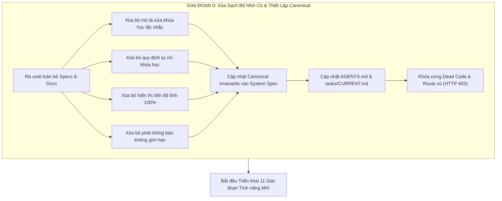

# Kế hoạch Triển khai Chi tiết: Xóa Sạch Workflow & Bộ Nhớ Cũ, Thiết Lập Hệ Thống Bản Nháp Khóa Học Tổng Hợp Một Lần (Unified Staging Draft), Ghi Danh Trọn Đời, Khắc Phục Quiz & Chuẩn Hóa Toàn Diện Hệ Thống PWD301

> **Tài liệu Kế hoạch:** `docs/superpowers/plans/2026-10-14-course-changeset-and-ui-remediation.md`  
> **Trạng thái:** Chờ Chủ dự án phê duyệt (`/plan`) trước khi bắt tay vào lập trình.  
> **Ngày lập:** 14/10/2026  
> **Tiêu chuẩn Kỹ thuật:** Pure Headless Backend, Fail-Closed Security, Anti-Tamper Video Pacing, Cisco NetAcad Editorial Dark Mode (#18181b / #202020), TDD Verification First.

---

## 1. Bối cảnh & 11 Mục tiêu Cốt lõi Sau Thử Nghiệm Thực Tế

Sau quá trình thử nghiệm thực tế trên toàn bộ hệ thống PWD301 (Backend REST API & Frontend Single Page Application), chúng ta cần giải quyết dứt điểm 11 tồn đọng và nâng cấp trải nghiệm người dùng:

1. **Bản nháp Khóa học Tổng hợp Một Lần (Unified Staging Draft)**: Tất cả mọi chỉnh sửa của giảng viên (thông tin chung, ảnh bìa, chuẩn đầu ra, đề cương, bài học, tài liệu, mini-quiz) trên khóa học đã xuất bản đều được lưu vào 01 bản nháp duy nhất (`STAGING_DRAFT`). Giảng viên gom lại kiểm tra chính xác rồi gửi đơn cập nhật 1 lần cho Admin duyệt tổng hợp, chấm dứt hoàn toàn việc Admin phải duyệt lắc nhắc từng bài học gây mất thời gian và quá tải.
2. **Tiến độ Động & Tự động Hoàn thành Bài học Video**: Khắc phục lỗi xem hết video nhưng bài học không tự đánh dấu hoàn thành; tính toán tiến độ khóa học góc trên bên phải theo công thức động `Math.round((số bài hoàn thành / tổng số bài) * 100)%`, xóa bỏ vĩnh viễn biến số tĩnh giả lập `100.00%`.
3. **Mini-Quiz trong Bài học - Nối Từ & Giao diện Làm Lại (Retry UI)**: Sửa lỗi câu hỏi nối từ không vẽ được đường nối trong bài học (do lệch bộ chọn DOM); thiết kế lại giao diện Làm lại (Retry) theo chuẩn NetAcad Dark & Slate/Emerald cao cấp (xóa bỏ màu đỏ neon chói lóa, reset sạch đường nối và trạng thái khi làm lại).
4. **Ghi Danh Trọn Đời (Strict Lifetime Enrollment Guarantee)**: Khóa vĩnh viễn tính năng học sinh rời khóa học (gỡ nút ở UI, khóa cứng API `POST /student/courses/<id>/leave` trả về HTTP 403 Forbidden); giảng viên không thể xóa học sinh ra khỏi khóa học. Khóa học một khi đã ghi danh sẽ đi theo tài khoản học sinh suốt đời (chỉ Admin chính có quyền đình chỉ kỷ luật khi có sai phạm).
5. **Tái Cấu Trúc Cài Đặt & Học Vụ $\rightarrow$ Danh Sách Sinh Viên**: Đổi tên nút thanh công cụ "Cài đặt & Học vụ" thành "Danh sách sinh viên" (mở trực tiếp bảng điểm/danh sách lớp); di chuyển toàn bộ cài đặt học vụ & thông số môn học sang "Trang Giới thiệu" với bố cục 3 tab chuẩn hóa.
6. **Động cơ Chấm Kéo Thả Từ & Bảo Mật Phòng Thi (Anti-Leak)**: Sửa lỗi đáp án kéo thả từ luôn bị chấm sai (do lệch giữa mã token và chuỗi văn bản); triệt tiêu hoàn toàn việc rò rỉ đáp án đúng/sai ngay khi đang làm bài thi; hiển thị chi tiết từng ô kéo thả (xanh đúng / đỏ sai kèm đáp án chuẩn) ở trang xem lại sau khi nộp bài.
7. **Bộ Soạn Thảo Công Thức Toán Học Trực Quan ($f(x)$ Palette & Live KaTeX)**: Tích hợp Bảng Ký hiệu Toán học Trực quan ($f(x)$ icon) kèm khung xem trước KaTeX thời gian thực, hỗ trợ chèn công thức chuẩn xác vào Đề câu hỏi, 4 đáp án A/B/C/D và Lời giải thích trong Exam Studio.
8. **Phân Quyền Phát Thông Báo Hệ Thống 2 Cấp (2-Tier Broadcast RBAC)**: Admin chính (Super Admin) toàn quyền phát mọi loại thông báo; Admin giám sát hệ thống (System Monitoring Admin) chỉ được phát thông báo loại `SYSTEM` (backend chặn HTTP 403 nếu chọn loại khác); các sub-admin khác bị ẩn nút và khóa API.
9. **Hàng Đợi Duyệt Khóa Học Bền Vững & Đồng Bộ Số Lượng**: Khắc phục lỗi duyệt khóa học/thay đổi không lưu vào MSSQL hoặc bị đảo ngược trạng thái khi F5 reload; đồng bộ chính xác số lượng hàng đợi giữa Thẻ KPI, Huy hiệu thanh điều hướng (badge) và số dòng bảng. Bổ sung nút duyệt nhanh kèm modal xác nhận.
10. **Hiển Thị Ảnh Bìa Khóa Học trong Trang Thẩm Định của Admin**: Backend serialize trường `thumbnail_url`; hiển thị ảnh bìa tỷ lệ 16:9 sắc nét trong giao diện thẩm định chi tiết của Admin.
11. **Phân Công Giảng Dạy: Phân Quyền Truy Cập Khóa Học & Ô Tìm Kiếm**: Cấp quyền cho `ADMIN_TEACHING_ASSIGNMENT` truy cập `GET /admin/courses`; bổ sung ô tìm kiếm tức thì theo mã môn, tên môn học, giảng viên phụ trách trong modal chuyển giao.

---

## 2. GIAI ĐOẠN 0: XÓA SẠCH TOÀN BỘ LOGIC, BỘ NHỚ CŨ & THIẾT LẬP BẤT BIẾN CANONICAL (MANDATORY LEGACY PURGE)

> [!IMPORTANT]
> **Chỉ đạo Tối cao của Chủ dự án:**
> *"Trước khi bắt tay vào làm hãy xóa sạch toàn bộ logic, bộ nhớ cũ, logic cũ, mô tả cũ,... mọi vấn đề, chức năng cũ của luồng workflow về những chỉnh sửa, thay đổi này toàn hệ thống và thay bằng cái mới để chắc chắn rằng khi làm xong kế hoạch này thì sau này khi mình nhớ bạn thực hiện 1 chức năng khác bạn không vô tình thấy bản thiết kế cũ của workflow này mà làm lại như cũ khiến bao công sức đổ sông đổ biển."*

Giai đoạn 0 là cam kết nền tảng bắt buộc thực thi ĐẦU TIÊN trước khi viết bất kỳ dòng mã tính năng mới nào. Chúng ta sẽ rà soát và xóa sạch toàn bộ mô tả cũ trong tài liệu đặc tả, hợp đồng tác tử, và dọn dẹp các tàn dư code cũ trên toàn bộ hệ thống:



### 2.1. Danh mục Tài liệu Đặc tả Hệ thống Phải Xóa & Thay Mới (`docs/system/PWD301_SYSTEM_SPECIFICATION/`)
1. **`business/01_BUSINESS_RULE_CATALOG.md`**:
   - **Xóa sạch cũ**: Bãi bỏ quy tắc cho phép tạo các yêu cầu thay đổi phân mảnh (`CourseChangeRequest`) riêng lẻ cho từng bài học hoặc từng trường dữ liệu khi khóa học đã xuất bản. Bãi bỏ quy tắc cho phép học sinh tự rút khỏi khóa học (`BR-EN-05: Voluntary Student Unenrollment`).
   - **Thay mới bằng**: 
     * `BR-CR-UNIFIED-01 (Unified Course Version Changeset Staging)`: Toàn bộ sửa đổi trên khóa học đã xuất bản được lưu trữ cục bộ vào 01 bản nháp (`CourseVersionChangeset` ở trạng thái `STAGING_DRAFT`). Chỉ gửi duyệt 1 lần duy nhất đến Admin.
     * `BR-EN-LIFETIME-01 (Strict Lifetime Enrollment Guarantee)`: Khóa học đã ghi danh là tài sản học tập vĩnh viễn gắn liền với tài khoản học sinh. Học sinh không thể rời; Giảng viên không thể xóa học sinh. Chỉ có Admin chính có quyền kỷ luật ngoại lệ.
2. **`workflows/02_COURSE_LIFECYCLE.md` & `state-machines/COURSE_STATE_MACHINE.md`**:
   - **Xóa sạch cũ**: Xóa bỏ các sơ đồ trạng thái mô tả việc gửi phê duyệt từng bài giảng độc lập (`LESSON_PENDING_REVIEW`) và mã trạng thái HTTP 202 trả về rải rác.
   - **Thay mới bằng**: Sơ đồ vòng đời Bản nháp Tổng hợp: `PUBLISHED` $\rightarrow$ Giảng viên sửa đổi $\rightarrow$ `STAGING_DRAFT` (tích lũy thay đổi) $\rightarrow$ Giảng viên bấm `[Gửi đơn cập nhật]` $\rightarrow$ `CHANGESET_PENDING` $\rightarrow$ Admin thẩm định Unified Diff $\rightarrow$ Duyệt All-or-Nothing $\rightarrow$ Áp dụng đồng loạt vào `PUBLISHED`.
3. **`workflows/03_ENROLLMENT_LIFECYCLE.md` & `state-machines/ENROLLMENT_STATE_MACHINE.md`**:
   - **Xóa sạch cũ**: Xóa bỏ chuyển trạng thái `ENROLLED` $\rightarrow$ `DROPPED` / `UNENROLLED` bởi học sinh hoặc giảng viên.
   - **Thay mới bằng**: Vòng đời Ghi danh Đơn hướng Trọn đời: `ENROLLED` $\rightarrow$ `IN_PROGRESS` $\rightarrow$ `COMPLETED` (không có nhánh tự hủy ghi danh).
4. **`workflows/11_NOTIFICATION_WORKFLOW.md` & `api/12_ADMIN_API.md`**:
   - **Xóa sạch cũ**: Bãi bỏ mô tả phát thông báo chỉ cần quyền admin chung.
   - **Thay mới bằng**: Ma trận phân quyền phát thông báo 2 cấp nghiêm ngặt (`ADMIN_PRIMARY` toàn quyền; `ADMIN_SYSTEM_MONITORING` chỉ được phát loại `SYSTEM`; các sub-admin khác bị từ chối HTTP 403).
5. **`api/04_COURSE_API.md` & `api/02_STUDENT_API.md`**:
   - **Xóa sạch cũ**: Xóa bỏ đặc tả API `POST /student/courses/<id>/leave` và các endpoint tạo lẻ change request.
   - **Thay mới bằng**: Đặc tả API quản lý bản nháp tổng hợp: `GET /instructor/courses/<id>/changeset/status`, `POST /instructor/courses/<id>/changeset/submit`, `POST /instructor/courses/<id>/changeset/discard`, `GET /instructor/courses/<id>/changeset/diff`. Khóa `/leave` với phản hồi HTTP 403.
6. **`implementation/06_NON_NEGOTIABLE_INVARIANTS.md`**:
   - Bổ sung 4 Bất biến Cốt lõi mới:
     * *Invariant 21 (Unified Staging Draft & Single Approval)*: Mọi chỉnh sửa khóa học live phải qua bản nháp tổng hợp, duyệt All-or-Nothing.
     * *Invariant 22 (Permanent Lifetime Enrollment)*: Ghi danh vĩnh viễn, triệt tiêu quyền tự rút và quyền giảng viên xóa học sinh.
     * *Invariant 23 (Anti-Leak Exam Security & Dynamic Pacing)*: Cấm lộ kết quả khi đang thi, tiến độ tính toán từ dữ liệu thực tế.
     * *Invariant 24 (Two-Tier Broadcast RBAC)*: Giới hạn nghiêm ngặt thẩm quyền phát thông báo toàn hệ thống.

### 2.2. Đồng Bộ Hợp Đồng Tác Tử & Nhật Ký Công Việc (`AGENTS.md` & `tasks/CURRENT.md`)
- **`AGENTS.md`**: Cập nhật mục 4 và mục 10, ghi rõ 4 bất biến mới để tất cả các phiên làm việc của bất kỳ agent nào (Antigravity, Codex, v.v.) trong tương lai đều phải tuân thủ nghiêm ngặt, không bao giờ tự ý phục hồi luồng cũ.
- **`tasks/CURRENT.md`**: Cập nhật mục đầu tiên với thông báo **Permanent Purge Notice** cho TASK-091, xác định rõ các thành phần cũ đã bị tiêu hủy vĩnh viễn.

### 2.3. Khóa Cứng & Dọn Sạch Code Tàn Dư (Dead Code & Route Deprecation)
- `src/pwd301/blueprints/student/routes.py`: Khóa cứng route `/courses/<course_id>/leave` bằng cách raise ngay `ForbiddenError("Chức năng rời khóa học đã bị vô hiệu hóa. Khóa học được ghi danh sẽ gắn liền với tài khoản học viên trọn đời.")`.
- `frontend/assets/js/api.js`: Xóa hàm trùng lặp `ApiClient.getAdminChangeRequests` (hiện bị khai báo 2 lần tại dòng 1141 và 1328); xóa hàm `ApiClient.leaveCourse`.
- `frontend/assets/js/views/student.js`: Gỡ bỏ toàn bộ sự kiện gán vào nút "Rời khóa học" và modal xác nhận rời khóa học.

---

## 3. GIAI ĐOẠN 1: Bản Nháp Khóa Học Tổng Hợp Một Lần (Unified Staging Draft Engine)

### 3.1. Phân tích Kỹ thuật Hiện trạng
- Hiện tại, khi giảng viên chỉnh sửa một khóa học ở trạng thái `PUBLISHED`:
  * Sửa thông tin chung (`update_course`) $\rightarrow$ tạo ngay 1 bản ghi `CourseChangeRequest` loại `COURSE_METADATA`.
  * Sửa bài giảng 1 $\rightarrow$ tạo ngay 1 `CourseChangeRequest` loại `LESSON_CONTENT`.
  * Sửa bài giảng 2 $\rightarrow$ tạo thêm 1 `CourseChangeRequest`.
- Hậu quả: Admin nhận được hàng loạt yêu cầu vụn vặt, không thấy được bức tranh tổng thể của lần cập nhật, phải duyệt 5-10 lần rất mất thời gian.

### 3.2. Thiết kế Kiến trúc Mới
1. **Lưu trữ Bản Nháp Cục Bộ (`STAGING_DRAFT`)**:
   - Khi khóa học ở trạng thái `PUBLISHED`, mọi thao tác chỉnh sửa của giảng viên (thông tin khóa học, ảnh bìa, chuẩn đầu ra, thêm/sửa/xóa bài giảng, câu hỏi mini-quiz, tài liệu đính kèm) đều được lưu vào đối tượng `CourseVersionChangeset` liên kết với khóa học đó với trạng thái `STAGING_DRAFT`.
   - Khóa học thực tế đang hiển thị cho học sinh (`PUBLISHED`) vẫn giữ nguyên vẹn 100% nội dung gốc cho đến khi có sự phê duyệt của Admin.
2. **Thanh Trạng Thái Bản Nháp (Draft Notification Bar) ở Phía Giảng Viên**:
   - Trên đầu màn hình Quản lý Đề cương & Nội dung của Giảng viên (`instructor.js`): Hiển thị thanh thông báo nổi bật phong cách NetAcad Dark:
     * Huy hiệu: `📝 Bản nháp đang mở: X thay đổi chưa gửi duyệt`.
     * Tóm tắt thay đổi: Ví dụ: *"Đã sửa thông tin chung, Đã sửa Bài 1, Đã thêm Bài 3"*.
     * Bộ 3 nút hành động:
       - `[Xem chi tiết thay đổi]`: Mở modal Deep Diff xem trước Before vs. After.
       - `[Hủy bỏ bản nháp]`: Đưa khóa học về trạng thái live hiện tại, xóa bỏ các thay đổi nháp (kèm modal xác nhận an toàn).
       - `[Gửi đơn cập nhật cho Admin]`: Nút Primary màu xanh ngọc (`bg-emerald-600 hover:bg-emerald-500`) gửi toàn bộ thay đổi.
3. **Nộp Đơn Cập Nhật 1 Lần Duy Nhất**:
   - Khi giảng viên bấm `[Gửi đơn cập nhật cho Admin]`, hệ thống gọi `POST /instructor/courses/<id>/changeset/submit`:
     * Đóng gói toàn bộ metadata diff + lesson diffs (added/modified/deleted) thành **01 Yêu cầu Phê duyệt Duy nhất** (`CourseChangeRequest` loại `COURSE_VERSION_CHANGESET`).
     * Chuyển trạng thái changeset sang `PENDING`. Khóa tạm thời quyền chỉnh sửa của giảng viên (trả về 409 Conflict nếu cố sửa tiếp khi đang chờ duyệt) để tránh phân kỳ dữ liệu.
4. **Màn Hình Thẩm Định Tổng Hợp Phía Admin (Unified All-or-Nothing Deep Diff)**:
   - Trong bảng điều khiển Admin (`#/admin/governance?tab=courses`), hàng đợi chỉ xuất hiện **DUY NHẤT 01 dòng** cho toàn bộ đợt cập nhật của khóa học này với nhãn `Cập nhật toàn diện giáo trình`.
   - Khi Admin bấm `[Xem]`, hệ thống mở màn hình Thẩm định Chi tiết Tổng hợp (`#/admin/change-requests/review?id=...`):
     * **Khu vực 1: Thông tin Khóa học & Ảnh bìa**: So sánh Before vs. After (Tên, Ảnh bìa 16:9, Chuẩn đầu ra, Mô tả).
     * **Khu vực 2: Khung Giáo trình & Bài giảng**: Cây thư mục hiển thị rõ bài nào được thêm mới (`MỚI`), bài nào được sửa (`ĐÃ SỬA`), bài nào bị xóa (`XÓA`).
     * **Khu vực 3: Chi tiết Bài giảng**: So sánh từng khối nội dung bài học, video, tài liệu, câu hỏi mini-quiz.
   - Admin chỉ cần bấm `[Phê duyệt]` **01 LẦN DUY NHẤT**:
     * Hệ thống áp dụng toàn bộ thay đổi vào CSDL trong **01 Database Transaction duy nhất** (All-or-Nothing Atomicity).
     * Cập nhật các bài học mới thành `PUBLISHED`, đánh dấu các phiên bản cũ là `HISTORICAL`, kích hoạt metadata mới.
     * Đóng changeset và chuyển trạng thái thành `APPROVED`.

### 3.3. Kế hoạch Triển khai Mã Nguồn
- `src/pwd301/services/course_service.py`: Cập nhật `update_course` khi khóa học `PUBLISHED` chuyển sang lưu staging payload trong `CourseVersionChangeset`.
- `src/pwd301/services/lesson_service.py`: Tích hợp metadata changes vào `CourseVersionChangeset` và cập nhật hàm `submit_course_changeset`.
- `src/pwd301/blueprints/instructor/routes.py`: Hoàn thiện các route quản lý changeset: status, submit, discard, preview.
- `src/pwd301/blueprints/admin/routes.py`: `admin_approve_change_request` áp dụng toàn diện cả metadata lẫn curriculum trong cùng một transaction.
- `frontend/assets/js/views/instructor.js`: Bổ sung thanh Draft Notification Bar, nút `[Gửi đơn cập nhật]` và giao diện xem trước bản nháp.

---

## 4. GIAI ĐOẠN 2: Tiến Độ Động & Tự Động Hoàn Thành Bài Học Video

### 4.1. Phân tích Kỹ thuật & Nguyên nhân
- **Nguyên nhân không hoàn thành bài học**: Khi học sinh xem hết video (sự kiện `ended` của HTML5 Video hoặc YouTube Player), client gọi `ApiClient.recordLessonProgress(activeItem.id, 0, 1.0, false)`. Vì truyền `secondsIncrement = 0`, server kiểm tra `progress.seconds_spent < lesson.minimum_completion_seconds` và từ chối đánh dấu hoàn thành (`is_completed = False`).
- **Nguyên nhân tiến độ luôn là 100%**: Ở thanh điều hướng trên cùng bên phải (`student.js:2453`), client đọc trực tiếp `progressData?.current_progress_percent ?? enrollment?.current_progress_percent`, trong khi dữ liệu mock demo được seed sẵn là `100.00%`, khiến thanh luôn cố định ở 100%.

### 4.2. Thiết kế Kiến trúc Mới
1. **Tự Động Hoàn Thành Khi Hết Video**:
   - Khi video phát đến cuối (`onEnded` hoặc `currentTime >= duration - 1`):
     * Client tính toán tổng thời gian thực tế đã xem và gọi `ApiClient.recordLessonProgress(activeItem.id, Math.ceil(duration), 1.0, true)`.
     * Server kiểm tra: Nếu bài học không có bài kiểm tra mini-quiz bắt buộc kèm theo (hoặc mini-quiz đã pass), tự động cập nhật `is_completed = True`, ghi nhận `completed_at = utc_now()`.
     * Client lập tức cập nhật giao diện: Đổi icon bài học trong danh mục bên trái thành tích xanh (`check_circle text-emerald-400`), phát hiệu ứng thông báo nhẹ `"Đã hoàn thành bài học!"`.
2. **Tính Toán Tiến Độ Động 100%**:
   - Loại bỏ việc đọc trường dữ liệu tĩnh `100.00%`.
   - Tính toán trực tiếp từ mảng bài học thực tế của học sinh trong khóa học:
     ```javascript
     const completedCount = lessons.filter(l => l.is_completed).length;
     const totalCount = lessons.length;
     const dynamicPercent = totalCount > 0 ? Math.round((completedCount / totalCount) * 100) : 0;
     ```
   - Cập nhật số hiển thị và độ rộng thanh tiến trình (`style="width: ${dynamicPercent}%"`) ngay trên thanh header góc trên bên phải. Khi học sinh học xong một bài mới, tiến độ tự động nhảy tăng lên tức thì mà không cần tải lại trang (F5).

---

## 5. GIAI ĐOẠN 3: Mini-Quiz trong Bài Học - Nối Từ & Giao Diện Làm Lại (Retry UI)

### 5.1. Phân tích Kỹ thuật & Nguyên nhân
- **Lỗi không nối được từ**: Tại `student.js:6954`, sự kiện chuột/chạm chỉ gán cho `.matching-challenge-board[data-exam-matching-qidx]` của bài thi lớn, hoàn toàn bỏ sót `.cisco-quiz-matching-board[data-cisco-quiz-qidx]` của mini-quiz trong bài học.
- **Lệch tông màu và không xóa đường nối**: Giao diện thông báo sai và làm lại (`student.js:4405`) sử dụng màu nền đỏ neon gắt (`bg-rose-600`), lệch tông hoàn toàn so với phong cách NetAcad Slate tối. Khi bấm nút làm lại, các đường nối SVG cũ không được dọn dẹp khỏi DOM.

### 5.2. Thiết kế Kiến trúc Mới
1. **Hàm Gắn Sự Kiện Nối Từ Đa Năng (`bindUniversalMatchingBoard`)**:
   - Hỗ trợ cả 2 tương tác mượt mà:
     * *Cách 1 (Click-to-Connect)*: Nhấp chuột vào 1 thẻ ở cột Thuật ngữ (Trái) $\rightarrow$ Thẻ sáng viền xanh $\rightarrow$ Nhấp chuột vào 1 thẻ ở cột Định nghĩa (Phải) $\rightarrow$ Tự động vẽ đường nối SVG mềm mại giữa hai điểm nối.
     * *Cách 2 (Drag-to-Connect)*: Kéo chuột từ chấm tròn của thẻ Trái và thả vào thẻ Phải.
   - Cho phép nhấp lại vào đường nối hoặc thẻ đã nối để hủy đường nối nếu muốn chọn lại.
2. **Thiết Kế Lại Giao Diện Làm Lại (Retry UI) Chuẩn NetAcad Dark**:
   - Thay thế toàn bộ màu đỏ neon bằng giao diện NetAcad Slate Dark tinh tế:
     * Card thông báo: Nền tối sâu `bg-slate-900/95 border border-slate-800 text-slate-200 shadow-xl rounded-xl p-6`.
     * Thông báo kết quả: Điểm nhấn màu hổ phách dịu `text-amber-400 bg-amber-950/40 border border-amber-800/60 rounded-lg p-3`: *"Bạn đạt X/Y điểm (chưa đạt ngưỡng yêu cầu Z%). Hãy xem lại bài giảng và thử lại!"*.
     * Nút hành động "Làm lại từ đầu": Nền xanh lục ngọc dịu `bg-emerald-600 hover:bg-emerald-500 text-white font-medium px-6 py-2.5 rounded-lg shadow-sm transition-all`.
3. **Cơ Chế Làm Sạch Trạng Thái Khi Thử Lại (Clean Reset)**:
   - Khi nhấp "Làm lại từ đầu":
     * Xóa sạch toàn bộ các thẻ `<path>` / `<line>` SVG nối từ.
     * Gỡ bỏ toàn bộ trạng thái `selected`, `matched`, `disabled` trên tất cả các thẻ từ.
     * Xóa sạch các lựa chọn trắc nghiệm hoặc điền từ đã nhập.
     * Đưa người học về Câu hỏi số 1 của mini-quiz trong trạng thái sạch sẽ hoàn toàn.

---

## 6. GIAI ĐOẠN 4: Ghi Danh Trọn Đời (Strict Lifetime Enrollment Guarantee)

### 6.1. Phân tích Nghiệp vụ & Yêu cầu
- Hiện tại, học sinh có nút "Rời khóa học" kích hoạt `POST /student/courses/<id>/leave`.
- Quy định học vụ mới: Khóa học một khi đã được ghi danh sẽ đi theo học sinh suốt đời để bảo toàn toàn bộ lịch sử học tập, chứng chỉ và bảng điểm. Giảng viên không có quyền xóa học sinh; học sinh không được phép tự rời.

### 6.2. Thiết kế Kiến trúc Mới
1. **Khóa Cứng Backend (`src/pwd301/blueprints/student/routes.py`)**:
   - Khóa route `/courses/<course_id>/leave`: Trả về ngay HTTP 403 Forbidden kèm thông điệp nghiệp vụ rõ ràng:
     ```python
     @student_bp.route("/courses/<course_id>/leave", methods=["POST"])
     @student_required
     def student_leave_course(course_id: str) -> Any:
         raise ForbiddenError(
             "Chức năng rời khóa học đã bị vô hiệu hóa. "
             "Khóa học đã ghi danh sẽ gắn liền với tài khoản học viên trọn đời."
         )
     ```
2. **Loại Bỏ Hoàn Toàn Khả Năng Giảng Viên Xóa Sinh Viên**:
   - Kiểm tra mã nguồn `src/pwd301/blueprints/instructor/routes.py`: Đảm bảo không tồn tại bất kỳ endpoint nào cho phép giảng viên xóa hoặc hủy ghi danh của sinh viên.
   - Quyền xử lý học vụ đặc biệt (đình chỉ sinh viên do gian lận hoặc vi phạm nội quy) thuộc thẩm quyền độc quyền của Super Admin thông qua module quản trị kỷ luật.
3. **Gỡ Bỏ Giao Diện Phía Frontend**:
   - `frontend/assets/js/views/student.js`: Gỡ bỏ triệt để nút "Rời khóa học", menu ngữ cảnh "Hủy ghi danh" trong trang danh sách khóa học của tôi, trang chi tiết khóa học và trang cài đặt học viên.
   - `frontend/assets/js/views/instructor.js`: Bảng danh sách sinh viên chỉ hiển thị thông tin học tập (tiến độ %, điểm bài tập, lần đăng nhập cuối); tuyệt đối không có nút "Xóa" hay "Kick".

---

## 7. GIAI ĐOẠN 5: Tái Cấu Trúc Cài Đặt & Học Vụ $\rightarrow$ Danh Sách Sinh Viên

### 7.1. Phân tích Hiện trạng & Yêu cầu
- Thanh công cụ quản lý khóa học của giảng viên đang có nút "Cài đặt & Học vụ" mở ra modal trùng lặp với trang Giới thiệu.
- Giảng viên cần một nút truy cập nhanh vào "Danh sách sinh viên" để theo dõi lớp học.
- Các cài đặt môn học và thông số học vụ cần được quy hoạch lại vào "Trang Giới thiệu" với bố cục 3 tab khoa học.

### 7.2. Thiết kế Kiến trúc Mới
1. **Đổi Nút Thanh Công Cụ Khóa Học (`instructor.js`)**:
   - Đổi nút `"Cài đặt & Học vụ"` trên thanh header khóa học thành `"Danh sách sinh viên"` (icon `people` hoặc `group`).
   - Khi nhấp vào nút này: Mở trực tiếp màn hình/modal Quản lý Danh sách Sinh viên & Bảng điểm Lớp học (`renderStudentsModal` hoặc điều hướng sang tab danh sách sinh viên).
2. **Tái Cấu Trúc Trang Giới Thiệu Khóa Học 3 Tab (`renderCourseAboutPage`)**:
   - Tại trang Giới thiệu (`#/instructor/courses/<id>/about`), phân chia rõ ràng thành 3 tab chuyên biệt:
     * **Tab 1: Thông tin Chung (Overview)**: Mã môn học, tên khóa học, danh mục, cấp độ khó, ảnh bìa khóa học, tóm tắt ngắn, mô tả chi tiết bài giảng.
     * **Tab 2: Đề cương & Chuẩn đầu ra (Curriculum & SLOs)**: Chuẩn đầu ra (Student Learning Outcomes - SLOs), tiêu chí hoàn thành khóa học, đối tượng học viên mục tiêu, môn học tiên quyết.
     * **Tab 3: Cài đặt & Học vụ (Governance & Settings)**: Sức chứa lớp học (capacity), giới hạn dung lượng lưu trữ tài liệu (quota bytes), chế độ duyệt bài tập, mã ghi danh bổ sung (nếu có).

---

## 8. GIAI ĐOẠN 6: Động Cơ Chấm Kéo Thả Từ & Bảo Mật Phòng Thi (Anti-Leak)

### 8.1. Phân tích Kỹ thuật Hiện trạng
- **Lỗi chấm sai 100%**: Trong `src/pwd301/services/attempt_service.py`, hàm so sánh đáp án kéo thả chỉ so khớp cứng mã token UUID nội bộ (`choice_key`), trong khi client gửi lên chuỗi văn bản đã chuẩn hóa hoặc token có định dạng khác, dẫn đến mọi câu trả lời dù kéo đúng vị trí vẫn bị tính 0 điểm.
- **Rò rỉ đề thi (Security Leak)**: Trong lúc học sinh đang làm bài thi, giao diện lại hiển thị ngay màu xanh (đúng) hoặc đỏ (sai) khi vừa thả từ vào ô, tạo điều kiện cho học sinh thử sai để tìm đáp án đúng.

### 8.2. Thiết kế Kiến trúc Mới
1. **Động Cơ Chấm Điểm Backend Linh Hoạt (`attempt_service.py`)**:
   - Nâng cấp logic so khớp trong `_grouped_multiple_choice_correct`:
     * Chấp nhận so khớp theo mã lựa chọn (`choice_key`).
     * Đồng thời so khớp dự phòng theo nội dung chuỗi văn bản sau khi chuẩn hóa (`text.strip().lower()`).
     * Lưu trữ chi tiết điểm số từng vị trí ô trống vào kết quả nộp bài.
2. **Bảo Mật Phòng Thi Tuyệt Đối (Anti-Leak During Exam)**:
   - Trong suốt thời gian làm bài thi: TUYỆT ĐỐI CẤM hiển thị bất kỳ màu xanh (đúng) hay đỏ (sai) nào.
   - Các từ sau khi kéo thả vào ô trống hiển thị màu trung tính chuẩn NetAcad Slate (`border-slate-600 bg-slate-800 text-slate-200 font-medium`), chỉ thể hiện trạng thái "Đã điền".
3. **Trang Xem Lại Kết Quả Sau Khi Nộp Bài (Post-Submission Review)**:
   - Sau khi học sinh đã nộp bài (`SUBMITTED` / `GRADED`) và truy cập trang Xem lại kết quả (`#/student/assessments/results`):
     * Hiển thị chi tiết từng ô kéo thả:
       - Nếu đúng: Viền xanh lục nhẹ `border-emerald-500 bg-emerald-950/20 text-emerald-400` kèm biểu tượng tích xanh `✓`.
       - Nếu sai: Viền đỏ mềm `border-rose-500 bg-rose-950/20 text-rose-400` kèm biểu tượng `✗`, và hiển thị ngay bên dưới ô đáp án đúng chuẩn mực.

---

## 9. GIAI ĐOẠN 7: Bộ Soạn Thảo Công Thức Toán Học Trực Quan trong Exam Studio

### 9.1. Phân tích Hiện trạng
- Trong Exam Studio (`instructor-exams.js`), tính năng "Chèn công thức" không hoạt động hoặc bắt buộc giảng viên phải gõ cú pháp mã LaTeX phức tạp bằng tay mà không có bất kỳ hướng dẫn hay bảng chọn ký hiệu trực quan nào, rất khó sử dụng và dễ gây lỗi hiển thị.

### 9.2. Thiết kế Kiến trúc Mới
1. **Bảng Ký Hiệu Toán Học Trực Quan ($f(x)$ Math Palette)**:
   - Bổ sung nút bấm icon $f(x)$ bên cạnh tất cả các trường nhập liệu văn bản trong Exam Studio: Đề câu hỏi, 4 đáp án A/B/C/D, và Lời giải thích.
   - Khi nhấp vào nút $f(x)$, hiển thị thanh công cụ chọn ký hiệu với 5 nhóm biểu tượng trực quan:
     * **Nhóm 1: Cơ bản**: Phân số (`\frac{a}{b}`), Căn bậc hai (`\sqrt{x}`), Căn bậc n (`\sqrt[n]{x}`), Số mũ (`x^{n}`), Chỉ số dưới (`x_{i}`), Nhân chia (`\times`, `\div`, `\pm`).
     * **Nhóm 2: Ký tự Hy Lạp**: $\alpha, \beta, \gamma, \theta, \pi, \sigma, \omega, \Delta, \Sigma, \Omega, \lambda, \mu$.
     * **Nhóm 3: Giải tích & Đại số**: Tích phân (`\int_{a}^{b}`), Tổng (`\sum_{i=1}^{n}`), Tích (`\prod`), Giới hạn (`\lim_{x \to \infty}`), Đạo hàm (`\frac{df}{dx}`).
     * **Nhóm 4: Quan hệ & Logic**: $\le, \ge, \neq, \approx, \in, \notin, \subset, \infty, \angle, \perp, \vec{v}, \rightarrow, \Leftrightarrow$.
     * **Nhóm 5: Ma trận & Ngoặc**: Ma trận $2 \times 2$, Ma trận $3 \times 3$, Hệ phương trình dấu ngoặc nhọn.
2. **Chèn Thông Minh Theo Vị Trí Con Trỏ (Caret-Aware Insertion)**:
   - Khi giảng viên nhấp vào một ký hiệu toán học, hệ thống tự động chèn đoạn mã mẫu LaTeX vào đúng vị trí con trỏ chuột trong ô nhập liệu đang thao tác mà không làm mất nội dung đã gõ.
3. **Khung Xem Trước KaTeX Thời Gian Thực (Live KaTeX Preview)**:
   - Ngay phía dưới ô nhập liệu hoặc bên trong modal công thức, hiển thị một khung xem trước trực tiếp:
     * Tự động bắt sự kiện gõ phím (`input`) và render công thức toán học sắc nét bằng thư viện KaTeX.
     * Nếu công thức gõ sai cú pháp, hiển thị thông báo hỗ trợ màu vàng nhẹ thay vì làm đơ giao diện.

---

## 10. GIAI ĐOẠN 8: Phân Quyền Phát Thông Báo Hệ Thống 2 Cấp (2-Tier Broadcast RBAC)

### 10.1. Phân tích Kỹ thuật Hiện trạng
- Endpoint `POST /admin/notifications/broadcast` hiện chỉ kiểm tra `@admin_required` mà không kiểm tra tiểu vai trò (`admin_sub_role`), dẫn đến việc bất kỳ tài khoản sub-admin nào (kể cả admin chỉ duyệt giảng viên) cũng có thể phát thông báo cho toàn trường.

### 10.2. Thiết kế Kiến trúc Mới
1. **Kiểm Soát Nghiêm Ngặt Phía Backend (`src/pwd301/blueprints/admin/routes.py`)**:
   - Tại hàm `admin_broadcast_notifications`:
     ```python
     actor = require_authenticated_actor()
     category = data.get("category", "SYSTEM").upper()
     
     # Cấp 1: Super Admin (Admin Chính) có toàn quyền phát mọi loại thông báo
     if actor.is_primary_admin:
         pass
     # Cấp 2: Admin Giám sát Hệ thống CHỈ được phép phát loại SYSTEM (Bảo trì/Hạ tầng)
     elif actor.admin_sub_role == "ADMIN_SYSTEM_MONITORING":
         if category != "SYSTEM":
             raise ForbiddenError(
                 "Admin giám sát hệ thống chỉ được phép phát thông báo liên quan đến hệ thống."
             )
     # Các vai trò Admin khác: Chặn hoàn toàn
     else:
         raise ForbiddenError("Bạn không có quyền phát thông báo toàn hệ thống.")
     ```
2. **Kiểm Soát Giao Diện Phía Frontend (`frontend/assets/js/views/admin.js`)**:
   - Kiểm tra vai trò của admin đang đăng nhập:
     * Nếu là `ADMIN_PRIMARY`: Hiển thị đầy đủ nút "Phát thông báo", modal cho phép chọn tất cả các danh mục (`Hệ thống`, `Học vụ`, `Bảo trì`, `Sự kiện`).
     * Nếu là `ADMIN_SYSTEM_MONITORING`: Hiển thị nút "Phát thông báo hệ thống", nhưng khóa cứng danh mục ở giá trị `Hệ thống` (disabled dropdown).
     * Nếu là các vai trò khác (`ADMIN_COURSE_REVIEW`, `ADMIN_INSTRUCTOR_REVIEW`, `ADMIN_TEACHING_ASSIGNMENT`): Ẩn hoàn toàn nút phát thông báo trên thanh công cụ và bảng điều khiển.

---

## 11. GIAI ĐOẠN 9: Hàng Đợi Duyệt Khóa Học Bền Vững & Đồng Bộ Số Lượng

### 11.1. Phân tích Kỹ thuật Hiện trạng
- Khi Admin duyệt khóa học hoặc yêu cầu thay đổi, thao tác trong database không được commit bền vững hoặc khi reload F5 trang thì các hàng đợi lại trở về trạng thái chưa duyệt.
- Số lượng hiển thị trên thẻ KPI, huy hiệu (badge) trên thanh điều hướng, và số dòng hiển thị trong bảng danh sách bị lệch pha nhau.

### 11.2. Thiết kế Kiến trúc Mới
1. **Cam Kết Bền Vững MSSQL (Atomic State Transition & Persistence)**:
   - Rà soát toàn bộ các hàm phê duyệt trong `course_service.py` và `admin/routes.py`:
     * Đảm bảo luôn thực thi `sess.commit()` dứt điểm sau khi cập nhật trạng thái `review_status = "APPROVED"` / `"REJECTED"`, ghi nhận `reviewed_by_admin_id = actor.id` và `reviewed_at = utc_now()`.
     * Đảm bảo trạng thái ghi nhận bền vững xuống CSDL Microsoft SQL Server, không bị rollback khi người dùng reload trang (F5).
2. **Đồng Bộ Chỉ Số Hàng Đợi Real-Time Toàn Diện**:
   - Xây dựng hàm đồng bộ trạng thái `syncAdminQueueMetrics()`: Sau mỗi thao tác duyệt (thành công hoặc từ chối), tự động cập nhật đồng thời:
     * (1) Thẻ KPI "Khóa học chờ duyệt" trên bảng điều khiển.
     * (2) Huy hiệu số lượng (Badge Pill) trên tab "Xét duyệt khóa học" ở thanh điều hướng.
     * (3) Xóa dòng tương ứng khỏi bảng dữ liệu hoặc chuyển trạng thái hiển thị thành "Đã duyệt".
3. **Bổ Sung Nút Duyệt Nhanh Kèm Xác Nhận**:
   - Tại bảng hàng đợi khóa học mới: Bổ sung cột hành động với 2 nút rõ ràng: `[Xem chi tiết]` (màu xanh lam) và `[Duyệt nhanh]` (màu xanh lục ngọc). Nút duyệt nhanh kích hoạt modal xác nhận `UI.confirm` trước khi gửi lệnh duyệt để chống bấm nhầm.

---

## 12. GIAI ĐOẠN 10: Hiển Thị Ảnh Bìa Khóa Học trong Trang Thẩm Định của Admin

### 12.1. Phân tích Hiện trạng
- Khi Admin mở trang chi tiết xem xét khóa học (`#admin/courses/review?id=...` hoặc `#admin/change-requests/review?id=...`), giao diện không hiển thị ảnh bìa của khóa học do backend không serialize trường `thumbnail_url` và frontend thiếu component hiển thị ảnh.

### 12.2. Thiết kế Kiến trúc Mới
1. **Backend Serialization (`src/pwd301/blueprints/admin/routes.py`)**:
   - Trong hàm serialize chi tiết khóa học cho admin (`_serialize_course` và `admin_get_course_detail`), bổ sung trường:
     * `thumbnail_url`: URL đầy đủ để tải ảnh bìa (từ `FileAsset` hoặc CDN/storage adapter).
     * `thumbnail_file_asset_id`: UUID của tài sản ảnh bìa.
2. **Frontend 16:9 Showcase (`frontend/assets/js/views/admin.js`)**:
   - Trong hàm `renderCourseReviewPage` và `renderChangeRequestReviewPage`: Bổ sung khung hiển thị ảnh bìa nổi bật tỷ lệ chuẩn 16:9 ở đầu trang:
     * Nếu khóa học có ảnh: Hiển thị ảnh bìa sắc nét kèm bo góc mềm (`rounded-xl border border-slate-700 shadow-md object-cover w-full max-h-64`). Khi nhấp vào ảnh, cho phép phóng to để Admin kiểm tra chất lượng hình ảnh.
     * Nếu khóa học chưa có ảnh: Hiển thị banner đồ họa placeholder với icon sách và mã môn học chuyên nghiệp.

---

## 13. GIAI ĐOẠN 11: Phân Công Giảng Dạy: Phân Quyền Truy Cập Khóa Học & Ô Tìm Kiếm

### 13.1. Phân tích Kỹ thuật Hiện trạng
- Route `GET /admin/courses` tại `src/pwd301/blueprints/admin/routes.py:82` đang kiểm tra cứng `if not actor.has_admin_permission("COURSE_REVIEW"): raise ForbiddenError(...)`.
- Khi tài khoản `ADMIN_TEACHING_ASSIGNMENT` mở modal phân công giảng dạy tại `#/admin/governance?tab=reassign`, API bị chặn 403 khiến danh sách khóa học rỗng (`courses = []`).
- Modal phân công giảng dạy thiếu ô tìm kiếm, gây khó khăn lớn cho Admin khi cần tìm môn học trong số hàng chục khóa học.

### 13.2. Thiết kế Kiến trúc Mới
1. **Mở Rộng Phân Quyền Backend (`src/pwd301/blueprints/admin/routes.py`)**:
   - Cập nhật hàm `admin_courses()`:
     ```python
     if not (actor.has_admin_permission("COURSE_REVIEW") or actor.has_admin_permission("TEACHING_ASSIGNMENT")):
         raise ForbiddenError("Bạn không có quyền xem danh sách khóa học quản trị.")
     ```
2. **Ô Tìm Kiếm Trực Tiếp Phía Frontend (`frontend/assets/js/views/admin.js`)**:
   - Trong modal Chuyển giao Phân công Giảng dạy (`renderReassignTeachingModal`):
     * Bổ sung ô tìm kiếm tức thì (Live Search Input) ở đầu danh sách khóa học: `"Tìm kiếm theo mã môn, tên môn học hoặc giảng viên hiện tại..."`.
     * Tự động lọc danh sách khóa học ngay khi người dùng gõ phím (real-time filtering).
     * Làm nổi bật khóa học đang được chọn và hiển thị rõ thông tin giảng viên tiếp nhận chuyển giao.

---

## 14. GIAI ĐOẠN 12: Bộ Kiểm Thử Tự Động & Xác Minh Thực Nghiệm (TDD & Verification Suite)

Tuân thủ nghiêm ngặt **Luật Sắt Xác minh Thực nghiệm (Anti-Hallucination Contract)**, mọi công đoạn đều phải có bằng chứng kiểm thử thực tế đạt 100% trước khi công bố hoàn thành:

### 14.1. Bộ Kiểm Thử Tự Động Backend (Pytest)
Xây dựng và chạy các file kiểm thử:
1. `tests/unit/test_course_staging_draft.py`:
   - Xác minh việc giảng viên sửa thông tin và bài giảng trên khóa học `PUBLISHED` chỉ lưu vào `STAGING_DRAFT`.
   - Xác minh lệnh `submit` gom tất cả thay đổi thành 01 bản ghi `CourseChangeRequest` duy nhất.
   - Xác minh lệnh `approve` của Admin cập nhật đồng thời metadata và lessons trong 1 transaction.
2. `tests/unit/test_lifetime_enrollment.py`:
   - Xác minh gọi `POST /student/courses/<id>/leave` trả về chính xác HTTP 403 Forbidden.
   - Xác minh không có API nào cho phép giảng viên xóa học sinh.
3. `tests/unit/test_broadcast_notification_rbac.py`:
   - Xác minh Super Admin phát được mọi category thông báo.
   - Xác minh System Monitoring Admin phát được `SYSTEM` nhưng bị chặn 403 khi phát `ACADEMIC` hay `EVENT`.
   - Xác minh các sub-admin khác bị chặn 403 hoàn toàn.
4. `tests/unit/test_drag_drop_quiz_grading.py`:
   - Xác minh hàm chấm điểm kéo thả từ so khớp thành công cả theo choice key và chuỗi text fallback.
5. `tests/unit/test_admin_teaching_assignment_courses.py`:
   - Xác minh tài khoản `ADMIN_TEACHING_ASSIGNMENT` gọi `GET /admin/courses` thành công (HTTP 200) và nhận đầy đủ danh sách khóa học.

### 14.2. Bộ Kiểm Thử Frontend & Giao Diện (Node Tests & Syntax Check)
- Chạy kiểm tra cú pháp toàn bộ các file JavaScript: `student.js`, `instructor.js`, `instructor-exams.js`, `admin.js`, `api.js`.
- Đảm bảo 0 lỗi syntax, 0 cảnh báo linter.

### 14.3. Kiểm Chứng Thực Tế Bằng Trình Duyệt Thật (Chrome DevTools MCP)
- Sử dụng Chrome DevTools MCP trực tiếp thao tác trên ứng dụng đang chạy ở `http://127.0.0.1:5000`:
  1. Thao tác trên vai trò Giảng viên: Sửa thông tin khóa học và bài học $\rightarrow$ Thanh Draft Bar hiển thị đúng số lượng $\rightarrow$ Bấm gửi duyệt 1 lần.
  2. Thao tác trên vai trò Admin: Mở trang thẩm định $\rightarrow$ Thấy ảnh bìa 16:9 sắc nét $\rightarrow$ Bấm phê duyệt $\rightarrow$ Reload F5 xác nhận trạng thái được lưu bền vững $\rightarrow$ Kiểm tra các thẻ KPI và badge đồng bộ số lượng.
  3. Thao tác trên vai trò Admin Giám sát Hệ thống: Kiểm tra ô phát thông báo bị khóa cứng ở danh mục `SYSTEM`.
  4. Thao tác trên vai trò Sinh viên: Làm bài mini-quiz nối từ trong bài học $\rightarrow$ Kiểm tra vẽ đường nối thành công $\rightarrow$ Thử làm sai để kiểm tra màn hình Retry NetAcad Dark $\rightarrow$ Xem hết video để xác nhận bài học tự hoàn thành và thanh tiến độ động nhảy chính xác.

---

## 15. Thứ Tự Triển Khai Chi Tiết (Step-by-Step Execution Plan)

| Bước | Hạng mục | Mô tả công việc chi tiết | File ảnh hưởng |
| :--- | :--- | :--- | :--- |
| **BƯỚC 1** | **Giai đoạn 0 (Purge)** | Xóa sạch toàn bộ mô tả, logic cũ trong System Specs, Invariants, AGENTS.md, CURRENT.md. Khóa cứng route `/leave` (403). Dọn dẹp code tàn dư. | `docs/system/PWD301_SYSTEM_SPECIFICATION/*`, `AGENTS.md`, `tasks/CURRENT.md`, `student/routes.py` |
| **BƯỚC 2** | **Backend Core RBAC & Services** | Nâng cấp phân quyền phát thông báo 2 cấp; nới lỏng quyền xem khóa học cho Phân công giảng dạy; sửa logic chấm điểm kéo thả từ. | `admin/routes.py`, `attempt_service.py`, `api_notifications/routes.py` |
| **BƯỚC 3** | **Backend Staging Changeset & Persistence** | Cập nhật `update_course` và `submit_course_changeset` cho Bản nháp Tổng hợp; đảm bảo commit bền vững MSSQL và serialize ảnh bìa `thumbnail_url`. | `course_service.py`, `lesson_service.py`, `admin/routes.py` |
| **BƯỚC 4** | **Frontend Student View** | Sửa bộ nối từ mini-quiz và giao diện Retry NetAcad Dark; xóa nút rời khóa học; tính toán tiến độ động và tự động hoàn thành bài học video. | `frontend/assets/js/views/student.js`, `api.js` |
| **BƯỚC 5** | **Frontend Instructor View** | Tích hợp Bảng Ký hiệu Toán KaTeX $f(x)$ vào Exam Studio; đổi nút "Danh sách sinh viên"; chuyển cài đặt sang Trang Giới thiệu 3 tab; thanh Draft Bar. | `frontend/assets/js/views/instructor.js`, `instructor-exams.js` |
| **BƯỚC 6** | **Frontend Admin View** | Hiển thị ảnh bìa 16:9; bổ sung ô tìm kiếm phân công giảng dạy; đồng bộ chỉ số hàng đợi và nút duyệt nhanh; giao diện phát thông báo 2 cấp. | `frontend/assets/js/views/admin.js` |
| **BƯỚC 7** | **Bộ Test & Verification** | Viết test Pytest cho các tính năng mới; chạy `./scripts/verify.ps1`; kiểm chứng thực nghiệm bằng Chrome DevTools MCP trên trình duyệt thật. | `tests/unit/*`, Live Browser |
