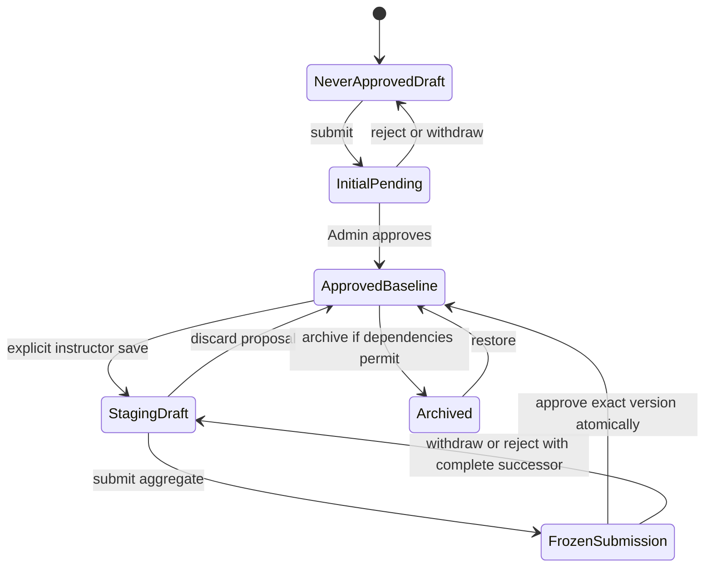

# Course state machine

See the [replacement contract](../implementation/WORKFLOW_SUPERSESSION.md).

Approved baseline includes APPROVED, PUBLISHED and historically approved courses.
Legacy published courses missing approved_at remain review-required. Course
baseline status and aggregate status are separate; no transition resets prior
approval to free authoring. Pending submissions freeze all instructor mutators.
