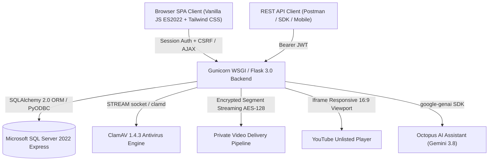

# PWD301 PLATFORM ARCHITECTURE & QUALITY ASSURANCE BASELINE

## 1. High-Level Architectural Model

PWD301 is an enterprise-grade Learning Management System (LMS) and Assessment Platform designed specifically for advanced software development and cybersecurity education. Following the 2026-10-15 architectural transition, PWD301 operates strictly as a **Pure Headless Backend & REST API Platform** paired with an autonomous **Single-Page Application (SPA)** client:



---

## 2. Platform Core Invariants & Guardrails

### 2.1. Pure Headless Transition (Anti-Regression Invariant)
- **Zero Legacy Templates:** All Jinja template directories (`src/pwd301/templates/`), static CSS/JS directories (`src/pwd301/static/`), and prototyping folders (`frontend-preview/`) are permanently eliminated.
- **Machine-Readable JSON Envelopes:** All 432 endpoints across 17 blueprints serve uniform JSON payloads:
  ```json
  {
    "success": true,
    "data": { ... },
    "error": null
  }
  ```
  On failure:
  ```json
  {
    "success": false,
    "data": null,
    "error": {
      "code": "INVALID_CREDENTIALS",
      "message": "Email hoặc mật khẩu không chính xác.",
      "field_errors": {},
      "correlation_id": "a98dfb..."
    }
  }
  ```

### 2.2. Dual Authentication Mechanism
1. **Web SPA Sessions:** Authenticated via HttpOnly, SameSite=Lax Flask session cookies with cryptographic CSRF token validation (`X-CSRFToken` header / cookie token synchronization).
2. **REST API Clients:** Authenticated via short-lived PyJWT Bearer tokens issued via `/api/auth/token` with cryptographic signing and revocation tracking.

### 2.3. Anti-Tamper Security Shield & Fail-Closed Protection
- **Global Key Interception:** Interception of F12, Ctrl+Shift+I/J/C, Ctrl+U, PrintScreen, and Win+Shift+S across all authenticated views.
- **Automated Revocation:** High-confidence tampering confirmation displays a full-screen Blackout Shield ("🛡️ CẢNH BÁO AN NINH HỆ THỐNG"), triggers server-side session revocation (`POST /auth/logout`), clears local storage/tokens, and redirects to `#/auth`.

### 2.4. Video Protection & Standard 16:9 Player Viewport
- Standard 16:9 aspect ratio (`aspect-video`, 100% width, 100% height, zero crop) across Student Learning, Instructor Preview, Course Hero Trailer, and Admin Review.
- Cover Poster Shield concealing players prior to explicit user interaction.
- Pacing engine allowing seek unlock in the final 5 seconds ($currentTime \ge Duration - 5s$).
- 12-hour short-lived AES-128 DRM streaming keys.

### 2.5. Strict 50MB Non-Archive Attachment Policy
- Maximum attachment size: 50 MB (`50_000_000` bytes).
- Permitted types: PDF, Word (.docx/.doc), Excel (.xlsx/.xls), PowerPoint (.pptx/.ppt), Plain Text (.txt), CAD (.dwg/.dxf), 3D Models (.obj/.fbx/.stl/.blend/.step/.stp/.gltf/.glb).
- Forbidden types: `.zip`, `.rar`, `.7z`, `.tar`, `.gz`, `.bz2`, `.xz`, `.iso` rejected with exact Vietnamese message:
  `"Hệ thống không hỗ trợ tệp nén (.zip, .rar, .7z...). Vui lòng tải trực tiếp tài liệu học tập (PDF, Word, Excel, CAD, 3D...)"`.

### 2.6. Single Active Editing Lease (Algorithm 07)
- Exclusive single-tab editing leases with cryptographic tokens for all assessment attempts.
- Multi-tab takeover immediately fences stale browser instances.
- Ordered autosave sequence enforcement (`client_sequence`).
- Idempotent submission guarantee.

---

## 3. Technology Stack & Runtime Matrix

| Layer | Component | Version / Specification | Configuration / Role |
|---|---|---|---|
| **Runtime OS** | Windows 11 / Ubuntu 22.04 LTS (Container) | Docker Desktop 28.0 | Containerized Production Staging |
| **Backend Framework** | Flask (Python 3.12) | Flask 3.0.3, SQLAlchemy 2.0.35 | Pure Headless REST API |
| **WSGI Server** | Gunicorn | Gunicorn 22.0.0 | High-performance multi-worker server |
| **Database** | Microsoft SQL Server Express 2022 | CU27-ubuntu-22.04 (Port 1433) | Relational Storage & Rowversion Locks |
| **Antivirus Scanner**| ClamAV Daemon | ClamAV 1.4.3 (Port 3310) | Realtime fail-closed file scanning |
| **Frontend Client** | Single-Page Application (SPA) | Vanilla JS ES2022 + Tailwind CSS CDN | Warm Editorial Typography & UI Components |
| **Browser Engine** | Google Chrome | Chrome 155 via Playwright Sync API | Real Browser E2E Automation Engine |
| **AI Integration** | Octopus AI Assistant | Google Gemini 3.8 (`google-genai`) | RAG-assisted contextual tutor |
