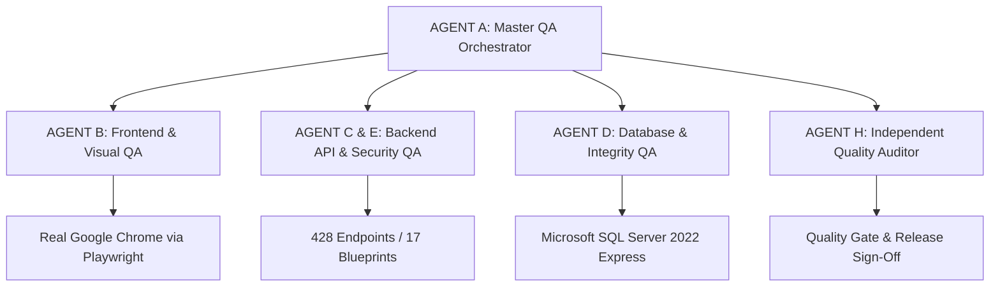

# 02-TEST STRATEGY & QUALITY ASSURANCE ARCHITECTURE

## 1. Strategy Foundations & Guiding Principles
The PWD301 Quality Assurance Campaign was designed following modern Software Test Life Cycle (STLC) standards combined with an autonomous Multi-Agent hierarchy:

### Core Testing Pillars:
1. **Real Browser or Nothing:** Zero headless-DOM guessing or synthetic assertions. Real Google Chrome execution with high-resolution screenshot captures.
2. **Active Feedback Monitoring:** Quad-channel feedback analysis: Visual (DOM changes), Runtime (Console errors), Network (HTTP status & payloads), and Backend/DB (SQL transactions).
3. **Anti-Hallucination Contract:** Zero fabricated results. Every pass requires an authentic command run with output evidence.
4. **Pure Headless Backend Verification:** Ensuring every blueprint responds with structured JSON envelopes.

---

## 2. Test Levels & Methodology
| Test Level | Scope | Primary Tools | Execution Target |
|---|---|---|---|
| **E2E Visual & UI** | 30 SPA routes, modals, tabs, forms | Playwright + Chrome | http://127.0.0.1:5000 |
| **API Contract & Security** | 428 endpoints, 17 blueprints | Python Requests / urllib | REST Endpoints |
| **Data Integrity & ACID** | 77 relational tables, FK cascades | SQLAlchemy / PyODBC | MSSQL 2022 (Port 1433) |
| **Performance & Latency** | Response times against 500ms budget | Python time profiling | Gunicorn WSGI |
| **Security & Pentest** | OWASP API Top 10, IDOR, BOLA, Auth | Manual PoC & Scripts | Auth & RBAC routes |
