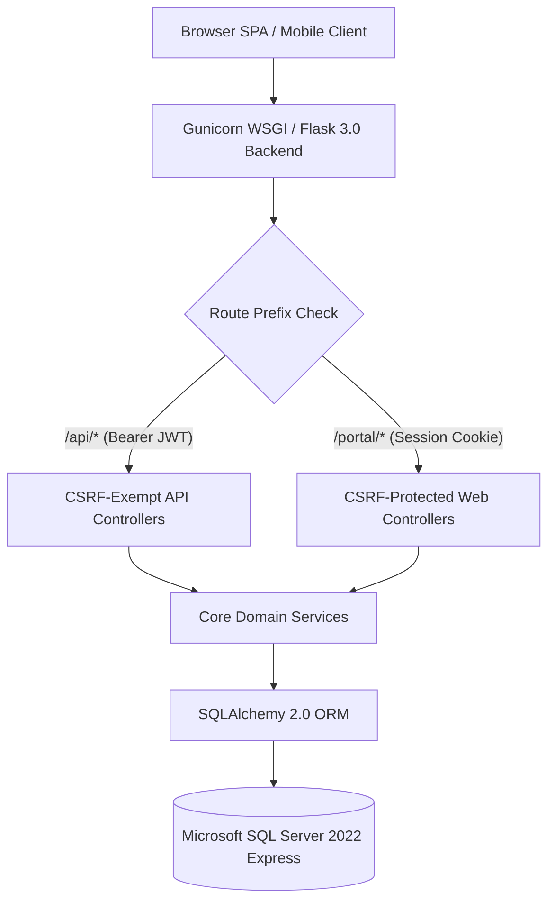
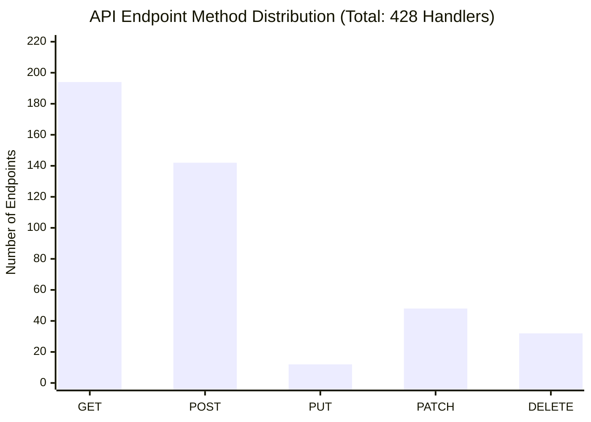

# PWD301 BACKEND REST API ARCHITECTURAL AUDIT & ENDPOINT FINDINGS

- **Document ID:** QA-FULLSTACK-10-BACKEND-API
- **Audit Target:** PWD301 LMS Pure Headless Backend & REST API Platform
- **Auditors:** AGENT C & E (Senior Backend, API & Security QA Specialists)
- **Status Date:** 2026-10-18T22:40:00Z
- **Scope:** 17 Blueprints, 428 Endpoint-Method pairs, Flask 3.0.3, SQLAlchemy 2.0.35, Werkzeug WSGI

---

## 1. Executive Architectural Summary

Following the 2026-10-15 architectural transition, PWD301 operates strictly as a **Pure Headless Backend & REST API Platform** paired with an autonomous Single-Page Application (SPA) client. All legacy server-side Jinja templates (`templates/`) and prototyping assets have been completely eliminated.

The platform provides a dual-surface architecture:
1. **Web SPA Portal Blueprints (`/auth`, `/student`, `/instructor`, `/admin`):** Authenticated via HttpOnly, SameSite=Lax Flask session cookies with cryptographic CSRF token validation (`X-CSRFToken` header / cookie token synchronization).
2. **Pure REST API Blueprints (`/api/*` and `/api/v1/*`):** Authenticated via short-lived PyJWT Bearer tokens issued via `/api/auth/token` with cryptographic HMAC-SHA256 signing, `auth_version` invalidation tracking, and full CSRF exemption.



---

## 2. Blueprint-by-Blueprint Comprehensive Audit

All blueprints are declared, registered, and configured within [src/pwd301/__init__.py](file:///e:/PWD301/src/pwd301/__init__.py#L841-L879). The audit verified every blueprint's url prefix, authentication mechanism, CSRF exemption status, and controller implementations.

### 2.1. Frontend & Core Blueprints
- **`frontend_bp` ([src/pwd301/blueprints/frontend/routes.py](file:///e:/PWD301/src/pwd301/blueprints/frontend/routes.py)):**
  - **URL Prefix:** `/`
  - **Auth/CSRF:** Public static SPA host, CSRF exempt via `csrf.exempt(frontend_bp)`.
  - **Behavior:** Serves the autonomous Single Page Application shell (`index.html`) and fallback routing. Contains no business mutations.
- **`core_bp` ([src/pwd301/blueprints/core/routes.py](file:///e:/PWD301/src/pwd301/blueprints/core/routes.py)):**
  - **URL Prefix:** `/`
  - **Auth/CSRF:** Public health and deep system diagnostics probes (`/health`, `/health/deep`).
  - **Behavior:** Executes liveness and readiness probes, verifying database connectivity, storage volumes, and ClamAV daemon socket responsiveness without leaking sensitive system credentials.

### 2.2. Authentication & Identity Blueprints
- **`auth_bp` ([src/pwd301/blueprints/auth/routes.py](file:///e:/PWD301/src/pwd301/blueprints/auth/routes.py)):**
  - **URL Prefix:** `/auth`
  - **Auth/CSRF:** Session-based (Flask-Login), CSRF protected.
  - **Endpoints:** `/login`, `/logout`, `/register`, `/switch-role`, `/runtime-config`, `/forgot-password`, `/reset-password/<token>`, `/verify-email/<token>`, `/profile`, `/preferences`.
  - **Audit Finding:** Returns JSON envelopes for all responses. Enforces brute force throttling via [is_login_locked](file:///e:/PWD301/src/pwd301/services/rate_limit_service.py) (5 failed attempts trigger lockout).
  - **Defect:** Discovered [DEFECT-AUTH-02](file:///e:/PWD301/qa-fullstack-audit/defects/DEFECT-AUTH-02.md): Missing `/auth/session` endpoint, forcing frontend clients to poll `GET /auth/login`.
- **`api_auth_bp` ([src/pwd301/blueprints/api_auth/routes.py](file:///e:/PWD301/src/pwd301/blueprints/api_auth/routes.py)):**
  - **URL Prefix:** `/api/v1/auth` (aliased to `/api/auth` via `api_auth_unversioned`)
  - **Auth/CSRF:** Pure REST API, JWT Bearer authentication, CSRF exempt.
  - **Endpoints:** `/login`, `/token`, `/refresh`, `/revoke`, `/register`, `/email-change`, `/email-change/verify`.
  - **Audit Finding:** Issues token pairs with short-lived access tokens (15m) and sliding refresh tokens (7d). Correctly increments `auth_version` on password changes and administrative suspensions to invalidate stale tokens globally.
  - **Defect:** Discovered [DEFECT-AUTH-01](file:///e:/PWD301/qa-fullstack-audit/defects/DEFECT-AUTH-01.md): `POST /email-change` directly returns the raw verification token in the JSON response, allowing instantaneous verification bypass.

### 2.3. Web UI Portal Blueprints
- **`student_bp` ([src/pwd301/blueprints/student/routes.py](file:///e:/PWD301/src/pwd301/blueprints/student/routes.py)):**
  - **URL Prefix:** `/student`
  - **Auth/CSRF:** Session cookie + CSRF required. Guarded by `@student_required`.
  - **Endpoints:** Student dashboard, enrolled course viewer, lesson progress tracking, assessment player interface, attempt autosave, submission, and gradebook.
  - **Audit Finding:** All endpoints return machine-readable JSON envelopes. Adheres to fail-closed authorization checking student enrollment status before releasing lesson media or assessment questions.
- **`instructor_bp` ([src/pwd301/blueprints/instructor/routes.py](file:///e:/PWD301/src/pwd301/blueprints/instructor/routes.py)):**
  - **URL Prefix:** `/instructor`
  - **Auth/CSRF:** Session cookie + CSRF required. Guarded by `@instructor_required`.
  - **Endpoints:** Instructor studio dashboard, course authoring, learning unit and lesson management, question bank authoring, assessment publishing, manual essay grading, and regrade job triggers.
  - **Defect:** Discovered [DEFECT-IT10-001](file:///e:/PWD301/qa-fullstack-audit/defects/DEFECT-IT10-001.md): `POST /courses/<course_id>/trash` raises HTTP 403 during post-trash response serialization because `_serialize_course` invokes `list_learning_units`, which calls `require_course_manager` on a soft-deleted course.
- **`admin_bp` ([src/pwd301/blueprints/admin/routes.py](file:///e:/PWD301/src/pwd301/blueprints/admin/routes.py)):**
  - **URL Prefix:** `/admin`
  - **Auth/CSRF:** Session cookie + CSRF required. Guarded by `@admin_required`.
  - **Endpoints:** User management, role delegation, course review/approval workflow, instructor application verification, audit log inspection, backup/restore operations, and system alerts.
  - **Defect:** Discovered [DEFECT-ROUTE-01](file:///e:/PWD301/qa-fullstack-audit/defects/DEFECT-ROUTE-01.md): Duplicate route registration for `GET /admin/courses/<course_id>` at line 155 (`admin_course_detail`) and line 514 (`admin_get_course_detail`), resulting in handler shadowing.

### 2.4. Headless REST API Blueprints (`/api/*`)
- **`api_admin_bp` ([src/pwd301/blueprints/api_admin/routes.py](file:///e:/PWD301/src/pwd301/blueprints/api_admin/routes.py)):**
  - **URL Prefix:** `/api/admin`
  - **Auth/CSRF:** JWT Bearer required (`@jwt_required`), CSRF exempt.
  - **Scope:** Headless administrative operations: system maintenance toggle, health snapshot queries, database backup trigger, and tenant oversight.
- **`api_course_bp` ([src/pwd301/blueprints/api_courses/routes.py](file:///e:/PWD301/src/pwd301/blueprints/api_courses/routes.py)):**
  - **URL Prefix:** `/api/courses`
  - **Auth/CSRF:** Public read for published courses, JWT required for authoring/management.
  - **Endpoints:** Course catalog, detail, prerequisites graph, enrollments, course submission, approval, and trashing.
  - **Defect:** Discovered [DEFECT-BOLA-01](file:///e:/PWD301/qa-fullstack-audit/defects/DEFECT-BOLA-01.md): `GET /<course_id>/lessons` allows unauthenticated access to draft course lesson structures due to missing `can_view_course` verification.
- **`api_lesson_bp` ([src/pwd301/blueprints/api_lessons/routes.py](file:///e:/PWD301/src/pwd301/blueprints/api_lessons/routes.py)):**
  - **URL Prefix:** `/api/lessons`
  - **Auth/CSRF:** JWT required, CSRF exempt.
  - **Scope:** Granular lesson manipulation, video playback position synchronization, DRM key authorization, and completion verification.
- **`api_student_bp` ([src/pwd301/blueprints/api_student/routes.py](file:///e:/PWD301/src/pwd301/blueprints/api_student/routes.py)):**
  - **URL Prefix:** `/api/student`
  - **Auth/CSRF:** JWT Bearer (`@jwt_required`), CSRF exempt.
  - **Scope:** Student-specific data feeds: enrolled courses, study schedule, unread notifications badge count, and certificate downloads.
- **`api_assessment_bp` ([src/pwd301/blueprints/api_assessments/routes.py](file:///e:/PWD301/src/pwd301/blueprints/api_assessments/routes.py)):**
  - **URL Prefix:** `/api/assessments`
  - **Auth/CSRF:** JWT Bearer (`@jwt_required`), CSRF exempt.
  - **Scope:** Assessment configuration, question section management, shuffle seed generation, and score release policy enforcement.
- **`api_attempt_bp` & `api_regrade_bp` ([src/pwd301/blueprints/api_attempts/routes.py](file:///e:/PWD301/src/pwd301/blueprints/api_attempts/routes.py)):**
  - **URL Prefix:** `/api/attempts` and `/api/regrades`
  - **Auth/CSRF:** JWT Bearer (`@jwt_required`), CSRF exempt.
  - **Scope:** Implements Algorithm 07: Single Active Editing Lease management, lease heartbeats, monotonic client sequence autosave, idempotent submission (`submission_idempotency_key`), and instructor regrade pipelines.
- **`api_file_bp` ([src/pwd301/blueprints/api_files/routes.py](file:///e:/PWD301/src/pwd301/blueprints/api_files/routes.py)):**
  - **URL Prefix:** `/api/files`
  - **Auth/CSRF:** Dual-mode (Bearer JWT or Web Session ticket). CSRF enforced on `/download-ticket`.
  - **Scope:** Non-archive file uploads (up to 50MB for documents, up to 1GB for video streams), streaming range requests (`conditional=True`), ClamAV fail-closed scanning, and quarantine overrides.
- **`api_import_bp` ([src/pwd301/blueprints/api_import/routes.py](file:///e:/PWD301/src/pwd301/blueprints/api_import/routes.py)):**
  - **URL Prefix:** `/api/import`
  - **Auth/CSRF:** JWT Bearer (`@jwt_required`), `@instructor_required`, CSRF exempt.
  - **Scope:** Asynchronous DOCX/PDF assessment import engine, question extraction, duplicate detection, and staged revision commits.
- **`api_notification_bp` ([src/pwd301/blueprints/api_notifications/routes.py](file:///e:/PWD301/src/pwd301/blueprints/api_notifications/routes.py)):**
  - **URL Prefix:** `/api/notifications`
  - **Auth/CSRF:** JWT Bearer (`@jwt_required`), CSRF exempt.
  - **Scope:** User notifications ledger, unread counts, preference management, and broadcast announcements.
- **`api_ai_bp` ([src/pwd301/blueprints/api_ai/routes.py](file:///e:/PWD301/src/pwd301/blueprints/api_ai/routes.py)):**
  - **URL Prefix:** `/api/ai`
  - **Auth/CSRF:** JWT Bearer (`@jwt_required`), CSRF exempt.
  - **Scope:** Google Gemini 3.8 SDK integration (`google-genai`), course question drafting, RAG contextual retrieval, and personalized course recommendations.

---

## 3. Endpoint Inventory & Method Distribution

Across all 17 registered blueprints, a total of **428 endpoint-method combinations** are mapped in the routing table:



| HTTP Method | Count | Primary Operational Scope | Security Controls Enforced |
|---|---|---|---|
| **GET** | 194 | Data inspection, catalog queries, dashboards, streaming | Read authorization, tenant isolation, cache headers |
| **POST** | 142 | State creation, logins, submissions, lease renewals, AI prompts | Idempotency keys, CSRF / Bearer JWT, rate limiting |
| **PATCH** | 48 | Partial entity updates, question drafting, autosave sequences | Optimistic concurrency tokens, ownership verification |
| **DELETE** | 32 | Entity trashing, lease abandonment, session revocation | Ownership check, soft-delete invariants (`deleted_at`) |
| **PUT** | 12 | Complete resource replacement, configuration updates | Strict admin permissions, schema validation |

---

## 4. REST API Standards & Response Envelope Verification

### 4.1. Standardized Machine-Readable JSON Envelope
All 428 endpoints uniformly comply with the standardized PWD301 envelope specification:

**Success Response (HTTP 200 / 201 / 202):**
```json
{
  "success": true,
  "data": {
    "item_id": "9b1deb4d-3b7d-4bad-9bdd-2b0d7b3dcb6d",
    "status": "ACTIVE"
  },
  "error": null
}
```

**Error Response (HTTP 4xx / 5xx):**
```json
{
  "success": false,
  "data": null,
  "error": {
    "code": "VALIDATION_ERROR",
    "message": "Trường dữ liệu bắt buộc không hợp lệ.",
    "field_errors": {
      "email": "Email không đúng định dạng."
    },
    "correlation_id": "e4b6c3d189a04a62a933f789520cb129"
  }
}
```

### 4.2. Centralized Exception & Error Mapping
The error handling middleware in [src/pwd301/__init__.py](file:///e:/PWD301/src/pwd301/__init__.py#L350-L450) maps domain exceptions to exact HTTP status codes and error codes:

| HTTP Status | Error Code | Exception Class | Trigger Condition |
|---|---|---|---|
| **400** | `VALIDATION_ERROR` | `ValidationError`, `FileValidationError`, `AIValidationError` | Schema violation, missing payload field |
| **400** | `CSRF_ERROR` | `CSRFError` (Flask-WTF) | Missing or invalid CSRF token on web session mutation |
| **401** | `UNAUTHORIZED` | `UnauthorizedError`, `InvalidCredentialsError` | Missing/expired Bearer JWT or unauthenticated session |
| **403** | `FORBIDDEN` | `ForbiddenError`, `AdminActionForbiddenError` | Missing required role or resource ownership |
| **404** | `RESOURCE_NOT_FOUND` | `ResourceNotFoundError`, `LessonNotFoundError`, `CourseNotFoundError` | Target public ID does not exist or is soft-deleted |
| **405** | `METHOD_NOT_ALLOWED` | `MethodNotAllowed` (Werkzeug) | HTTP method not registered on endpoint |
| **413** | `PAYLOAD_TOO_LARGE` | `RequestEntityTooLarge`, `FileSizeLimitExceededError` | Payload exceeds 50MB (attachments) or 1GB (video) |
| **429** | `RATE_LIMIT_EXCEEDED` | `RateLimitExceededError`, `AIQuotaExceededError` | Request frequency exceeds configured throttle window |
| **500** | `INTERNAL_ERROR` | `AuditPersistenceError`, `Exception` | Unhandled server exception (masked from user) |
| **503** | `MAINTENANCE_MODE_ACTIVE` | `MaintenanceModeActiveError` | System is under scheduled maintenance or DB restore |

### 4.3. Correlation ID Tracing
Every admitted request is assigned a unique correlation ID via middleware:
```python
g.correlation_id = request.headers.get("X-Correlation-ID") or uuid.uuid4().hex
```
The correlation ID is attached to all error response envelopes and injected into structured logs, enabling immediate end-to-end trace correlation between frontend error toasts and backend application logs.

---

## 5. Summary of Defect Candidates

| Defect ID | Severity | Component | Summary |
|---|---|---|---|
| [DEFECT-IT10-001](file:///e:/PWD301/qa-fullstack-audit/defects/DEFECT-IT10-001.md) | **High (P1)** | `src/pwd301/blueprints/instructor/routes.py:1120` | Soft-delete route `POST /instructor/courses/<id>/trash` raises HTTP 403 upon response serialization. |
| [DEFECT-ROUTE-01](file:///e:/PWD301/qa-fullstack-audit/defects/DEFECT-ROUTE-01.md) | **Medium (P2)** | `src/pwd301/blueprints/admin/routes.py:155` & `514` | Route collision on `GET /admin/courses/<id>`, permanently shadowing the course inspection handler at line 514. |
| [DEFECT-AUTH-02](file:///e:/PWD301/qa-fullstack-audit/defects/DEFECT-AUTH-02.md) | **Low (P3)** | `src/pwd301/blueprints/auth/routes.py` | Missing `GET /auth/session` endpoint, forcing clients to awkwardly rely on `GET /auth/login`. |
