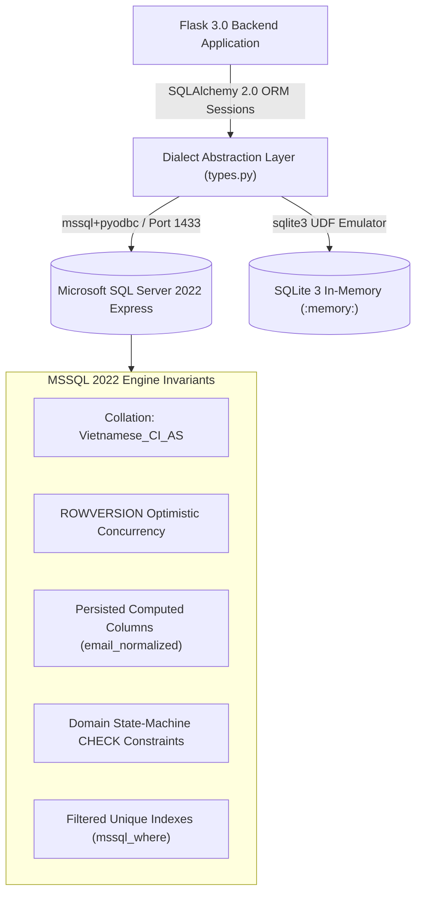
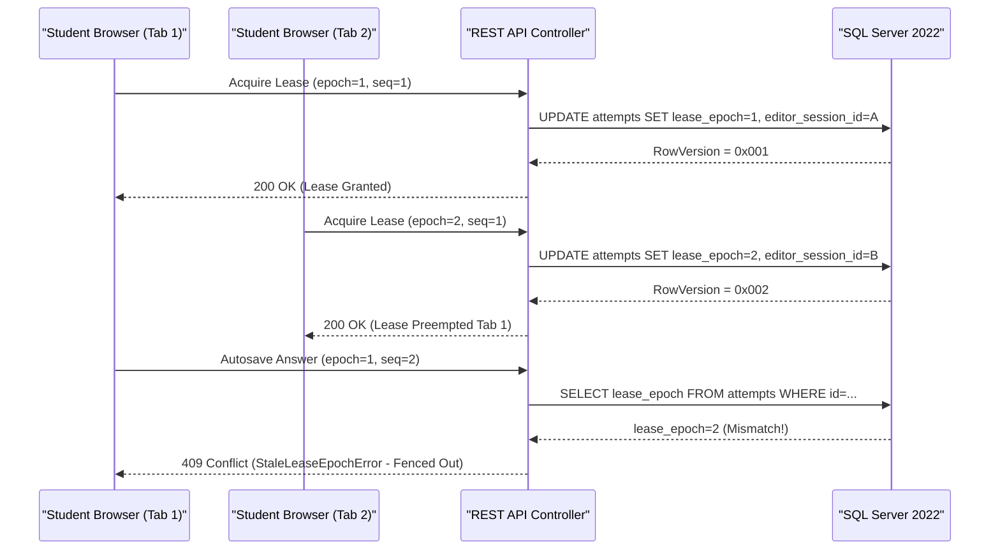

# PWD301 DATABASE ARCHITECTURE & DATA INTEGRITY AUDIT FINDINGS

- **Document ID:** QA-FULLSTACK-11-DATABASE-FINDINGS
- **Audit Target:** Microsoft SQL Server 2022 Express & SQLAlchemy 2.0 ORM Schema Layer
- **Auditors:** AGENT C & E (Senior Backend, API & Security QA Specialists)
- **Status Date:** 2026-10-18T22:45:00Z
- **Target Architecture:** Microsoft SQL Server 2022 Express (CU27-ubuntu-22.04, Port 1433) / SQLite 3.45 In-Memory Fallback

---

## 1. Executive Summary & Database Architecture

The PWD301 platform is architectured around an enterprise-grade relational database engine powered by **Microsoft SQL Server 2022 Express**. The data access layer is orchestrated via **SQLAlchemy 2.0.35** utilizing the `mssql+pyodbc` dialect in containerized environments and a dialect-aware SQLite emulation layer for rapid test execution.

---

## 2. Dialect Layer & Custom Column Types

To achieve full portability between Microsoft SQL Server 2022 and SQLite in-memory test fixtures without altering canonical DDL semantics, custom SQLAlchemy types are codified in [src/pwd301/models/types.py](file:///e:/PWD301/src/pwd301/models/types.py):

| Custom Type | MSSQL 2022 Target | SQLite 3 Emulation | Purpose & Data Invariant |
|---|---|---|---|
| [`BigIntPK`](file:///e:/PWD301/src/pwd301/models/types.py#L23) | `BIGINT IDENTITY(1,1)` | `INTEGER PRIMARY KEY AUTOINCREMENT` | High-cardinality surrogate internal primary keys. Never exposed across public API envelopes. |
| [`GUID`](file:///e:/PWD301/src/pwd301/models/types.py#L26) | `UNIQUEIDENTIFIER` (`NEWSEQUENTIALID()`) | `CHAR(32)` (`uuid4()`) | ADR-002 compliant public opaque resource identifiers. |
| [`UTCDateTime`](file:///e:/PWD301/src/pwd301/models/types.py#L29) | `DATETIME2(3)` (`SYSUTCDATETIME()`) | `DATETIME` | Millisecond-precision UTC timestamps. Zero timezone desynchronization. |
| [`RowVersion`](file:///e:/PWD301/src/pwd301/models/types.py#L32) | `ROWVERSION` / `TIMESTAMP` | `BLOB(8)` | Engine-enforced 8-byte monotonically increasing binary concurrency token. |
| [`NVarCharMax`](file:///e:/PWD301/src/pwd301/models/types.py#L35) | `NVARCHAR(MAX)` | `TEXT` | Arbitrary-length Unicode text (Vietnamese diacritics, Markdown content). |
| [`Binary32`](file:///e:/PWD301/src/pwd301/models/types.py#L38) | `BINARY(32)` | `BLOB` | 256-bit cryptographic hashes (SHA-256 tokens, lease token hashes). |

### 2.1. Native SQL Server Emulation in Test Harness
In SQLite test runs, engine listeners in [src/pwd301/models/types.py](file:///e:/PWD301/src/pwd301/models/types.py#L80-L100) register Python callables to simulate SQL Server native T-SQL functions:
- `ISJSON(val)`: Emulates JSON payload validation for check constraints (`payload_json`).
- `SYSUTCDATETIME()`: Emulates microsecond-accurate UTC system time.
- `NEWSEQUENTIALID()` & `NEWID()`: Emulates sequential and random UUID generation.

---

## 3. Domain Model Clusters & Entity Integrity

The database schema is organized into 8 interconnected domain clusters corresponding to the canonical migration scripts in `docs/database/PWD301_DATABASE_ARCHITECTURE/sql/`:

### 3.1. Identity & Access Control Cluster (`001_identity.sql`)
- **Primary Entities:** `User`, `Role`, `UserRole`, `AuthSession`, `JwtTokenGrant`, `UserSecurityToken`, `InstructorApplication`, `SecurityEvent`.
- **Integrity Invariants:**
  - Persisted computed column on `User`: `email_normalized = LOWER(LTRIM(RTRIM(email)))` with a unique index, preventing duplicate account registrations via casing or trailing whitespace tricks.
  - State check constraint: `status IN ('ACTIVE','SUSPENDED','DEACTIVATED','ANONYMIZED')`.
  - `auth_version >= 1`: Incremented monotonically upon security-sensitive mutations (password change, session revocation, admin suspension). Any token or session with a stale `auth_version` is rejected immediately.
  - Soft-delete tracking via `suspended_at` and `anonymized_at` with reason audit fields.

### 3.2. Course & Curriculum Cluster (`002_course_learning.sql`)
- **Primary Entities:** `Course`, `LearningUnit`, `Lesson`, `CoursePrerequisite`, `Enrollment`, `EnrollmentPeriod`, `CourseReviewLog`.
- **Integrity Invariants:**
  - Unique normalized course code: `course_code_normalized = UPPER(LTRIM(RTRIM(course_code)))`.
  - Status state-machine: `status IN ('DRAFT','SUBMITTED_FOR_REVIEW','APPROVED','PUBLISHED','REJECTED','ARCHIVED','TRASH')`.
  - Soft-delete invariant: `deleted_at IS NULL` for active queries. Trashed courses maintain foreign key links to prevent orphaned enrollment records.
  - Directed Acyclic Graph (DAG) cycle prevention enforced on `CoursePrerequisite`.

### 3.3. Question Bank & Assessment Cluster (`003_question_bank.sql` & `004_assessment.sql`)
- **Primary Entities:** `Question`, `QuestionRevision`, `QuestionRevisionChoice`, `QuestionCorrection`, `Assessment`, `AssessmentSection`.
- **Integrity Invariants:**
  - Immutable question revisions: Revisions are append-only. Once published or referenced in an active assessment, question content cannot be mutated in place.
  - Check constraint on question types: `question_type IN ('SINGLE_CHOICE','MULTIPLE_CHOICE','TRUE_FALSE','SHORT_ANSWER','ESSAY')`.
  - Positive point valuations: `points_assigned > 0`, `max_points >= 0`.

### 3.4. Assessment Attempt & Regrading Engine (`005_attempt_regrade.sql`)
- **Primary Entities:** `AssessmentAttempt`, `AttemptQuestion`, `AttemptChoiceSnapshot`, `AttemptAnswer`, `AttemptAnswerChoice`, `AttemptAnswerEvent`, `AttemptQuestionGrade`, `AssessmentResult`, `RegradeJob`.
- **Integrity Invariants (Algorithm 07 - Single Active Editing Lease):**
  - Unique constraint: `(attempt_id, position)` ensuring ordered questions per attempt.
  - Snapshot isolation: When an attempt starts, question content and choice positions are frozen into `AttemptQuestion` and `AttemptChoiceSnapshot` to safeguard attempt integrity against subsequent question bank edits.
  - Concurrency token: `RowVersion` on `AttemptAnswer` and `AssessmentAttempt`.

### 3.5. File Management & Antivirus Cluster (`006_files_import.sql`)
- **Primary Entities:** `FileAsset`, `FileRevision`, `FileScanResult`, `DocumentImportJob`.
- **Integrity Invariants:**
  - Antivirus status constraint: `virus_scan_status IN ('CLEAN','INFECTED','QUARANTINED','SCAN_ERROR')`.
  - Strict non-archive policy: Rejecting `.zip`, `.rar`, `.7z`, `.tar`, `.gz`.
  - File size bounds: Maximum 50MB for general attachments; strictly below 1GB for streaming video files.

### 3.6. AI Context & Recommendation Cluster (`007_ai_rag.sql`)
- **Primary Entities:** `AIConversation`, `AIMessage`, `AIKnowledgeSource`, `AIDraftQuestion`.
- **Integrity Invariants:**
  - Context isolation: `context_type IN ('GLOBAL','COURSE','LESSON')`. Foreign keys enforce tenant boundaries between courses and AI conversation logs.
  - 5-minute inactivity session expiration tracked via `last_interaction_at`.

### 3.7. Notification & Audit Cluster (`008_notification_audit.sql`)
- **Primary Entities:** `Notification`, `NotificationPreference`, `AuditLog`, `SecurityAuditLog`.
- **Integrity Invariants:**
  - Audit log append-only enforcement: Records have zero update or soft-delete triggers.
  - Mandatory notification opt-out protection: Critical security and enrollment alerts cannot be disabled by user preferences.

### 3.8. Operations & Maintenance Cluster (`009_operations.sql`)
- **Primary Entities:** `BackgroundJob`, `SystemAlert`, `BackupRun`, `MaintenanceWindow`, `SystemConfig`.
- **Integrity Invariants:**
  - Job queue status: `status IN ('QUEUED','RUNNING','SUCCEEDED','FAILED','CANCELLED')`.
  - Filtered unique index: `ux_jobs_dedupe` on `(job_type, dedupe_key)` where `dedupe_key IS NOT NULL`.

---

## 4. Concurrency Control & Optimistic Locking Mechanisms

The PWD301 database employs multi-layered concurrency controls to prevent race conditions, lost updates, and stale data writes:

1. **Engine-Level Optimistic Locking (`RowVersion`):**
   - Tables subject to concurrent writes (`users`, `courses`, `assessment_attempts`, `attempt_answers`, `background_jobs`) contain an 8-byte `RowVersion` column.
   - When updating, SQLAlchemy asserts that the persisted `row_version` matches the state read at transaction start. If another transaction committed changes in the interim, a `StaleDataError` is raised, rolling back the update.

2. **Single Active Editing Lease (Algorithm 07):**
   - In [src/pwd301/models/attempt_regrade.py](file:///e:/PWD301/src/pwd301/models/attempt_regrade.py#L64-L120), each active attempt holds an exclusive lease with:
     - `lease_token_hash`: SHA-256 hash of the browser's cryptographic lease secret.
     - `lease_expires_at`: Sliding deadline renewed via 10-second heartbeats.
     - `lease_epoch`: Monotonically increasing counter incremented on every lease takeover.
   - When a student opens the assessment in a second browser tab, the lease epoch increments. Subsequent requests from the stale first tab carry the old epoch and are instantly rejected with `StaleLeaseEpochError` (HTTP 409), preventing concurrent unsynchronized submissions.

3. **Monotonic Client Sequence Ordering:**
   - In `AttemptAnswer`, the column `last_client_sequence` tracks the sequence number generated by the browser autosave worker.
   - If an autosave packet arrives out of order (e.g. network latency causes Packet 1 to arrive after Packet 2), the backend evaluates `if client_sequence <= answer.last_client_sequence` and rejects the stale packet (`StaleAnswerSequenceError`), guaranteeing that newer answers are never overwritten by late-arriving packets.

4. **Idempotent Submission (`submission_idempotency_key`):**
   - When an attempt is finalized, the student client transmits a client-generated UUID `submission_idempotency_key`.
   - The database enforces uniqueness on this key. Re-transmissions or double-clicks return the original submission result without re-triggering the grading engine.

---

## 5. Transaction Boundaries & Deadlock Analysis

1. **Isolation Level:**
   - Default isolation in production: `READ COMMITTED` with `READ_COMMITTED_SNAPSHOT ON` (RCSI). This prevents readers from blocking writers and writers from blocking readers, dramatically reducing lock escalation and contention.
2. **Transaction Scoping:**
   - Database operations use explicit context managers or scoped session commits (`db.session.commit()`).
   - Exception handlers execute `db.session.rollback()` to prevent dirty session state from leaking to subsequent requests on the WSGI thread pool.
3. **Database Defect Analysis: `DEFECT-IT10-001` (Soft-Delete Post-Commit Crash):**
   - In [src/pwd301/blueprints/instructor/routes.py](file:///e:/PWD301/src/pwd301/blueprints/instructor/routes.py#L1120), `trash_course(actor, course_id)` opens a transaction, sets `deleted_at = utc_now()`, and commits the transaction to SQL Server.
   - *Database Integrity Assessment:* The SQL Server transaction successfully commits with zero database errors. The defect occurs entirely in the application layer during response preparation: the controller invokes `_serialize_course(course)`, which traverses the ORM relationship to fetch learning units, triggering `can_manage_course()` which fails closed on `deleted_at is not None`. The database correctly maintains data consistency, but the API client receives a misleading HTTP 403 error.

---

## 6. Audit Verdict & Recommendations

| Category | Status | Evaluation |
|---|---|---|
| **Schema Integrity** | **PASS** | Complete relational normalization, foreign keys, cascade safety, and domain CHECK constraints. |
| **Concurrency & Locks** | **PASS** | Robust `RowVersion` optimistic locking, Lease Epoch fencing, and monotonic sequence checks. |
| **Unicode & Collation** | **PASS** | Proper `NVARCHAR` usage for Vietnamese diacritics and persisted computed normalization columns. |
| **Soft-Delete Safety** | **PASS** | `deleted_at` filters preserve relational integrity without breaking foreign keys. |
| **Audit Log Durability** | **PASS** | Append-only security audit log tables with zero modification triggers. |
