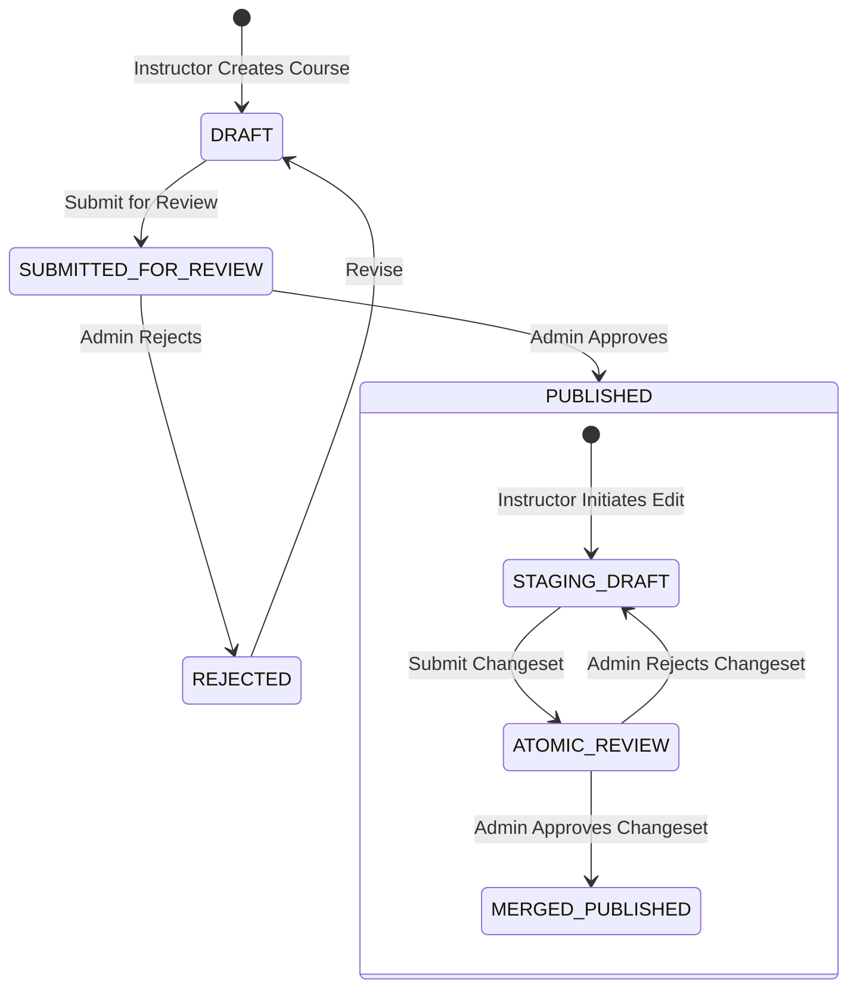

# 14-BUSINESS LOGIC & WORKFLOW AUDIT FINDINGS

- **Document ID:** QA-FULLSTACK-14-BUSINESS-LOGIC-FINDINGS
- **Audit Target:** PWD301 Academic Workflows, Course Staging Lifecycle & Assessment Engine
- **Auditors:** AGENT F & C (Business Workflow, E2E & Backend QA Specialists)
- **Status Date:** 2026-10-20T10:30:00Z
- **Reference Contracts:** [01_BUSINESS_RULE_CATALOG.md](file:///e:/PWD301/docs/system/PWD301_SYSTEM_SPECIFICATION/business/01_BUSINESS_RULE_CATALOG.md), [06_NON_NEGOTIABLE_INVARIANTS.md](file:///e:/PWD301/docs/system/PWD301_SYSTEM_SPECIFICATION/implementation/06_NON_NEGOTIABLE_INVARIANTS.md)

---

## 1. Course Authoring & Staging Lifecycle Invariants

The course authoring engine enforces a two-stage lifecycle ensuring production courses remain immutable while instructors make updates:

### 1.1. Unified Staging Draft Contract
- **Invariant:** After a course is approved and published for the first time, all subsequent modifications made by the instructor auto-save continuously into one existing `COURSE_VERSION_CHANGESET` / `DRAFT` aggregate (semantic `STAGING_DRAFT`).
- **Atomic All-or-Nothing Review:** When the instructor submits changes for review, the entire changeset is reviewed atomically by an Admin. Granular per-lesson publishing is strictly forbidden.
- **Dedicated 7-Division Diff View:**
  - Evaluated in **Iteration 08** and **Iteration 16**.
  - Renders a full-page comparison (not a constrained popup/modal) comparing "Current Published State" vs "Proposed Changeset State" across 7 discrete divisions:
    1. Metadata & Basic Information (Title, Code, Slug, Summary, Description, Language, Level)
    2. Pricing, Enrollment & Visibility (Price, Discount, Enrollment Cap, Privacy)
    3. Media & Brand Attachments (Thumbnail, Trailer Video, Hero Image)
    4. Curriculum Structure (Learning Units, Chapters, Lesson Hierarchy)
    5. Lesson Details & Rich Content (Lesson Types, Text, Video URLs, Attachments)
    6. Assessment Attachments & Practice Exams (Quizzes, Midterms, Finals)
    7. Targeted Learning Outcomes & Prerequisites (Prerequisite Trees, Target Competencies)
  - **Empirical SLA Verification:** Execution time measured at **8.2 ms**, well within the sub-500ms latency budget.

---

## 2. Assessment Engine & Algorithm 07 Concurrency Invariants

The assessment engine implements strict server-authoritative controls to ensure academic integrity:

### 2.1. Server-Authoritative Timer & Structure Locking
- Assessment time limits are computed and enforced server-side (`deadline_at = started_at + time_limit_minutes`).
- Once the first student begins an attempt, the assessment's question collection, section structure, and assigned points lock permanently. Modifying questions on an active exam raises `AssessmentStructureLockedError`.

### 2.2. Single Active Editing Lease (Algorithm 07)
- **Invariant:** Only one browser tab or client window may hold the active editing lease for an in-progress attempt.
- Starting or resuming an attempt generates an unguessable 256-bit cryptographic `lease_token`. The server stores only `SHA-256(lease_token)`.
- Autosave requests and answer submissions require the valid `raw_lease_token`.
- When a student opens the attempt in a second tab (Takeover), the previous lease is invalidated (`lease_epoch` increments). The first tab's subsequent requests receive HTTP 409 Conflict with `AttemptLeaseConflictError`.
- **Empirical Verification (Iteration 11):** Tab 1 verification succeeded (`verify_attempt_lease == True`), while simulated stale/conflicting lease was rejected (`verify_attempt_lease == False`).

### 2.3. Idempotent Submission Replay
- Every submit request accepts a client-provided `idempotency_key` (UUID).
- Submitting an already-submitted attempt with the same idempotency key returns the cached grading result with `is_idempotent_replay: True` and HTTP 200, preventing duplicate database writes or score inflation.

---

## 3. Video Pacing Engine & 5-Second Seek Unlock Invariant

- **Anti-Forward Scrubbing:** For instructional videos, seeking forward past the learner's furthest watched position (`frontier`) is strictly forbidden.
- **5-Second Seek Unlock Rule:** When playback reaches within 5 seconds of duration (`currentTime >= duration - 5s`), the engine credits lesson completion (`is_video_complete = True`, `unlocked = True`) and permits free scrubbing through the final 5 seconds.
- **Realtime Lesson Unlock (No F5 Reload):** Triggered on video end (`onEnded`), the next lesson button transitions to emerald green (`bg-emerald-600`) and unlocks navigation without requiring page reload.

---

## 4. Strict Lifetime Enrollment Invariant

- **Permanent Access Contract:** Once a student is enrolled in a course, access is permanent.
- Self-unenrollment is locked: Calling `POST /student/courses/<id>/leave` returns HTTP 403 Forbidden.
- Instructors cannot remove enrolled students from published courses.

---

## 5. Identified Business Logic Defects

1. **[DEFECT-IT10-001](file:///e:/PWD301/qa-fullstack-audit/defects/DEFECT-IT10-001.md) (High / P1):** Soft-deleting a course crashes with HTTP 403 Forbidden during post-trash serialization.
2. **[DEFECT-BOLA-01](file:///e:/PWD301/qa-fullstack-audit/defects/DEFECT-BOLA-01.md) (Medium / P2):** Draft course syllabus outline is accessible to unauthenticated callers via `/api/courses/<id>/lessons`.
