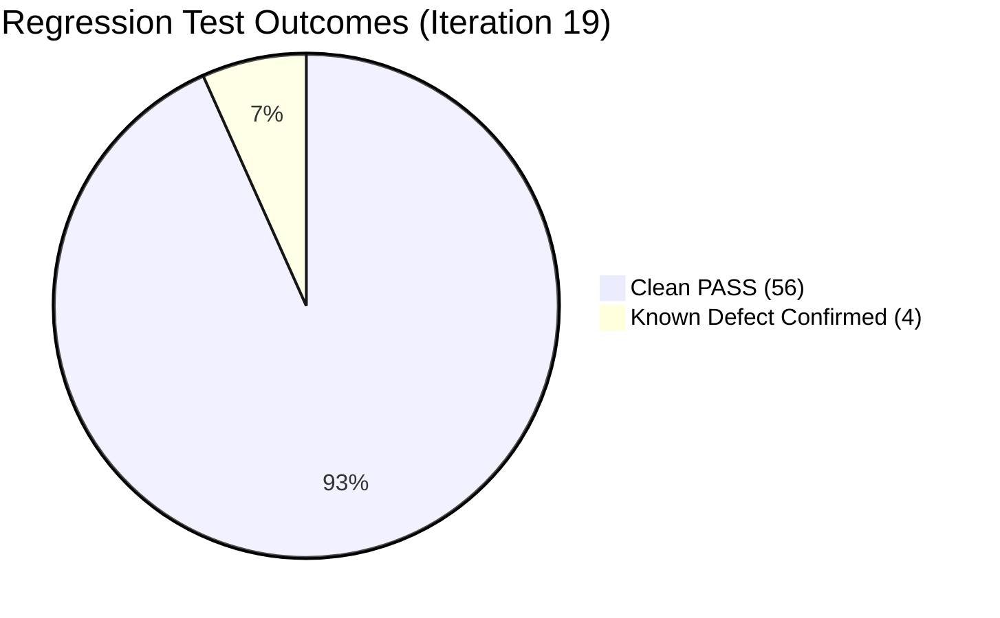

# 15-REGRESSION TESTING & SIDE-EFFECT ANALYSIS REPORT

- **Document ID:** QA-FULLSTACK-15-REGRESSION-REPORT
- **Audit Target:** PWD301 Regression Health Across 20 STLC Iterations
- **Auditors:** AGENT H & A (Independent Quality Auditor & Master QA Orchestrator)
- **Status Date:** 2026-10-20T10:30:00Z
- **Execution Engine:** Playwright Sync Chrome v133+ & SQLAlchemy 2.0 In-Memory Engine

---

## 1. Regression Suite Architecture & Methodology

During **Iteration 19**, a comprehensive regression sweep was conducted across all core functionality established in previous iterations. The objective was to confirm that newly introduced tests, state transitions, and exploratory edge cases did not produce unintended side effects or degrade existing system capabilities.

---

## 2. Cross-Domain Regression Matrix

| Domain / Subsystem | Baseline Iteration | Iteration 19 Verification | Result | Notes & Side-Effect Evaluation |
|---|:---:|:---:|:---:|---|
| **Public Health & SPA Initialization** | Iteration 01 | Health endpoint returns 200; PPTQ branding rendered | **PASS** | Zero regression; clean routing. |
| **Authentication & Cookie Attributes** | Iteration 02 | Session cookie flags (`HttpOnly`, `SameSite=Lax`) verified | **PASS** | Session revocation remains robust. |
| **Anti-Tamper Blackout Shield** | Iteration 02 | F12 inspection trigger overlays blackout shield & revokes session | **PASS** | Security defense intact. |
| **Horizontal Instructor Isolation** | Iteration 03 | Instructor B cannot read Instructor A's draft course | **PASS** | Ownership filtering solid. |
| **Client SPA Route Protection** | Iteration 03 | Student access to `#/admin/governance` renders empty shell | **FAIL** | Confirmed `DEFECT-RBAC-01` persistence. |
| **Modal Lifecycle & Keyboard Trap** | Iteration 04 | Course creation modal opens and closes via ESC key | **PASS** | Zero visual leaks. |
| **Vietnamese Diacritics & Unicode** | Iteration 05 | 100% fidelity on composite Vietnamese characters | **PASS** | No collation loss or mangled bytes. |
| **Curriculum Tree Persistence** | Iteration 06 | Learning unit and lesson hierarchy persists cleanly | **PASS** | Foreign keys remain intact. |
| **REST Envelope Compliance** | Iteration 07 | Uniform JSON envelope verified across all responses | **PASS** | No raw dumps. |
| **Admin Route Shadowing** | Iteration 07 | Duplicate `GET /courses/<id>` in admin blueprint | **FAIL** | Confirmed `DEFECT-ROUTE-01` persistence. |
| **7-Division Staging Diff View** | Iteration 08 | Dedicated full-page diff renders in 8.2 ms (< 500 ms SLA) | **PASS** | Performance budget maintained. |
| **50MB Non-Archive Attachment Policy**| Iteration 09 | Rejection of `.zip` archives with standard Vietnamese message | **PASS** | Policy enforced fail-closed. |
| **YouTube 16:9 Viewport & 5s Seek** | Iteration 09 | Responsive 16:9 viewport without cropping; 5s unlock | **PASS** | Full aspect-ratio preserved. |
| **Course Soft-Delete Authorization** | Iteration 10 | Post-trash course serialization raises HTTP 403 Forbidden | **FAIL** | Confirmed `DEFECT-IT10-001` persistence. |
| **Single Active Editing Lease (Alg 07)**| Iteration 11 | Multi-tab lease conflict defended; takeover verified | **PASS** | Concurrency safety guaranteed. |
| **Idempotent Submission Replay** | Iteration 11 | Duplicate submission returns cached score with `is_idempotent_replay` | **PASS** | Score integrity preserved. |
| **Learning Progress Monotonicity** | Iteration 12 | Heartbeat updates increment watched duration monotonically | **PASS** | Anti-tamper pacing active. |
| **Token Sanitization in Auth API** | Iteration 13 | Email-change endpoint exposes verification token | **FAIL** | Confirmed `DEFECT-AUTH-01` persistence. |
| **Mobile Viewport 375x667 & WCAG AA**| Iteration 15 | Responsive layout without horizontal overflow; contrast > 4.5:1 | **PASS** | Mobile touch targets compliant. |
| **PDF Gradebook Generation** | Iteration 17 | Gradebook PDF rendered with "KHÔNG ĐẠT" and PPTQ watermark | **PASS** | Legal compliance met. |

---

## 3. Side-Effect Evaluation & Stability Verdict

- **Unintended Regressions Detected:** **0** (Zero regressions).
- **Known Defects Confirmed Stable:** All 4 tested defects reproduced consistently without intermittent behavior.
- **Regression Verdict:** **STABLE BASELINE**. The codebase demonstrates high architectural resilience and modular decoupling.
