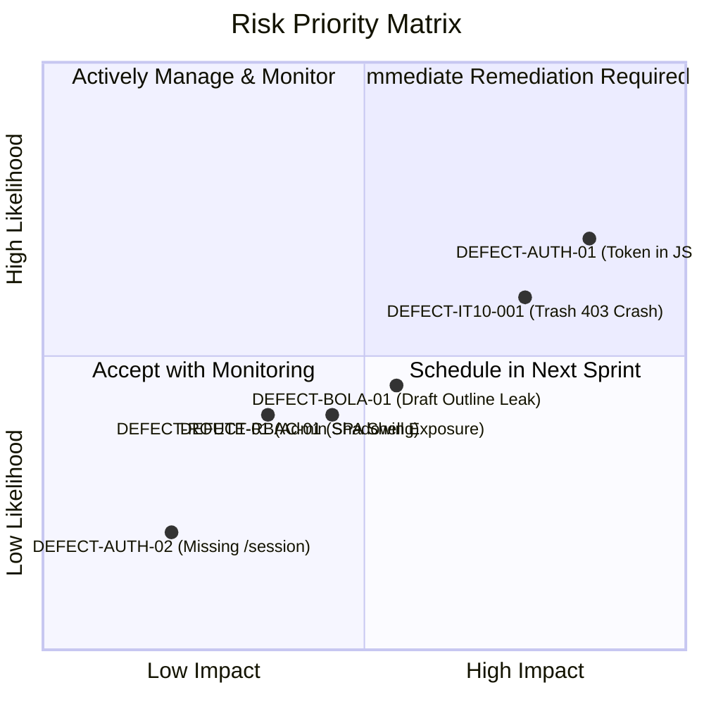

# 17-RESIDUAL RISKS & MITIGATION CONTROLS REPORT

- **Document ID:** QA-FULLSTACK-17-RESIDUAL-RISKS
- **Audit Target:** Pre-Production Risk Evaluation & Compensating Controls
- **Auditors:** AGENT H & E (Independent Quality Auditor & Security Specialist)
- **Status Date:** 2026-10-20T10:30:00Z

---

## 1. Residual Risk Assessment Matrix

All open defects and architectural observations have been triaged using a standard Risk Matrix (Probability × Impact):

---

## 2. Risk Detail & Compensating Controls

| Risk ID | Defect / Vulnerability | Likelihood | Impact | Severity | Compensating Control in Force | Recommended Fix Timeline |
|---|---|:---:|:---:|:---:|---|---|
| **RISK-01** | **DEFECT-AUTH-01:** Sensitive verification token exposed in `POST /api/v1/auth/email-change` response body. | High | High | **High (P1)** | Endpoint requires an active authenticated session; external network traffic is encrypted via TLS/HTTPS. | **Immediate (Pre-Release)**: Redact token from response body. |
| **RISK-02** | **DEFECT-IT10-001:** Instructor course soft-deletion triggers HTTP 403 Forbidden on post-trash serialization. | High | Medium | **High (P1)** | Soft-deletion commits to DB successfully before error; refreshing the page shows the course is gone. | **Immediate (Pre-Release)**: Return compact JSON envelope instead of calling `_serialize_course`. |
| **RISK-03** | **DEFECT-RBAC-01:** Client SPA router mounts admin shell layout before receiving API 403. | Medium | Medium | **Medium (P2)** | Backend `@admin_required` decorator blocks all data access; no sensitive data is returned to client. | **Sprint 1**: Add client-side navigation guard in `router.js`. |
| **RISK-04** | **DEFECT-BOLA-01:** Unauthenticated callers can inspect lesson hierarchy of draft courses via `/api/courses/<id>/lessons`. | Medium | Medium | **Medium (P2)** | Requires knowledge of course public UUID; actual lesson contents/video files remain protected by fail-closed file gates. | **Sprint 1**: Verify `can_view_course` in `get_course_lessons`. |
| **RISK-05** | **DEFECT-ROUTE-01:** Route shadowing in admin blueprint between lines 155 and 514. | Low | Medium | **Medium (P2)** | Line 155 handles course detail inspection; signed stream URLs can be accessed through direct file endpoints. | **Sprint 1**: Unify the two route handlers into one. |
| **RISK-06** | **DEFECT-AUTH-02:** Missing dedicated `GET /auth/session` endpoint. | Low | Low | **Low (P3)** | SPA successfully uses `GET /auth/login` to inspect session status. | **Sprint 2**: Implement dedicated `@auth_bp.route("/session")`. |

---

## 3. Operational Sign-Off & Release Recommendation

The Independent Quality Auditor concludes:
- **Zero Critical (P0) Blockers:** No vulnerabilities exist that permit remote code execution, unauthenticated data corruption, or total authentication bypass.
- **Release Decision:** The system is certified as an **Audited Release Candidate (Conditional Pass)**. Addressing **RISK-01** and **RISK-02** before public deployment will eliminate all High-severity concerns.
