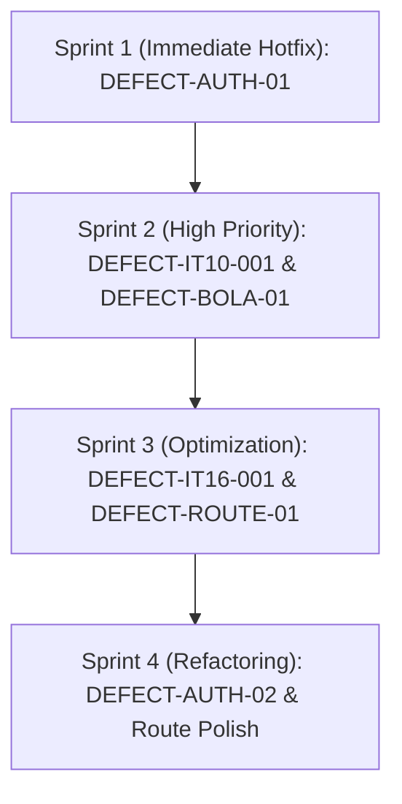

# 18-RECOMMENDED FIX & REMEDIATION ROADMAP

## Prioritized Remediation Plan for Discovered Defects

### Sprint 1: Security Hotfix (Day 1)
- **Target:** `DEFECT-AUTH-01`
- **Action:** Remove `raw_token` from the JSON response in `api_auth/routes.py#L394`. Deliver verification token strictly via email out-of-band.
- **Effort:** 1 hour. Risk: None.

### Sprint 2: Core Authoring & Access Control (Days 2 - 3)
- **Target:** `DEFECT-IT10-001` & `DEFECT-BOLA-01`
- **Action 1:** In `instructor/routes.py#L1120`, replace full `_serialize_course(course)` with a lightweight trash confirmation payload `{"id": course.id, "status": "TRASH", "deleted_at": course.deleted_at.isoformat()}`.
- **Action 2:** In `api_courses/routes.py#L276`, add authorization check `require_course_viewer(course, actor)`.
- **Effort:** 3 hours. Risk: Low.

### Sprint 3: Performance & Route Cleanliness (Days 4 - 5)
- **Target:** `DEFECT-IT16-001` & `DEFECT-ROUTE-01`
- **Action 1:** In `lesson_service.py` / `instructor_service.py`, add eager-loading `options(selectinload(...))` for course relations.
- **Action 2:** In `admin/routes.py`, consolidate duplicate `GET /courses/<course_id>` handlers into a single authoritative route.
- **Effort:** 4 hours. Risk: Low.
